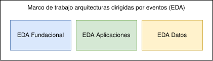
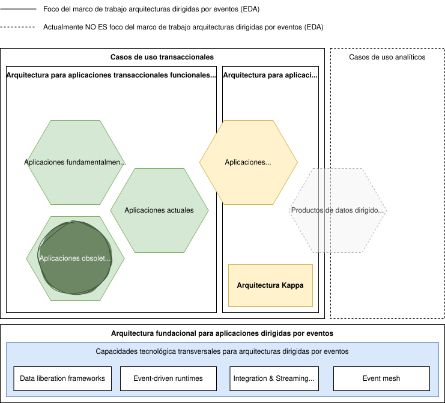
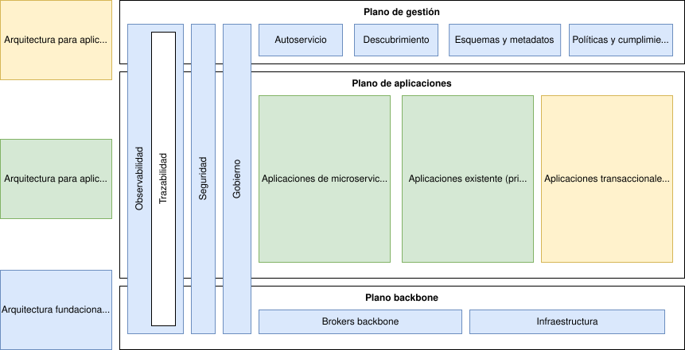
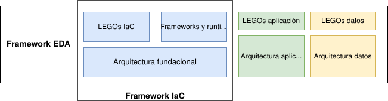

# Marco de trabajo para arquitecturas dirigidas por eventos (EDA Framework)

> Fuente: [https://segurosti.atlassian.net/wiki/spaces/AR/pages/4588863512](https://segurosti.atlassian.net/wiki/spaces/AR/pages/4588863512) · versión 40 · actualizado 2026-08-05 por Víctor Daniel Martínez Olier

> **⚠️ Advertencia**
>
> En esta documentación EDA es una abreviatura para *Event-Driven Architecture*. **NO TIENE NINGUNA RELACIÓN CON LA MISMA ABREVIATURA USADA POR OTRA GERENCIA PARA REFERIRSE A ESTRATEGIA DE DATOS Y ANALÍTICA.**

# Introducción

Este documento busca establecer un marco de trabajo común para las arquitecturas dirigidas por eventos, tanto de referencia como de implementación, inicialmente acotadas a casos de uso transaccionales, con base en la estrategia de abordaje que se definió desde el equipo TAM (Transformación de arquitectura y modernización).

# Dirigido por eventos (Event-driven) vs paso de mensajes (Message-driven/Message-passing)

> *Streams hold truth.*
>
> *Queues do work.*

El abordaje arquitectónico dirigido por eventos (*event-driven*) y el de paso de mensajes (*message-passing*) pueden considerarse semejantes porque permiten en las aplicaciones la comunicación entre componentes evitando el acoplamiento estrecho (*tight coupling*), sin embargo tienen enfoques, capacidades, y necesidades diferentes. La siguiente tabla permite determinar la afinidad de un estilo arquitectónico, ayudando a determinar cuál es más apropiado según la necesidad:

| **Criterio** | **Event-driven** | **Message-driven** |
| --- | --- | --- |
| Elemento de comunicación | Emisión de eventos | Envío de mensajes |
| ¿Qué se necesita comunicar? | Un hecho (fact), un cambio de estado | Un comando |
| Conciencia del destinatario | No, los productores normalmente no conocen a los consumidores | Normalmente sí |
| Desacoplamiento | Muy alto | Medio/Bajo |
| Reproducibilidad | Sí | No necesariamente |
| Inmutabilidad | Sí | No necesariamente |
| Soporte para streaming | Sí | No |
| Consistencia | Eventual | Eventual y fuerte |
| Manejo de errores (transacciones distribuidas) | Compensación (Sagas) | Reintentos |
| ACK | No | Es posible |
| Trazabilidad histórica | Sí | No |

## Modelos de decisión

El [Modelo de decisión y casos de uso de integración](https://segurosti.atlassian.net/wiki/spaces/AR/pages/3443097604) permite determinar si el caso de uso de integración puede verse beneficiado con la implementación de una arquitectura dirigida por eventos (EDA), específicamente al desembocar en el escenario 18 ([Casos de uso integración de aplicaciones](https://segurosti.atlassian.net/wiki/spaces/AR/pages/3701276684/Casos+de+uso+integraci+n+de+aplicaciones#Escenario-18)).

# Estrategias de abordaje

Para poder cubrir adecuadamente la complejidad inherente de las arquitecturas dirigidas por eventos se establecen dos estrategias de abordaje, una conceptual y otra de implementación.

## Estrategia conceptual

Debido a la magnitud, carga cognitiva (conceptual), casos de uso y complejidad que puede involucrar las arquitecturas dirigidas por eventos, para lograr una visión coherente que busque generar establecer un abordaje consistente de los escenarios de aplicación se estableció una estrategia que busca un abordaje transversal y específico planteando los siguientes frentes:

- Abordaje EDA transversal, que llamaremos fundacional.
- Abordaje EDA para casos de uso transaccionales para aplicaciones funcionales.
- Abordaje EDA para casos de uso transaccionales para aplicaciones intensivas en datos.

## Estrategia de implementación

Gracias a las características de disponibilidad, portabilidad (no generando un locking tecnológico con un proveedor de servicios), escalabilidad y tolerancia a fallas de las tecnologías enmarcadas aquí, la estrategia de implementación para habilitar y escalar las capacidades que habilita el marco de trabajo a través de sus arquitecturas dirigidas por eventos, se enfoca en realizar un abordado incremental que permita evitar complejidades accidentales y maximizar los beneficios que ofrecen estas arquitecturas para las soluciones.

Etapas del abordaje incremental:

1. Habilitar las capacidades mínimas necesarias transversales de la arquitectura de la capa fundacional/backbone (ver abajo), que permitan asegurar los requerimientos de seguridad, gobierno y observabilidad requeridos.
2. Construcción de artefactos reutilizables que permitan acelerar la implementación de arquitecturas dirigidas por eventos para los casos de uso priorizados.
3. Identificación de los casos de uso que se pueden beneficiar/obtener valor/apalancar con base en los criterios de pertinencia del marco de trabajo.
4. A través de artefactos reutilizables implementar las soluciones.
5. Retroalimentar y escalar el marco de trabajo.

# Focos y bases de las arquitecturas

Aunque las arquitecturas abrazadas por el marco de trabajo pueden posteriormente escalar perfectamente a casos de usos analíticos, inicialmente tienen un foco priorizado a casos de uso **transaccionales**, por tanto, junto con los principios de diseño de cada arquitectura, una de las primeras decisiones fue establecer las bases arquitectónicas y tecnológicas de las arquitecturas enmarcadas.

Focos y bases arquitectónicas del marco de trabajo EDA

A continuación se resumen estas bases, el detalle se encuentra en cada respectiva arquitectura:

- [Arquitectura fundacional para aplicaciones dirigidas por eventos](../paginas/Marco-de-trabajo-para-arquitecturas-dirigidas-por-eventos-EDA-Framework/Arquitectura-fundacional-para-aplicaciones-dirigidas-por-eventos.md) :

  - Frameworks y entornos de ejecución dirigidos por eventos (Event-driven frameworks/runtimes)
  - Malla de datos dirigida por eventos (Event-driven data mesh).
  - Frameworks para el procesamiento en streaming.
- [Arquitectura para aplicaciones transaccionales funcionales dirigidas por eventos](../paginas/Marco-de-trabajo-para-arquitecturas-dirigidas-por-eventos-EDA-Framework/Arquitectura-para-aplicaciones-transaccionales-funcionales-dirigidas-por-eventos.md) :

  - Modernas.

    - Event-Driven Microservices (EDM), microservicios dirigidos por eventos.
  - Existentes y obsoletas:

    - Data liberation frameworks.
- <https://segurosti.atlassian.net/wiki/spaces/AR/pages/4614586424>:

  - Arquitectura base: Arquitectura Kappa.
  - Framework base: Event-Driven Data Mesh.

# Arquitecturas y capacidades

El marco de aborda sus capacidades a través de tres arquitecturas relacionadas:

1. [Arquitectura fundacional para aplicaciones dirigidas por eventos](../paginas/Marco-de-trabajo-para-arquitecturas-dirigidas-por-eventos-EDA-Framework/Arquitectura-fundacional-para-aplicaciones-dirigidas-por-eventos.md) .
2. [Arquitectura para aplicaciones transaccionales funcionales dirigidas por eventos](../paginas/Marco-de-trabajo-para-arquitecturas-dirigidas-por-eventos-EDA-Framework/Arquitectura-para-aplicaciones-transaccionales-funcionales-dirigidas-por-eventos.md) .
3. <https://segurosti.atlassian.net/wiki/spaces/AR/pages/4614586424>.

La siguiente figura ilustra como cada una de las capacidades está distribuida en cada una de las arquitecturas:

Arquitecturas y capacidades del marco de trabajo EDA

# Framework EDA, Framework IaC y LEGOs

El Framework EDA soporta sobre el Framework IaC (<https://segurosti.atlassian.net/wiki/spaces/AR/pages/3043590261>) las capacidades de despliegue de la [Arquitectura fundacional para aplicaciones dirigidas por eventos](../paginas/Marco-de-trabajo-para-arquitecturas-dirigidas-por-eventos-EDA-Framework/Arquitectura-fundacional-para-aplicaciones-dirigidas-por-eventos.md) .

# Referencias y bibiliografía

<https://doc.akka.io/libraries/guide/concepts/message-driven-event-driven.html>

<https://ibm-cloud-architecture.github.io/refarch-eda/concepts/terms-and-definitions/>

<https://cloudevents.io/>

<https://www.akamai.com/blog/edge/what-is-an-event-driven-microservices-architecture>

<https://nexocode.com/blog/posts/lambda-vs-kappa-architecture/>

<https://axual.com/blog/starting-small-with-kafka-why-its-the-right-choice-for-your-enterprise>

<https://microservices.io/patterns/data/transactional-outbox.html>

<https://axual.com/blog/implementing-outbox-pattern-with-apache-kafka-and-spring-modulith>

<https://axual.com/blog/kafka-consumer-configuration-optimize-performance-with-key-settings-use-cases>

<https://axual.com/blog/kafka-consumer-groups-and-offsets-what-you-need-to-know>

<https://axual.com/blog/implementing-outbox-pattern-with-apache-kafka-and-spring-modulith>

<https://axual.com/blog/change-data-capture-with-postgresql-debezium-and-axual-part-2>

<https://www.confluent.io/events/kafka-summit-london-2023/an-introduction-to-kafka-cruise-control/>

<https://www.confluent.io/blog/turning-the-database-inside-out-with-apache-samza/>

<https://medium.com/data-mesh-learning/what-is-data-qos-and-why-is-it-critical-c524b81e3cc1>

<https://medium.com/mercadolibre-tech/migrating-mercado-libres-fury-streams-to-virtual-threads-1dabe01291ee>

<https://docs.dapr.io/reference/components-reference/supported-pubsub/>

<https://medium.com/event-driven-utopia/a-gentle-introduction-to-event-driven-change-data-capture-683297625f9b>

<https://en.wikipedia.org/wiki/Retrofitting>

<https://learn.microsoft.com/en-us/azure/event-hubs/event-hubs-federation-patterns>

<https://learn.microsoft.com/en-us/azure/event-hubs/schema-registry-overview>

<https://learn.microsoft.com/en-us/azure/event-hubs/log-compaction>

<https://learn.microsoft.com/en-us/azure/event-hubs/use-log-compaction?tabs=portal>

<https://learn.microsoft.com/en-us/azure/event-hubs/event-hubs-kafka-connect-debezium>

<https://www.amundsen.io/amundsen/metadata/>

<https://zipkin.io/>

<https://www.jaegertracing.io/>

<https://github.com/jaegertracing/jaeger-ui>

<https://m-a-n-a-v.medium.com/data-liberation-in-event-driven-architecture-bridging-the-old-and-the-new-c412652a3471>

<https://seanfalconer.medium.com/the-future-of-ai-agents-is-event-driven-9e25124060d6>

<https://medium.com/%40leela.kumili/scaling-microservices-message-driven-vs-event-driven-architecture-16fe79402e40>

<https://dl.acm.org/doi/10.1145/502059.502057> : <https://mdw.la/papers/seda-sosp01.pdf>
