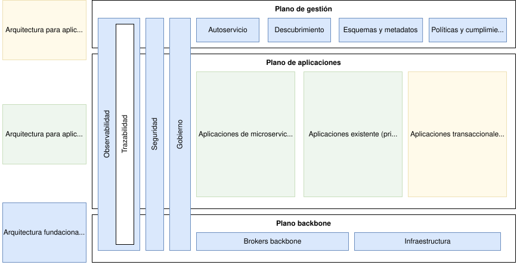
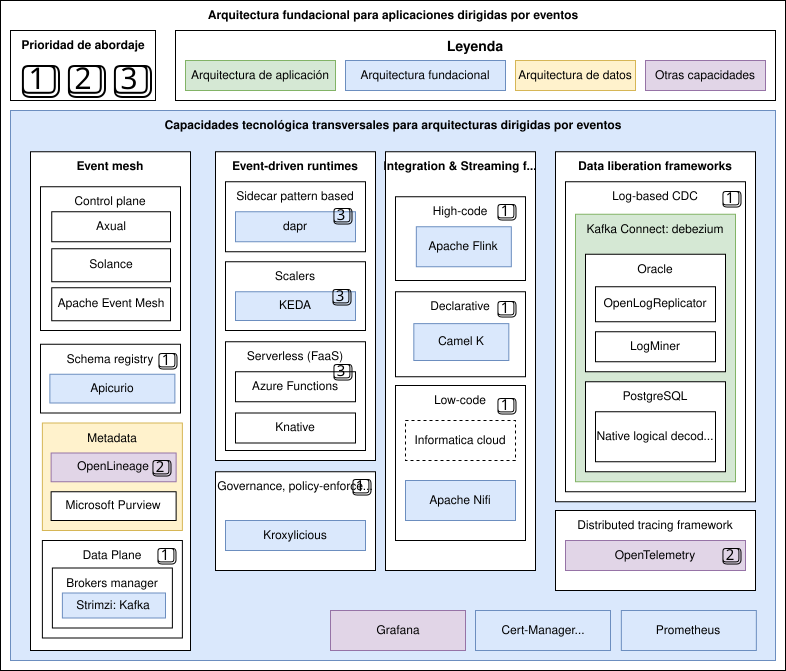
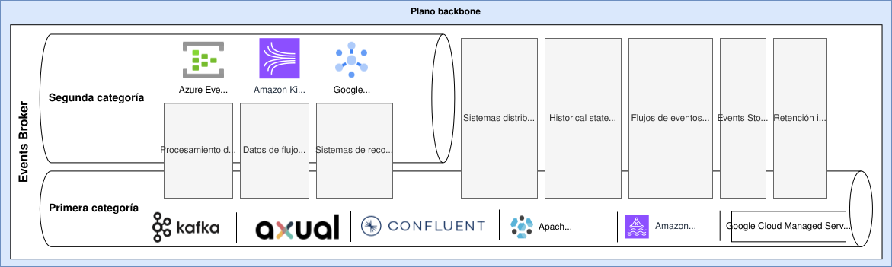

# Arquitectura fundacional para aplicaciones dirigidas por eventos

> Fuente: [https://segurosti.atlassian.net/wiki/spaces/AR/pages/4614586440](https://segurosti.atlassian.net/wiki/spaces/AR/pages/4614586440) · versión 27 · actualizado 2026-11-10 por Víctor Daniel Martínez Olier

> **⚠️ Advertencia**
>
> En esta documentación EDA es una abreviatura para *Event-Driven Architecture*. **NO TIENE NINGUNA RELACIÓN CON LA MISMA ABREVIATURA USADA POR OTRA GERENCIA PARA REFERIRSE A ESTRATEGIA DE DATOS Y ANALÍTICA.**

Capacidades abordadas en la arquitectura fundacional para aplicaciones dirigidas por eventos

# Principios de diseño

- Portabilidad.
- Escalabilidad.
- Disponibilidad.
- Inmutabilidad.
- Desacoplamiento.

# Necesidades y escenarios de aplicación

Los siguientes son algunos de los casos de usos con un alto grado de afinidad con la arquitectura fundacional para aplicaciones dirigidas por eventos:

- Flujos de eventos de cambios de datos desde bases de datos (captura de datos de cambio, CDC).
- Datos de flujo de clics (*clickstream data*) de aplicaciones web o móviles.
- Procesamiento de datos donde las fuentes son redes sociales.
- Aplicaciones IoT.
- Sistemas distribuidos, reactivos, escalables y tolerantes a fallos.

## Sistemas de recomendación

- Sistemas de gestión de bienestar que requieren la propagación de eventos de salud a diferentes sistemas para poder disparar diferentes acciones, procesos, o actualización de indicadores o índices.

## Sistemas de detección o reacción en tiempo real

- Sistemas de detección de fraude o vulnerabilidades, y eventos de seguridad en general.
- Trazabilidad de procesos que requieren respuesta en (o cercanas) tiempo real. Por ejemplo, en multicanalidad interconectada, recopilar desde diferentes fuentes y confirmar en tiempo real la probabilidad de la asistencia a la cita.

## Inteligencia artificial

- Sistemas multiagentes para IA, desacoplados.

## Criterios para cuestionar la aplicabilidad

Los siguientes son algunos criterios relevantes que deberían cuestionar la aplicabilidad de arquitecturas dirigidas por eventos:

- No es posible tolerar o compensar la consistencia eventual, y por tanto sería necesario implementar estrategias adicionales para compensar esto.
- El sistema no se verá funcional ni técnicamente beneficiado si no requiere capacidades de escalabilidad y desacoplamiento.
- Si requiere capacidades de coordinación complejas deberían contemplarse otros estilos de arquitectura, por ejemplo usando una topología mediador (<https://segurosti.atlassian.net/wiki/spaces/AR/pages/560038438>).
- No se requiere procesamiento en Streaming ni Real-Time.

# Capacidades y pila tecnológica

La arquitectura fundacional habilita las capacidades transversales necesarias buscando una coherencia, y aceleración para las soluciones que se ven apalancadas por las otras arquitecturas que se soportan sobre la misma.

Schema Registry

Event Broker + Event Store

Capa de aplicación de gobernanza, seguridad, políticas y auditoría

El siguiente diagrama resume la pila tecnológica propuesta, y que se priorizará la implementación de los habilitadores necesarios para materializar la arquitectura de implementación fundacional, y su prioridad de abordaje:

Pila tecnológica arquitectura fundacional EDA, y prioridad de abordaje

## Event Mesh (Malla de eventos)

Una malla de eventos es una capa de arquitectura que permite que los eventos de una aplicación se enruten y reciban dinámicamente por cualquier otra aplicación, independientemente de su ubicación (sin nube, nube privada o nube pública). Esta capa está compuesta por una red de intermediarios de eventos.

La malla de eventos debe estar compuesta por lo menos de dos capas/planos, el plano de control (control plane), y el de datos (data plane):

Data plane:

- Brokers (clusters) manager: <https://strimzi.io/>

Adicionalmente para apoyar el gobierno, consistencia, cumplimiento y observabilidad se debe contar con:

Schema Registry (sistema de registro para los esquemas de los eventos)

- Apicurio Registry: <https://www.apicur.io/registry/>

Estándar para la definición del linage de los datos:

- OpenLineage: <https://openlineage.io/>

## Data liberation frameworks (marcos de liberación de datos)

- Log-based (CDC):

  - Debezium: <https://debezium.io/>

## Capa de cumplimiento de gobernanza, seguridad, políticas y auditoría

- Proxy para Event Broker que permite la implementación del cumplimiento de la gobernanza, filtros de seguridad (como cifrado, o enmascarado), políticas y auditoría:

  - Kroxylicious: <https://kroxylicious.io/>

## Streaming & Integration Frameworks (Framework de integración con procesamiento en streaming)

- High-code:

  - Apache Flink: <https://flink.apache.org/>

    - <https://nightlies.apache.org/flink/flink-docs-release-2.0/docs/dev/table/sql/overview/>
- Declarative:

  - Kamelets: <https://camel.apache.org/camel-kamelets/4.10.x/index.html>
  - Apache Camel K: <https://camel.apache.org/camel-k/>
- Low-code (<https://en.wikipedia.org/wiki/Flow-based_programming>):

  - Apache NiFi: <https://nifi.apache.org/>

## Event-driven runtime (Entornos de ejecución dirigidos por eventos)

- Basados en el patrón Sidecar:

  - Dapr: <https://dapr.io/>

    - <https://docs.dapr.io/developing-applications/building-blocks/pubsub/pubsub-overview/>
    - <https://docs.dapr.io/reference/components-reference/supported-pubsub/setup-apache-kafka/>
- Scalers:

  - <https://keda.sh/>
- Serverless

  - <https://knative.dev/docs/>

# Categoría de los Brokers de eventos basados en (o con soporte para) Kafka

Adicional a los atributos bases que son indispensables para un Event Broker en la arquitectura EDA, existe un aspecto que determina la aplicabilidad en algunos casos de uso, y es el soporte para tiempo ilimitado de retención de los eventos. Así, la arquitectura fundacional plantea catalogar los Event Broker en dos categoría:

- **Events Brokers de primera categoría:** Soporta tiempos de retención de los eventos ilimitado y compatibilidad completa con el protocolo Kafka. Algunas implementaciones de refencia son:

  - Kafka puro.
  - Axual Kafka con Strimzi.
  - Confluent Kafka.
  - Apache Kafka in Azure HDInsight.
  - Amazon MSK (Amazon Managed Streaming for Kafka (MSK))
- **Events Brokers de segunda categoría:** No soportan tiempos de retención de los eventos ilimitado, y pueden también tener compatibilidad limitada con el protocolo Kafka.

  - Azure Event Hub

    - <https://learn.microsoft.com/en-us/azure/event-hubs/event-hubs-quotas>
    - <https://learn.microsoft.com/en-us/azure/event-hubs/apache-kafka-troubleshooting-guide#limits>
  - Amazon Kinesis
  - Google Pub/Sub

El siguiente diagrama ilustra los dos categorías de los brokers de eventos, y los casos de uso que habilitan:

Categorías de Events Brokers

# Glosario de definiciones y conceptos

[EDA Framework: Glosario y definiciones generales](../../paginas/Marco-de-trabajo-para-arquitecturas-dirigidas-por-eventos-EDA-Framework/EDA-Framework-Glosario-y-definiciones-generales.md)
