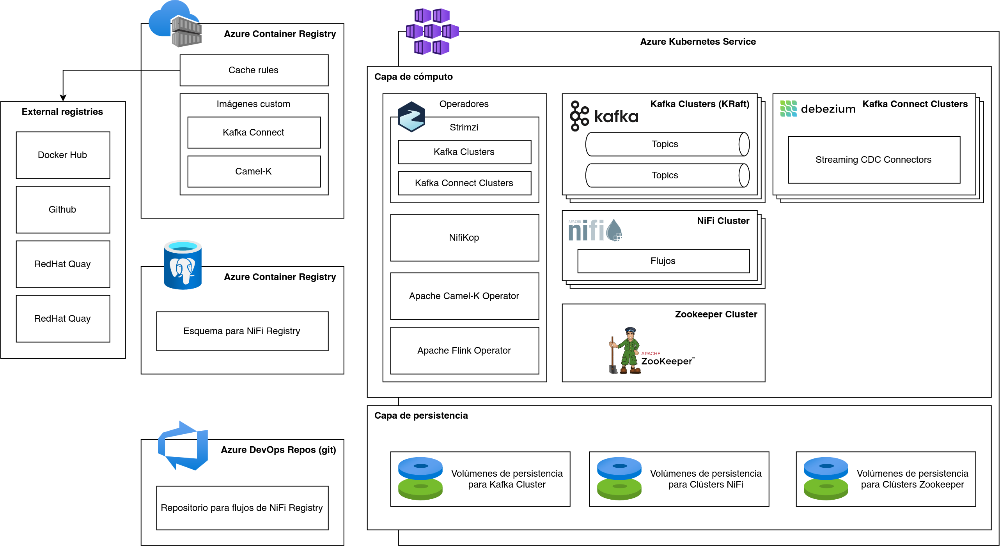
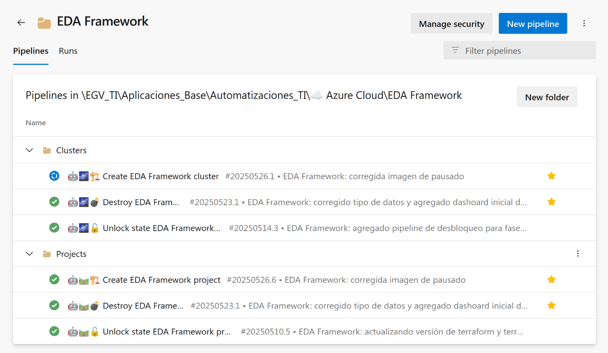
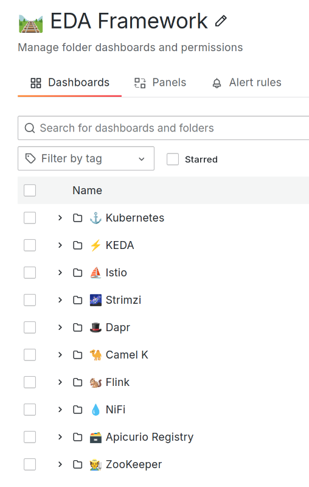

# POC: EDA Framework v1.0

> Fuente: [https://segurosti.atlassian.net/wiki/spaces/AR/pages/4741071017](https://segurosti.atlassian.net/wiki/spaces/AR/pages/4741071017) · versión 13 · actualizado 2026-08-05 por Víctor Daniel Martínez Olier

> **⚠️ Advertencia**
>
> En esta documentación EDA es una abreviatura para *Event-Driven Architecture*. **NO TIENE NINGUNA RELACIÓN CON LA MISMA ABREVIATURA USADA POR OTRA GERENCIA PARA REFERIRSE A ESTRATEGIA DE DATOS Y ANALÍTICA.**

> **⚠️ Advertencia**
>
> Este documento detalla sólo la POC para el EDA Framework, por tanto no implica en lo más mínimo ninguna modificación a la <https://segurosti.atlassian.net/wiki/spaces/AR/pages/4263149655> de la compañía, sea sumanete cauteloso con la información y tecnologías que acá se muestran. Los fines de este documento son exclusivamente con fines de validación técnica.

# Introducción

Esta POC busca validar conceptural y técnicamente los componentes tecnológicos que habilitan las capacidades de la [Arquitectura fundacional para aplicaciones dirigidas por eventos](../../../paginas/Marco-de-trabajo-para-arquitecturas-dirigidas-por-eventos-EDA-Framework/Arquitectura-fundacional-para-aplicaciones-dirigidas-por-eventos.md) establecida en el [Marco de trabajo para arquitecturas dirigidas por eventos (EDA Framework)](../../../paginas/Marco-de-trabajo-para-arquitecturas-dirigidas-por-eventos-EDA-Framework.md) .

# Diseño

El siguiente es el diagrama que muestra el diseño de la arquitectura de despliegue habilitada en la POC:

# URLs de acceso a los componentes

| **Componente** | **URL** |
| --- | --- |
| 💧 Apache NiFi | <http://nifi-edatest-testcluster-westus.7473aece-7c0d-42b8-a135-a3c0c6395481.dll.cloudsura.com.co:8080/> |
| 🎩 Dapr Framework Dashboard | <http://dapr-dashboard-edatest-westus.7473aece-7c0d-42b8-a135-a3c0c6395481.dll.cloudsura.com.co:8080/> |
| 🦇 Kafbat UI (nueva Kafka UI) | <http://kafbat-ui-edatest-testcluster-westus.7473aece-7c0d-42b8-a135-a3c0c6395481.dll.cloudsura.com.co:8080/> |
| 📊 Grafana | <http://grafana-edatest-westus.7473aece-7c0d-42b8-a135-a3c0c6395481.dll.cloudsura.com.co:3000/> |
| 🐿️ Apache Flink UI | <http://flink-edatest-testcluster-westus.7473aece-7c0d-42b8-a135-a3c0c6395481.dll.cloudsura.com.co:8081/> |
| 🐪 Apache Camel K Karavana | <http://karavan-edatest-testcluster-westus.7473aece-7c0d-42b8-a135-a3c0c6395481.dll.cloudsura.com.co:8080/> |
| ⛵️ Kiali (Istio UI) | <http://kiali-edatest-westus.7473aece-7c0d-42b8-a135-a3c0c6395481.dll.cloudsura.com.co:20001/> |
| 🗃️ Apicurio Registry (Schema Registry) | **APIs:**  <http://apicurio-registry-edatest-westus.7473aece-7c0d-42b8-a135-a3c0c6395481.dll.cloudsura.com.co:8080/apis>  **UI:**  <http://apicurio-registry-ui-edatest-westus.7473aece-7c0d-42b8-a135-a3c0c6395481.dll.cloudsura.com.co:8080/explore> |

# Código fuente y pipelines de despliegue

Como se declara en el [Marco de trabajo para arquitecturas dirigidas por eventos (EDA Framework)](../../../paginas/Marco-de-trabajo-para-arquitecturas-dirigidas-por-eventos-EDA-Framework.md) , este está soportado para el despliegue de recursos en nube sobre el <https://segurosti.atlassian.net/wiki/spaces/AR/pages/3043590261> , por tanto todos los componentes son desplegados a través de IaC ya sea usando Terraform/OpenTofu o Manifiestos de Kubernetes apalancados gracias <https://kubernetes.io/docs/concepts/extend-kubernetes/operator/> .

El código fuente para el despliegue de los componentes fundacionales se encuentran en el repositorio: <https://dev.azure.com/SuraColombia/Gerencia_Tecnologia/_git/878-lego-iac_global-terraform-remote-states-iac> , actualmente en la rama `feature/eda-framework`.

Los pipelines se encuetran organizados en la ruta [https://dev.azure.com/SuraColombia/Gerencia\_Tecnologia/\_build?definitionScope=\EGV\_TI\Aplicaciones\_Base\Automatizaciones\_TI\☁️ Azure Cloud\EDA Framework](https://dev.azure.com/SuraColombia/Gerencia_Tecnologia/_build?definitionScope=%5CEGV_TI%5CAplicaciones_Base%5CAutomatizaciones_TI%5C%E2%98%81%EF%B8%8F%20Azure%20Cloud%5CEDA%20Framework):

La estructura se compone de dos fases, proyectos y clústers, detallados en las secciones siguientes.

## 🛤️ Proyectos EDA (directorio `06-eda-framework-projects`)

Acá se despliegan los componentes de infraestructura base para poder aprovisionar clústers EDA. En esta fase se habilita los siguientes componentes:

- Repositorio de imágenes de contenedores, soportado sobre ACR (Azure Container Registry).

  - Reglas de caché para las imágenes usadas por todos los componentes.
- Cluster de Kubernetes para soportar las cargas de trabajo, soportado sobre AKS.
- Servicio de Prometheus, soportado sobre AMW (Azure Monitor Workspace).
- Operadores para las siguientes tecnologías:

  - Strimzi.
  - Apache Camel K.
- Operador y despliegue de Grafana.

  - Dashboards de Grafana.
  - Directorios para Dashboards de Grafana.
- Operador y despliegue para Fluent-bit.
- Cert Manager.
- Trust Manager.
- External DNS configurado con zona DNS privada.
- Keyvault.
- Kiali (Istio UI).
- OpenSearch Operator.
- Strimzi Operator.
- Dapr Runtime Framework.
- Dapr Dashboard.
- Apicurio Registry.

Los pipelines para desplegar esta fase se encuentran en:  
[https://dev.azure.com/SuraColombia/Gerencia\_Tecnologia/\_build?definitionScope=\EGV\_TI\Aplicaciones\_Base\Automatizaciones\_TI\☁️ Azure Cloud\EDA Framework\Projects](https://dev.azure.com/SuraColombia/Gerencia_Tecnologia/_build?definitionScope=%5CEGV_TI%5CAplicaciones_Base%5CAutomatizaciones_TI%5C%E2%98%81%EF%B8%8F%20Azure%20Cloud%5CEDA%20Framework%5CProjects)

## 🌌 Clústers EDA (directorio `07-eda-framework-cluster`)

Permite desplegar los Clúster EDA sobre un proyecto EDA. En esta fase se despliegan las siguientes capacidades:

- Clúster de Apache Kafka.
- Clúster de Apache Zookeeper (requerido inicialmente por clúster de Apache NiFi).
- Clúster de Camel K.

  - Apache Karavan.
- Apache Flink.
- Operador para Apache NiFi.
- Clúster de Apache NiFi.
- Kafbat UI (nuevo Kafka UI).

Los pipelines para desplegar esta fase se encuentran en:

[https://dev.azure.com/SuraColombia/Gerencia\_Tecnologia/\_build?definitionScope=\EGV\_TI\Aplicaciones\_Base\Automatizaciones\_TI\☁️ Azure Cloud\EDA Framework\Clusters](https://dev.azure.com/SuraColombia/Gerencia_Tecnologia/_build?definitionScope=%5CEGV_TI%5CAplicaciones_Base%5CAutomatizaciones_TI%5C%E2%98%81%EF%B8%8F%20Azure%20Cloud%5CEDA%20Framework%5CClusters)

# Artefactos de pruebas

## Apache NiFi

WIP

# Dashboards de Grafana

Para fines de validaciones mínimas de observabilidad, se habilitaron algunos Dashboards de Grafana organizados en directorios por componente, este aspecto requiere ser fuertemente revisado para ser reemplazado por elementos alineados con la línea base de observabilidad:

