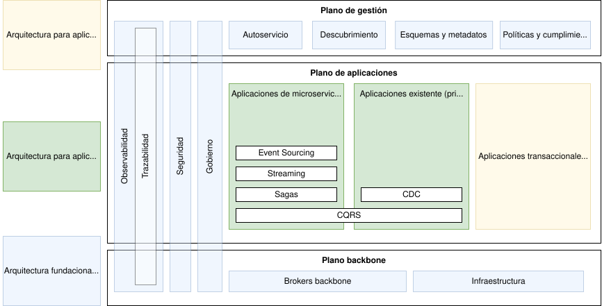
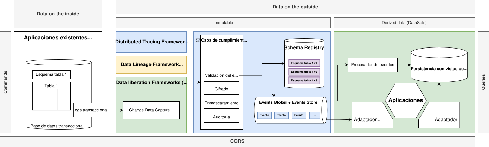
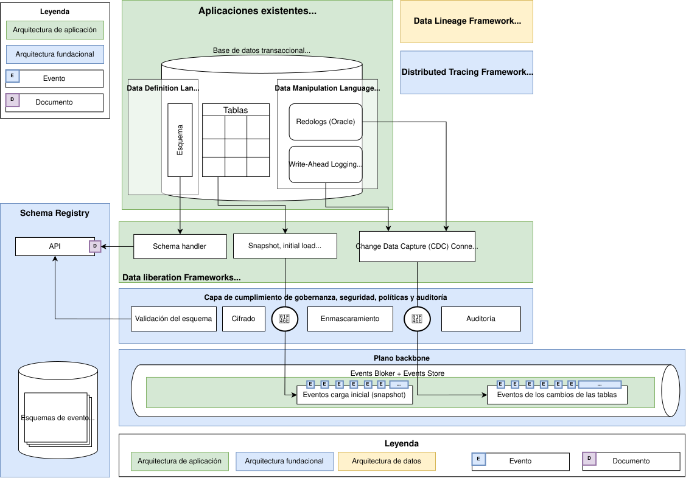
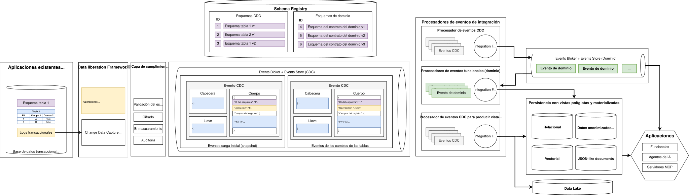
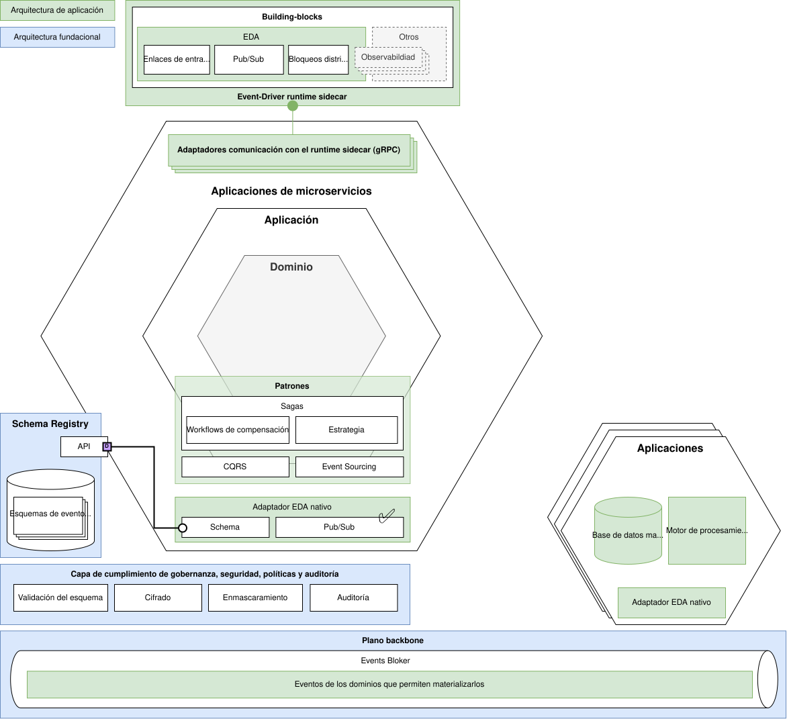

# Arquitectura para aplicaciones transaccionales funcionales dirigidas por eventos

> Fuente: [https://segurosti.atlassian.net/wiki/spaces/AR/pages/4614553659](https://segurosti.atlassian.net/wiki/spaces/AR/pages/4614553659) · versión 50 · actualizado 2026-11-10 por Víctor Daniel Martínez Olier

> **⚠️ Advertencia**
>
> En esta documentación EDA es una abreviatura para *Event-Driven Architecture*. **NO TIENE NINGUNA RELACIÓN CON LA MISMA ABREVIATURA USADA POR OTRA GERENCIA PARA REFERIRSE A ESTRATEGIA DE DATOS Y ANALÍTICA.**

Capacidades abordadas en la arquitectura para aplicaciones transaccionales funcionales dirigidas por eventos

# Principios de diseño

> *Streams hold truth.*
>
> *Queues do work.*

- Desacoplamiento.
- Portabilidad.
- Escalabilidad.
- Disponibilidad.

# Escenarios de aplicación y necesidad

- Procesamiento cercano al tiempo real (*near real-time*).
- Procesamiento en *Streaming*.
- Integración con sistemas actuales y obsoletos.
- Generación consistente y escalable de vistas políglotas materializadas, para soportar casos de uso diversos:

  - Búsquedas de texto completo (*full-text search*),
  - Cache, tanto la generación, como la sincronización, e invalidación.
  - Bases de datos vectoriales, por ejemplo, para soportar la persistencia del significado en *embeddings*, permitiendo las búsquedas de similitud semántica, en una Arquitectura de generación aumentada por recuperación, RAG (*Retrieval-Augmented Generation*), <https://segurosti.atlassian.net/wiki/spaces/AR/pages/3752230915>.
  - Ingesta al DataLake.
  - Vistas normalizadas (aplanas) para casos de uso OLAP (*Online analytical processing*).

## Patrones de diseño

- CQRS, Command Query Responsibility Segregation:

  - <https://learn.microsoft.com/en-us/azure/architecture/patterns/cqrs>
- CDC, Change Data Capture

  - <https://www.redhat.com/en/topics/integration/what-is-change-data-capture>
  - <https://www.confluent.io/blog/how-change-data-capture-works-patterns-solutions-implementation/>
- Transactional Outbox Pattern

  - <https://microservices.io/patterns/data/transactional-outbox.html>
- ES, Event Sourcing:

  - <https://learn.microsoft.com/en-us/azure/architecture/patterns/event-sourcing>

# Enfoques

Debido a la realidad de la compañía y diversidad en las complejidades para , la arquitecta para aplicaciones transaccionales funcionales se aborda desde varios enfoques, todos se soportan sobre las capacidades de la [Arquitectura fundacional para aplicaciones dirigidas por eventos](../../paginas/Marco-de-trabajo-para-arquitecturas-dirigidas-por-eventos-EDA-Framework/Arquitectura-fundacional-para-aplicaciones-dirigidas-por-eventos.md) . La característica fundamental de la separación se base en cuál es la fuente de la verdad (*Source of Truth*), entendiendo que todas implementan una arquitectura SSOT (<https://en.wikipedia.org/wiki/Single_source_of_truth>), ya sea esta una de las siguientes:

- Base de datos transaccional como fuente de la verdad, *OLTP Database as Source of Truth*.
- Almacén de eventos como fuente de la verdad, *Event Store as Source of Truth*.

Así, los enfoques son:

- Aplicaciones transaccionales funcionales actuales.
- Aplicaciones fundamentalmente dirigidas por eventos.

Estos enfoques promueven una Arquitectura Kappa, ya que de ser necesario esta puede soportar con la misma arquitectura tanto casos de uso de procesamiento cercano al tanto tiempo real (*near real-time, streaming*), como por lotes (*batch*).

> **ℹ️ Nota**
>
> Para información detallada sobre Arquitectura Kappa, vea:
>
> - <https://hazelcast.com/foundations/software-architecture/kappa-architecture/> .
> - <https://learn.microsoft.com/en-us/azure/architecture/databases/guide/big-data-architectures> .
> - <https://medium.com/towards-data-engineering/data-processing-architectures-lambda-vs-kappa-for-big-data-8cc9a7edeffd> .

## Aplicaciones transaccionales funcionales actuales

Arquitectura de referencia para aplicaciones transaccionales funcionales actuales

### Introducción

En las aplicaciones transaccionales funcionales actuales de la compañía, que son sistemas de registro (SOR, *System Of Record*), la fuente de la verdad (*Source of Truth*) normalmente es una base de datos transaccional, *OLTP Database*, comúnmente es una RDBMS (*Relational Database Management System*), el enfoque que se plantea aquí busca promover y permitir la repotenciación (*Retrofitting Software*), y modernización de estas aplicaciones mediante el aprovechamiento las capacidades de arquitecturas dirigidas por eventos (EDA).

Para definir el alcance de esta arquitectura, debemos entender que los datos de la aplicación podemos verlos desde dos posiciones:

- Datos en el interior *(Data on the inside)*, aquellos que están en la fuente de la verdad.
- Datos en el exterior *(Data on the outside)*, aquellos que se están por fuera de la fuente de la verdad, y se derivan de esta.

Esta arquitectura se enfoca principalmente en una manera de habilitar y aprovechar los datos en el exterior (*Data on the outside*), entendiendo que estos deben ser:

- Inmutables.
- Identificables.
- Derivados de datos en el interior (*Data on the inside*).

> **ℹ️ Nota**
>
> Para profundizar más sobre los conceptos de *Data on the inside* y *Data on the outside*, vea <https://queue.acm.org/detail.cfm?id=3415014> .

Adicionalmente la arquitectura planteada se soporta fundamentalmente sobre los siguientes conceptos:

- El patrón de segregación de responsabilidades de consultas y comandos (*Command Query Responsibility Segregation*, CQRS, <https://learn.microsoft.com/en-us/azure/architecture/patterns/cqrs>), teniendo esta separación de abordaje de las complejidades que implican los comandos y las consultas, esta arquitectura, por lo menos inicialmente no se enfoca en estrategias o capacidades para la solicitud de comandos a las aplicaciones, para esto contemple otros escenarios de integración tal como se plantean en el [Modelo de decisión y casos de uso de integración](https://segurosti.atlassian.net/wiki/spaces/AR/pages/3443097604).
- El patrón de vistas (políglotas) materializadas (<https://learn.microsoft.com/en-us/azure/architecture/patterns/materialized-view>): El llamar políglotas las vistas en este caso se refiere a la capacidad de aprovechar el flujo de eventos generado para reconstruir/derivar modelos de datos políglotas (relacional, o vectorial, o relacional, documental, etc.) que cumplan con necesidades de las aplicaciones y casos de uso diversos.
- El patrón *Change Data Capture*, CDC.
- El patrón de bandeja de salida transaccional, (*Transactional Outbox Pattern*), detallando su aplicabilidad en la arquitectura más abajo.

Aunque esta arquitectura no se enfoca en los comandos, es importante aclarar que la propagación, notificación, o emisión de eventos que producen una reacción sobre las aplicaciones es parte del alcance de esta arquitectura, ya que como tal el evento no es un comando para una aplicación puntual, sino que cada aplicación según las necesidades funcionales que tenga podría reaccionar, o no, de manera distinta a los eventos de su interés, sin ser consciente de esto el emisor del evento, o tener que involucrarlo cuando un nuevo consumidor de los eventos aparece.

### Patrón de bandeja de salida transaccional (Transactional Outbox Pattern)

Aunque los eventos de cambio que se producen desde las tablas de las aplicaciones representan finalmente los cambios de estado de la aplicación, en ocasiones es necesario que las aplicaciones también emitan eventos de manera más explícita, ante la ocurrencia de comandos o sucesos derivados de las transacciones, pero es necesario garantizar que tanto el cambio del estado en las tablas como la emisión del evento sucedan de manera atómica, esto requiere poder involucrar transacciones distribuida (X/Open XA, *eXtended Architecture*) y que no es posible principalmente porque normalmente los *brokers* de eventos, como Kafka, por diseño no soporta *commits* de dos fases (*Two-Phase Commit*, 2PC), que es un requerimiento fundamental para implementar este tipo de transacciones, para resolver esto se recomienda hacer uso del patrón de bandeja de salida transaccional (Transactional Outbox Pattern), manteniendo la base de datos como SSOT, y permitiendo garantizar la atomicidad de la operación.

> **ℹ️ Nota**
>
> Para información más detallada sobre el patrón de bandeja de salida transaccional, vea:
>
> - <https://microservices.io/patterns/data/transactional-outbox.html>.

> **ℹ️ Nota**
>
> Para información detallada sobre la implementación del patrón de bandeja de salida transaccional y su integración con Frameworks de liberación de datos como basados en Kafka Connect como debezium, vea:
>
> - <https://debezium.io/blog/2019/02/19/reliable-microservices-data-exchange-with-the-outbox-pattern/> .

> **⚠️ Advertencia**
>
> Tenga presente que las implementaciones actuales del Framework de liberación de datos basado en Kafka Connect Debezium, soporta de caja el patrón de bandeja de salida transaccional, para información de cómo se configura, vea:
>
> - <https://debezium.io/documentation/reference/stable/transformations/outbox-event-router.html> .

> **ℹ️ Nota**
>
> Para información sobre el estándar X/Open XA (*eXtended Architecture*), vea:
>
> - <https://en.wikipedia.org/wiki/X/Open_XA> .

### Capacidades

#### Marcos de liberación de datos (*Data liberation Frameworks*)

Marcos de liberación de datos

Los marcos de liberación de datos (*Data liberation Framework*) son un abordaje conceptual en arquitecturas dirigidas por eventos para la extracción de datos en el interior (*Data on the inside*) desde sistemas existentes; para disponibilizarlos en un flujo de eventos cercano al tiempo real (*near real-time*), y habilitando capacidades como el procesamiento en *Streaming*, esta arquitectura se enfoca y prioriza aquellos marcos de liberación de datos soportados sobre patrones de liberación de datos (*Data Liberation Patterns*), como el patrón CDC (*Change Data Capture*), que se basan en los logs transaccionales de las bases de datos (*Log-based*).

> **ℹ️ Nota**
>
> Para conocer más sobre los conceptos:
>
> - Patrones de liberación de datos (*Data Liberation Patterns*).
> - Marcos de liberación de datos (*Data liberation Framework*).
> - Patrón CDC (*Change Data Capture*).
>
> Lea: <https://www.oreilly.com/library/view/building-event-driven-microservices/9781492057888/ch04.html> .

### Definiciones

Diagrama para ilustrar las definiciones de la arquitectura

#### Tipos de eventos

En este enfoque de la arquitectura se definen dos tipos de eventos:

- Eventos CDC (Change Data Capture).
- Eventos de dominio (externos).

##### Eventos CDC (Change Data Capture)

> **✅ Lineamiento**
>
> Los convertidores de los eventos CDC debe basarse en Kafka Connect usando unicamente convertidores de código abierto (<https://segurosti.atlassian.net/wiki/spaces/AR/pages/2654896144>).
>
> ✅️ Pueden usarse los siguientes convertidores:
>
> - Para Avro: `io.apicurio.registry.utils.converter.AvroConverter`.
> - Para JSON: `io.apicurio.registry.utils.converter.ExtJsonConverter`.
> - Para JSON (no se recomienda su uso): `org.apache.kafka.connect.json.JsonConverter`.
>
> ❌️ **No deben usarse los siguientes convertidores:**
>
> - Requiere el Confluent Schema Registry: `io.confluent.connect.avro.AvroConverter`.
> - Requiere el Confluent Schema Registry y su licencia no es de código abierto: `io.confluent.connect.protobuf.ProtobufConverter`.
> - Requiere el Confluent Schema Registry y su licencia no es de código abierto: `io.confluent.connect.json.JsonSchemaConverter`.

Son los eventos producidos directamente por los marcos de liberación de datos al aplicar CDC sobre las base de datos transaccionales. Estos eventos al estar ligados directamente al esquema de datos de las tablas, si se usan en aplicaciones externas podrían generar un acoplamiento ya que no permiten una abstracción del dominio de la aplicación, y por tanto no deberían ser usados fuera del ámbito de las capacidades de las aplicación dueña de la tabla origen. Sin embargo, deben respetar/fomentar/promover/cumplir con un esquema definido en el *Schema Registry*, este se base en el esquema (DDL) de las tablas origen en la base de datos relacional.

> **⚠️ Advertencia**
>
> Debido a la inherente relación entre el esquema de la base de datos fuente de la verdad y el esquema de los eventos CDC es obligatorio que cualquier cambio en el esquema de una entidad (tabla, por ejemplo) sea un proceso previamente planeado, evaluando las implicaciones, teniendo presente mantener aspectos como la compatibilidad, tanto para adelante (*forward compatibility*) como para atrás (*backward compatibility*). Y en casos en los que no sea posible mantener aspectos como la compatibilidad, dimensionar y planear lo que implicaría la reconstrucción (*resnapshoting*).

##### Eventos de dominio (externos)

> **✅ Lineamiento**
>
> Los eventos de dominio deben cumplir con la especificación CloudEvents:
>
> - Kafka: <https://github.com/cloudevents/spec/blob/v1.0.2/cloudevents/bindings/kafka-protocol-binding.md>.
> - JSON: <https://github.com/cloudevents/spec/blob/v1.0.2/cloudevents/formats/json-format.md>.
> - Avro: <https://github.com/cloudevents/spec/blob/v1.0.2/cloudevents/formats/avro-format.md>.

Son los eventos derivados del funcionamiento de procesadores de eventos que buscan encapsular las capacidades de dominio de la aplicación, estos respetan/cumplen/honran un esquema (contrato) que abstrae el modelo de datos subyacente de la aplicación dueña/propietaria, para finalmente disponibilizarlos como datos en el exterior (*Data on the outside*).

> **⚠️ Advertencia**
>
> Igual que con los eventos CDC, los cambios de evolución del esquema de los eventos deben considerar la compatibilidad, tanto para adelante como para atrás, para evitar el rompimiento de interfaces que comprometan la operación de las aplicaciones y casos de uso.

> **⚠️ Advertencia**
>
> Todos los eventos, sin importar su tipo, antes de ser emitidos deben respetar/cumplir/honrar un contrato (esquema) que deberá estar previamente definido y versionado en el un *Schema Registry* tal como está definido en la [Arquitectura fundacional para aplicaciones dirigidas por eventos](../../paginas/Marco-de-trabajo-para-arquitecturas-dirigidas-por-eventos-EDA-Framework/Arquitectura-fundacional-para-aplicaciones-dirigidas-por-eventos.md).

> **ℹ️ Nota**
>
> En la arquitectura [Arquitectura fundacional para aplicaciones dirigidas por eventos](../../paginas/Marco-de-trabajo-para-arquitecturas-dirigidas-por-eventos-EDA-Framework/Arquitectura-fundacional-para-aplicaciones-dirigidas-por-eventos.md) se define la capa para el cumplimiento de la gobernanza, seguridad, políticas y auditoría, que intercepta los eventos antes de ser llevados al bróker de eventos.

#### Procesadores de eventos

##### Tipos de procesadores de eventos

Los procesadores de eventos son los encargados de procesar el flujo de eventos, y con estos pueden:

- Producir datos derivados.
- Reaccionar.

Teniendo la base de datos como fuente de verdad y los eventos emitidos a través de CDC como una versión immutable de los cambios y registros disponibles, se plantea la siguiente segregación para los procesadores de eventos que producen datos derivados:

- Procesadores de eventos CDC para producir eventos de dominio.
- Procesadores de eventos CDC para derivar datos en una capa de persistencia con vistas políglotas materializadas.
- Procesadores de eventos funcionales (dominio).

##### Modelo de decisión para implementar procesadores de eventos

- Low-Code:

  - Apache NiFi
- Declarative:

  - Camel K.
- High-Code:

  - Apache Flink.

### Base de datos con vistas políglotas y materializadas

Entendiendo el flujo de eventos como una fuente de verdad compartida e immutable, podemos, al procesarlo, construir vistas diferentes, en tamaño, presentación (estructuras de datos), y soportadas sobre tecnologías subyacentes heterogéneas, de ahí el que se le el de el adjetivo de políglotas, permitiendo que se ajusten óptimamente al caso de uso que se quiere resolver con los datos.

La proceso de construcción, ya sea continua (streaming) o no, idealmente debe estar soportado sobre paradigmas de programación funcional, mediante funciones puras, buscando evitar los efectos secundarios, y promoviendo la repetibilidad.

### Proceso de carga de instantánea de datos existentes (*Snapshotting*)

El proceso de CDC captura los eventos de cambio, pero no captura los datos existentes, para esto es necesario realizar un proceso de carga de instantánea de los datos, conocido también como Snapshotting, carga inicial, o *initial load*.

El proceso de Snapshotting pueden realizar principalmente de dos maneras:

- Carga inicial antes de iniciar el proceso de CDC: Puede ser adeacuados para conjutos de datos pequeños (< 10 GiB).
- Carga de instantánea de los datos incremental, en paralelo al proceso de CDC: Puede ser usada para conjuntos de datos grandes.

## Aplicaciones fundamentalmente dirigidas por eventos

Arquitectura de referencia de aplicaciones fundamentalmente dirigidas por eventos

El otro enfoque de la arquitectura aborda aquellas aplicaciones que son fundamentalmente dirigidas por eventos, estas tiene como fuente de verdad al event broker + event store, persistiendo ahí directamente sus cambios de estado. Esto trae varios beneficios de cara a los casos de uso dirigidos por eventos, como la simplificación tecnológica, pero también plantea algunos retos de cara a aspectos como la consistencia y los paradigmas de programación, donde fundamentalmente se prioriza el paradigma funcional, en lugar del orientado a objetos.

Para entender la manera de cómo las aplicaciones fundamentalmente dirigidas por eventos, es necesario hacer una deconstrucción de la base de datos, separando más conscientemente cómo son estas manejan los comandos (escrituras) y las consultas (lecturas), algo que es fundamental para entender y aplicar el patrón CQRS.

### Definiciones

#### Tipos de eventos

- Eventos de dominio (internos).
- Eventos de dominio (externos).
- Eventos de propósito específico:

  - Observabilidad (métricas, registros de logs, etc.)
  - Notificaciones durables.

# Glosario de definiciones y conceptos

[EDA Framework: Glosario y definiciones generales](../../paginas/Marco-de-trabajo-para-arquitecturas-dirigidas-por-eventos-EDA-Framework/EDA-Framework-Glosario-y-definiciones-generales.md)

# Referencias y bibiliografía

<https://queue.acm.org/detail.cfm?id=3415014>

<https://learn.microsoft.com/en-us/azure/architecture/patterns/cqrs>

<https://www.oreilly.com/library/view/building-event-driven-microservices/9781492057888/>

<https://en.wikipedia.org/wiki/Single_source_of_truth>

<https://hazelcast.com/foundations/software-architecture/kappa-architecture/>

<https://learn.microsoft.com/en-us/azure/architecture/databases/guide/big-data-architectures>

<https://medium.com/towards-data-engineering/data-processing-architectures-lambda-vs-kappa-for-big-data-8cc9a7edeffd>
