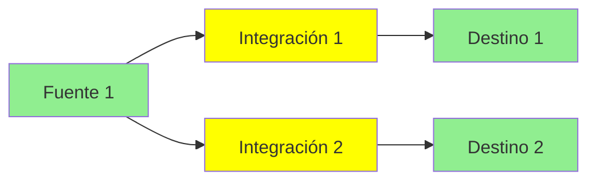
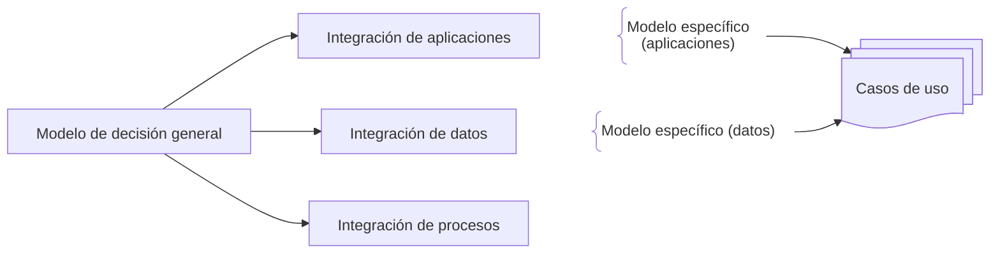
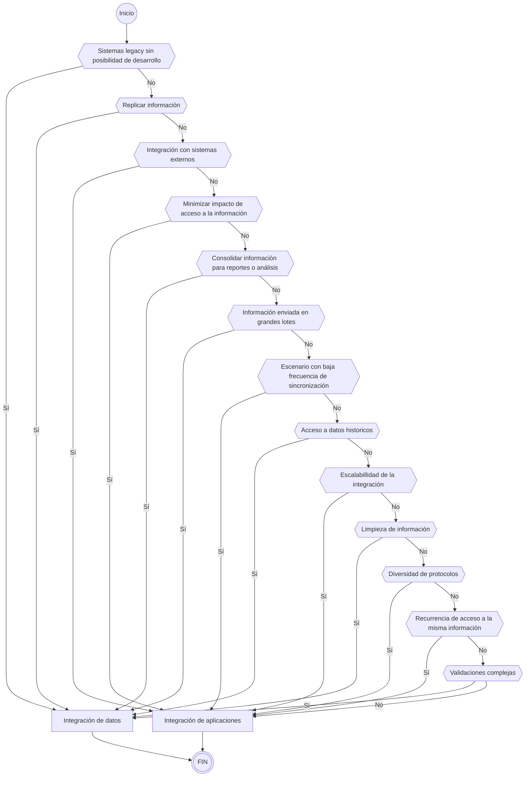
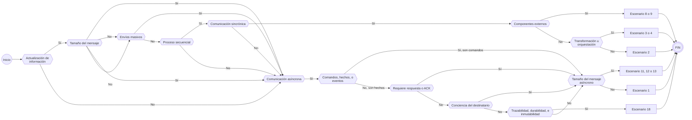

# Modelo de decisión y casos de uso de integración

> Fuente: [https://segurosti.atlassian.net/wiki/spaces/AR/pages/3443097604](https://segurosti.atlassian.net/wiki/spaces/AR/pages/3443097604) · versión 51 · actualizado 2026-09-01 por Víctor Daniel Martínez Olier

# Introducción

Cuando hablamos de integración aparece una variedad de alternativas o caminos por los cuales se puede resolver un escenario determinado, a su vez, existen diferentes niveles y enfoques para abordar los temas desde integración. Este documento pretende consolidar las alternativas que comúnmente se presentan en la compañía y ofrecer un modelo que permita escoger el camino más apropiado a tu necesidad.

# Cómo abordar el modelo de decisión

> **ℹ️ Nota**
>
> Para ejecutar el modelo, se deben contar inicialmente con los siguientes insumos:
>
> - Diagrama de solución con integraciones o relaciones.
> - Dimensionamiento o entendimiento de cada par origen con destino.

Normalmente una solución tiene multiples puntos de integración, fuentes, destinos e integraciones que permiten el intercambio de información entre estos. Las integraciones pueden unidireccionales o bidireccionales. Gráficamente puede verse algo como esto:





Es importante acotar que el resultado del modelo es una casuística de integración entre 2 componentes por lo tanto siga los siguientes pasos:

1. **Pares fuentes con destinos de información:** Para iniciar el recorrido del modelo, es necesario tener claras las fuentes y destinos de la integración, esto permite conocer si son varias fuentes/destinos y la forma como se debe abordar la integración.
2. **Modelo de decisión general:** Posterior a conocer la fuente y destino de la información, es necesario recorrer el modelo de decisión general, esto con el fin de identificar si la integración es de datos o de aplicaciones.
3. **Tipo de integración:** Al finalizar el flujo del modelo de decisión general, se debe tener claro el tipo de integración, para este caso si es de datos o de aplicación.

```mermaid
---
config:
  htmlLabels: false
---
flowchart LR
    AA((Inicio))
    AA --> CRLI{{"`¿Cómo resuelvo la integración?`"}}
    CRLI --> TVFDI{{"`**1. ¿Tiene varias fuentes o destinos de información?**`"}}
    TVFDI --> IEFDE["`Identifique un escenario de fuente y destino específicos`"]
    IEFDE --> MDG["`**2. Modelo de decisión general**`"]
    MDG --> TI{{"`**3. Tipo de integración**`"}}
    TI -->|"`Aplicacón`"| ME["`Modelos específicos`"]
    TI -->|"`Datos`"| ME
    ME --> ZZ(((FIN)))
```





# Enfoque

Dado que en integración tenemos varias aproximaciones *(datos, aplicación, y procesos)*, el modelo de decisión consta de un modelo general que te permite aterrizar inicialmente cual aproximación es la que se ajusta de mejor forma a tu escenario, luego de eso existen modelos más específicos por cada aproximación y finalmente unos casos de uso que te ayudan a aterrizar el escenario y la implementación tecnológica que aplica en la compañía.





```
---
config:
  htmlLabels: false
---
flowchart LR
    MG["`Modelo de decisión general`"]
    IA["`Integración de aplicaciones`"]
    ID["`Integración de datos`"]
    IP["`Integración de procesos`"]
    MG --> IA
    MG --> ID
    MG --> IP
    MEIA@{ shape: comment, label: "Modelo específico (aplicaciones)" }
    MEID@{ shape: comment, label: "Modelo específico (datos)" }
    IA ~~~ MEIA
    ID ~~~ MEID
    CU@{ shape: docs, label: "Casos de uso" }
    MEIA --> CU
    MEID --> CU
```

## Modelo de decisión general

Este modelo general brinda un punto de partida de por donde deberías enfocar tus esfuerzos; se muestran una serie de criterios o elementos que se encuentran ordenados de acuerdo a su relevancia e impacto en la decisión y que se deben ir resolviendo en el respectivo orden, ***si algún criterio NO aplica se debe proceder al siguiente***.

> **⚠️ Advertencia**
>
> Tenga en cuenta que normalmente un criterio determina de entrada por donde deberías enfocar la aproximación. La aproximación general **NO** es un absolutismo y en algunos casos específicos debes considerar la combinación de varios criterios.





## Modelos específicos

Una vez seleccionado el enfoque general, cada aproximación, aplicación o datos, tendrá una serie de alternativas que son resueltas por cada uno de los modelos particulares:

- Integración de datos:

  - <https://segurosti.atlassian.net/wiki/spaces/AR/pages/369459206>
  - <https://segurosti.atlassian.net/wiki/spaces/AR/pages/2449440829>
- Integración de aplicaciones:

  - <https://segurosti.atlassian.net/wiki/spaces/AR/pages/1360724091>

### Modelo de decisión de integración de aplicaciones

Este modelo busca la toma de decisiones bajo criterios funcionales/no funcionales, donde dependiendo de una serie de patrones de decisión, se entregarán escenarios de integración acordes a dichos criterios.

**Insumos del modelo de decisión de aplicaciones:**

- Número de transacciones
- Volumen transacciones
- Formato de la información(HL7, FHIR, JSON, XML, Etc)
- Frecuencia de actualización
- Tiempo de respuesta

**Modelo de decisión:**

A continuación se presenta el modelo de integración, el primer cuestionamiento es el de **actualización de información**.

#### Actualización de información

¿Es necesario que los datos se actualicen en el momento en los componentes destino?:

- Sí:

  - Siga con el cuestionamiento del **tamaño del mensaje**.
- No:

  - Siga con el cuestionamiento de **comunicación asíncrona**.

> **ℹ️ Nota**
>
> El objetivo de esta pregunta es determinar el grado de urgencia con que los datos deben estar disponibles en los componentes destino, lo cual influye en la Arquitectura y los métodos de integración que se utilizarán.

#### Tamaño del mensaje

¿El tamaño del mensaje es considerable? (> 2MiB):

- Sí:

  - Siga con el cuestionamiento de **comunicación asíncrona**.
- No:

  - Siga con el cuestionamiento de **envíos masivos**.

> **ℹ️ Nota**
>
> El objetivo de esta pregunta es identificar si el tamaño del mensaje es un factor que debe ser considerado en el diseño de la integración, con esto evitar problemas de rendimiento o errores durante el proceso de intercambio de datos.

#### Envíos masivos

¿La información se enviará de forma masiva? (> 1000 reg/min):

- Sí:

  - Siga con el cuestionamiento de **comunicación asíncrona**.
- No:

  - Siga con el cuestionamiento de **proceso secuencial**.

> **ℹ️ Nota**
>
> El objetivo de esta pregunta es identificar si la cantidad de datos transmitidos podría superar la capacidad sugerida, lo que influiría en las decisiones de diseño y en las herramientas de integración que se deben utilizar.

#### Proceso secuencial

¿La integración es parte de un proceso secuencial?:

- Sí:

  - Siga con el cuestionamiento de **comunicación sincrónica**.
- No:

  - Siga con el cuestionamiento de **comunicación asíncrona**.

> **ℹ️ Nota**
>
> El propósito de esta pregunta es entender si la integración requiere coordinación estricta entre las puntas de integración, lo que puede implicar la necesidad de mecanismos de control de flujo, transacciones distribuidas o la gestión de dependencias entre diferentes etapas.

#### Comunicación sincrónica

¿La comunicación debe ser sincrónica?:

- Sí:

  - Siga con el paso de **componentes externos**.
- No:

  - Siga con el paso de **comunicación asíncrona**.

> **ℹ️ Nota**
>
> El objetivo de esta pregunta es identificar si la integración necesita operar de manera simultánea y coordinada, lo que puede afectar aspectos como la latencia y la disponibilidad.

#### Componentes externos

¿Alguno de los componentes es externo a la compañía, Sura?:

- Sí:

  - Escenario 8: [Casos de uso integración de aplicaciones](../paginas/Modelo-de-decision-y-casos-de-uso-de-integracion/Casos-de-uso-integracion-de-aplicaciones.md) .
  - Escenario 9: [Casos de uso integración de aplicaciones](../paginas/Modelo-de-decision-y-casos-de-uso-de-integracion/Casos-de-uso-integracion-de-aplicaciones.md) .
- No:

  - Siga con el paso de **transformación u orquestación**.

> **ℹ️ Nota**
>
> Una vez identificado el tipo de comunicación, es crucial determinar si es necesario desarrollar servicios destinados a ser utilizados por terceros. Si es así, estos servicios deben cumplir con ciertos requisitos mínimos antes de ser expuestos. Para ello, se puede utilizar una lista de verificación conocida como → Checklist APIficable, a continuación se presentan los escenarios aplicables → Casos de uso/Escenarios 8 y 9

#### Transformación u orquestación

¿Se requiere transformación u orquestación con otros componentes?:

- Sí:

  - Escenario 3: [Casos de uso integración de aplicaciones](../paginas/Modelo-de-decision-y-casos-de-uso-de-integracion/Casos-de-uso-integracion-de-aplicaciones.md) .
  - Escenario 4: [Casos de uso integración de aplicaciones](../paginas/Modelo-de-decision-y-casos-de-uso-de-integracion/Casos-de-uso-integracion-de-aplicaciones.md) .
- No:

  - Escenario 2: [Casos de uso integración de aplicaciones](../paginas/Modelo-de-decision-y-casos-de-uso-de-integracion/Casos-de-uso-integracion-de-aplicaciones.md) .

> **ℹ️ Nota**
>
> Para continuidad de servicios internos, se evaluará si es necesario realizar transformaciones o necesidad específica de un orquestador para integrarse con otros componentes internos de la compañía, para este caso es necesario el uso del APImanager de la compañía, en este caso → Apigee ahora se presentan los escenarios aplicables→ Casos de uso/Escenarios 2/3 y 4

#### Comunicación asíncrona

¿La comunicación puede ser asíncrona?:

- Sí:

  - Siga con el cuestionamiento de **comandos, hechos, o eventos**.
- No:

  - Siga con el cuestionamiento de **comunicación sincrónica**.

> **ℹ️ Nota**
>
> El propósito de esta pregunta es identificar si la integración puede operar sin depender de una respuesta inmediata, lo que permite mayor flexibilidad en el diseño y reduce la presión sobre los recursos de procesamiento en tiempo real. La comunicación asíncrona es ideal cuando los procesos pueden tolerar demoras o cuando se desea evitar bloqueos en el flujo de trabajo.

#### Comandos, hechos, o eventos

¿Son comandos/acciones o sólo hechos/eventos?:

- Sí, son comandos:

  - Siga con el cuestionamiento de **tramaño del mensaje asíncrono**.
- No, son sólo hechos:

  - Siga con el cuestionamiento de requiere respuesta o ACK.

> **ℹ️ Nota**
>
> ¿La integración va a comunicar comandos, operaciones, acciones; o sólo son, hechos, notificaciones o cambios de estado?

#### Requiere respuesta o ACK

¿El modelo de comunicación requiere una respuesta?:

- Sí:

  - Siga con el cuestionamiento de **tramaño del mensaje asíncrono**.
- No:

  - Siga con el cuestionamiento de **conciencia del destinatario**.

> **ℹ️ Nota**
>
> Validar si la integración requiere una respuesta, por ejemplo un mensaje de devuelta, mensaje de confirmación de recibido.

#### Conciencia del destinatario

¿El emisor/publicador tiene, o requiere, conocimiento/conciencia del destinatario, incluso futuros?:

- Sí:

  - Siga con el cuestionamiento de **tramaño del mensaje asíncrono**.
- No:

  - Siga con el cuestionamiento de **trazabilidad, durabilidad, e inmutabilidad**.

> **ℹ️ Nota**
>
> El emisor tiene conciencia o conocimiento de la existencia, características, capacidades del destinatario, o es irrelevante la existencia del receptor. Por ejemplo, el esquema del mensaje debe estar formateado teniendo conciencia del destinatario, o los eventos deben emitirse a una velocidad según las capacidades del receptor.

#### Trazabilidad, durabilidad, e inmutabilidad

¿Requiere reproducibilidad, trazabilidad, durabilidad, o inmutabilidad?:

- Sí:

  - Escenario 18: [Casos de uso integración de aplicaciones](../paginas/Modelo-de-decision-y-casos-de-uso-de-integracion/Casos-de-uso-integracion-de-aplicaciones.md) .
- No:

  - Siga con el paso de **tamaño del mensaje asíncrono**.

> **ℹ️ Nota**
>
> ¿El caso de uso de integración requiere alguna, o varias, de las siguientes características?:
>
> Reproducibilidad de eventos: Se requiere capacidad de recrear, repetir, o reconstruir la secuencia de sucesos/hechos/eventos, sin tener que volver a involucrar al emisor/productor de los eventos. Por ejemplo, para volver a procesar eventos históricos para reconstruir el estado del sistema, resignificar/darles nuevos significados a los eventos del pasado, auditar, depurar o alimentar nuevos consumidores.
>
> Durabilidad: Los eventos al ser leídos, no son descartados/eliminados, perduran, sin importar cuántas veces sean leídos.
>
> Inmutabilidad: Los eventos al ser emitidos no cambian, cualquier modificación se hace mediante nuevos eventos compensatorios.
>
> Trazabilidad funcional: Capacidad de seguimiento de los eventos/sucesos/hechos funcionales ocurridos.

#### Tamaño del mensaje asíncrono

¿El tamaño del mensaje asíncrono es considerable? (> 2MB):

- Sí:

  - Escenario 11: [Casos de uso integración de aplicaciones](../paginas/Modelo-de-decision-y-casos-de-uso-de-integracion/Casos-de-uso-integracion-de-aplicaciones.md) .
  - Escenario 12: [Casos de uso integración de aplicaciones](../paginas/Modelo-de-decision-y-casos-de-uso-de-integracion/Casos-de-uso-integracion-de-aplicaciones.md) .
  - Escenario 13: [Casos de uso integración de aplicaciones](../paginas/Modelo-de-decision-y-casos-de-uso-de-integracion/Casos-de-uso-integracion-de-aplicaciones.md) .
- No:

  - Escenario 1: [Casos de uso integración de aplicaciones](../paginas/Modelo-de-decision-y-casos-de-uso-de-integracion/Casos-de-uso-integracion-de-aplicaciones.md) .

> **ℹ️ Nota**
>
> Teniendo claro que la comunicación será de forma asíncrona, ahora es necesario conocer el tamaño del mensaje.





> **ℹ️ Nota**
>
> En algunos puntos del modelo de decisión anterior se hace uso de algunos términos y conceptos en el contexto de las arquitecturas dirigidas por eventos que tienen un significado que se debe tener claro para poder realizar un cuestionamiento adecuado, estos los puede encontrar en una página dedicada a definir estos términos y conceptos: [EDA Framework: Glosario y definiciones generales](https://segurosti.atlassian.net/wiki/spaces/AR/pages/5251366915) .

### Casos de uso o escenarios

Los casos de uso determinan escenarios comunes que son muy estándares en la industria o que son de uso regular en la compañía, para los cuales ya se tiene identificado una forma de resolverlo, algunas particularidades y la implementación tecnológica que lo resuelve:

[Casos de uso integración de aplicaciones](../paginas/Modelo-de-decision-y-casos-de-uso-de-integracion/Casos-de-uso-integracion-de-aplicaciones.md)

La estructura de los casos de uso es la siguiente:

- ***Descripción:*** descripción general del caso
- ***Enfoque:*** Aplicación o datos
- ***Tipo:*** Sincrono o Asíncrono
- ***Diagrama necesidad:*** planteamiento de la necesidad a resolver
- ***Diagrama solución:*** como se plantea resolver la necesidad
- ***Flujo principal:*** explicación del paso a paso normal del escenario
- ***Flujos alternos:*** variaciones que puede tener el escenario
- ***Notas, restricciones o lineamientos:*** elementos adicionales a tener en cuenta
- ***Stack tecnológico:*** implementación tecnológica oficial para SURA y que debe tenerse en cuenta a la hora de implementar el escenario

> **📝 Nota**
>
> Se agregaran nuevos casos en la medida en la que se vayan mapeando desde los diferentes dominios o a media que la forma de implementarlos o el stack tecnológico presenten cambios.

### Tenga en cuenta

> **⚠️ Advertencia**
>
> Esta es una primera aproximación a los modelos de decisión y casos de uso que va a ir evolucionando. Consulte constantemente para estar al tanto de las actualizaciones.
>
> ***Cualquier sugerencia o recomendación remitirla al equipo de Arquitectura Técnica***
