# Casos de uso integración de aplicaciones

> Fuente: [https://segurosti.atlassian.net/wiki/spaces/AR/pages/3701276684](https://segurosti.atlassian.net/wiki/spaces/AR/pages/3701276684) · versión 15 · actualizado 2025-12-02 por Víctor Daniel Martínez Olier

A continuación se muestran los escenarios de integración de aplicaciones que se han identificado como escenarios comunes en la compañía, el flujo normal que deberían seguir estos casos, las alternativas que se podrían considerar, el stack tecnológico que lo resuelve y algunas consideraciones que se deben tener en cuenta como documentación de referencia y lineamientos que le aplican.

El modelo de decisión de integración de aplicaciones ([Modelo de decisión y casos de uso de integración](../../paginas/Modelo-de-decision-y-casos-de-uso-de-integracion.md)) tiene en cuenta dichas casuísticas y las referencia como una alternativa que cumple con una serie de criterios a resolver.

## Escenario 1

Escenario 1

Aplicación A cuenta con la capacidad de emitir eventos y dichos eventos pueden ser leídos por uno o varios consumidores

***Tipo:*** Asíncrono

***Diagrama necesidad:***

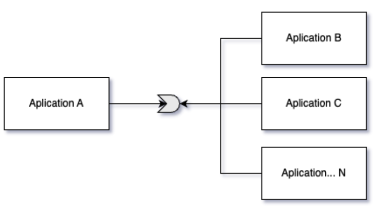

***Diagrama solución:***

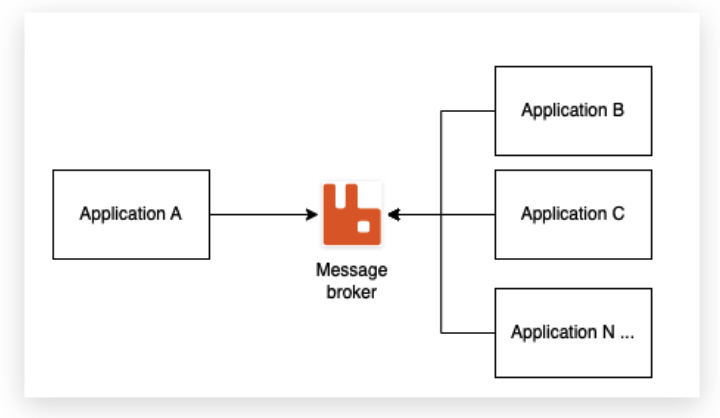

***Flujo principal:***

1. Aplicación A publica un mensaje en determinada cola
2. Aplicación X se suscribe a dicha cola y lee mensaje enviado
3. Aplicación X procesa mensaje (acá se pueden tener caminos alternos)"

***Flujos alternos:***

- Aplicación consumidora envía confirmación de recibido y el mensaje es borrado de la cola
- Los mensajes de la cola se borran después de un tiempo X
- Los mensajes necesitan mecanismos de reenvío"

***Notas, restricciones, lineamientos:***

- El dueño de la cola es quien ofrece el mecanismo de integración
- Ellos son los que deben garantizar la correcta configuración de la cola y brindar los mecanismos para mapear los escenarios de integración que pueda tener dicha cola; esto debe ser negociado con los interesados de la integración"

***Stack tecnológico:***

- RabbitMQ como Broker de mensajería

***Documentación:***

[https://segurosti.atlassian.net/wiki/spaces/AR/pages/377815044/Lineamientos+Uso+RabbitMQ](https://segurosti.atlassian.net/wiki/spaces/AR/pages/377815044)

## Escenario 2

Escenario 2

Aplicación A expone un servicio web que será consumido por uno o varios consumidores (esto incluye plataformas transversales como: SAP, P8, CCM, Salesforce)  
  
***Tipo:*** Síncrono

***Diagrama necesidad:***

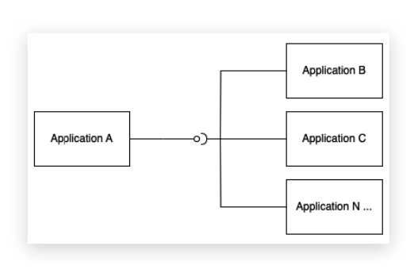

***Diagrama solución:***

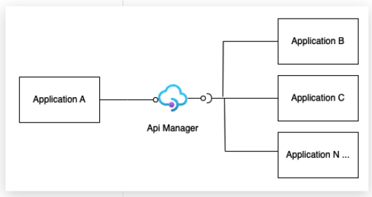

***Flujo principal:***

1. Aplicación A crea servicio y lo configura en plataforma API manager
2. Aplicación X consume servicio desde el API Manager

***Flujos alternos:***

- Servicio expuesto no se encuentra disponible, los consumidores deben implementar mecanismos de Circuit Breaker.

***Notas, restricciones, lineamientos:***

- No se pueden consumir servicios directamente, se debe pasar por la plataforma de API Manager
- Todo servicio debe estar debidamente asegurado
- El responsable de la integración es la aplicación A o dueño funcional del activo de negocio (quien expone el servicio)
- Todos los cambios que realice la aplicación A deben ser notificados a tiempo

***Stack tecnológico:***

- Apimanager definido en la compañía --> **Apigee**

***Documentación:***

<https://segurosti.atlassian.net/wiki/spaces/AR/pages/256672056>

<https://segurosti.atlassian.net/wiki/spaces/AR/pages/2721415362>

## Escenario 3

Escenario 3

Aplicación A necesita consumir servicios de diferentes dominios, los cuales requieren algún tipo de orquestación  
  
***Tipo:*** Síncrono

***Diagrama necesidad:***

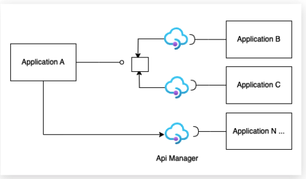

***Diagrama solución:***

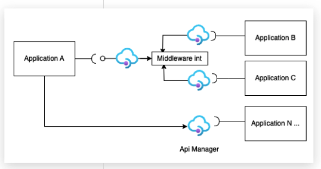

***Flujo principal:***

1. Aplicaciones B y C exponen sus servicios en plataforma Apimanager
2. Aplicación A se encarga de realizar orquestación en Middleware definido
3. Aplicación A consume resultado orquestación

***Flujos alternos:***

- El middleware de integración podría ser el mismo apimanager en caso de orquestaciones simples o la plataforma de integración definida por la compañia en caso de orquestaciones complejas

***Notas, restricciones, lineamientos:***

- El responsable de la integración es quien tenga la necesidad de orquestación

***Stack tecnológico:***

- Apimanager definido en la compañia(Apigee)
- Middleware de integración definido(Informática, Microintegradores, Azure iPaas)

***Documentación:***

## Escenario 4

Escenario 4

Aplicación B necesita consumir un servicio que expone la aplicación A y requiere aplicarle transformaciones al mensaje

***Tipo:*** Síncrono

***Diagrama necesidad:***

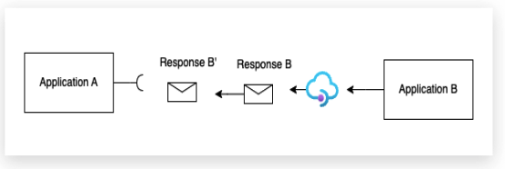

***Diagrama solución:***

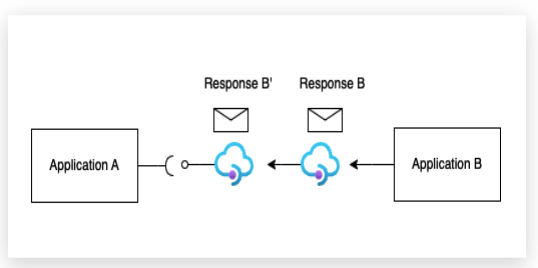

***Flujo principal:***

1. Aplicación B expone servicio en api manager
2. Aplicación B se encarga de realizar transformación en apimanager
3. Aplicación A consume resultado transformación

***Flujos alternos:***

- Se podría llegar a usar GraphQL para exponer el servicio de la aplicación B en Api manager y que la aplicación A consuma solo lo que requiere
- Transformaciones complejas que no soporte la plataforma apimanager debe realizarse en middleware definido

***Notas, restricciones, lineamientos:***

- La aplicación B seguira siendo responsable del servicio expuesto inicialmente incluyendo cualquier modificación ya que es el dueño de la información.

***Stack tecnológico:***

- Apimanager definido en la compañía (Apigee)
- Middleware de integración definido(Informática, Microintegradores, Azure iPaas)

***Documentación:***

## Escenario 5

Escenario 5

Información que se encuentra en BD transaccionales para llevarla al Datalake.

***Tipo:*** Asíncrono

***Diagrama necesidad:***

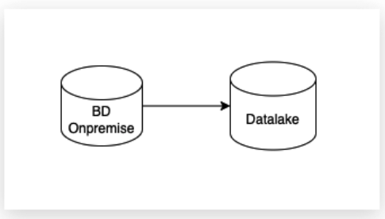

***Diagrama solución:***

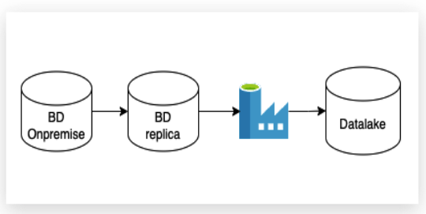

***Flujo principal:***

1. BD origen crea una replica que se sincronice con GoldenGate
2. Movimiento de información con Datafactory desde la replica hacia datalake
3. Consolidación en zona landing y procesamiento con databricks

***Flujos alternos:***

- En escenarios donde el impacto en la fuente no es crítico, se puede omitir la BD réplica

***Notas, restricciones, lineamientos:***

***Stack tecnológico:***

- GoldenGate
- Azure DataFactory
- Databricks
- Azure Datalake Gen2

***Documentación:***

## Escenario 6

Escenario 6

Aplicación A necesita consumir un servicio que expone la aplicación B y esta a su vez requiere como insumo el consumo de otro servicio que expone la aplicación C

***Tipo:*** Sincrono

***Diagrama necesidad:***

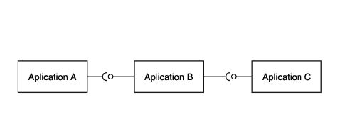

***Diagrama solución:***

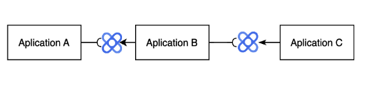

***Flujo principal:***

1. La aplicación C expone servicio en plataforma Apimanager
2. La aplicación B expone servicio en Apimanager, consumiendo desde ahí el servicio de la aplicación C
3. Aplicación A consume servicio expuesto por aplicación B

***Flujos alternos:***

- Si alguno de los servicios no se encuentra disponible, se debe implementar un servicio de resiliencia para su manejo, ejemplo circuit breaker

***Notas, restricciones, lineamientos:***

***Stack tecnológico:***

- Apimanager definido por la compañía (Apigee)

***Documentación:***

## Escenario 7

Escenario 7

Aplicación A necesita consumir un servicio web externo a Sura

***Tipo:*** Sincrono

***Diagrama necesidad:***

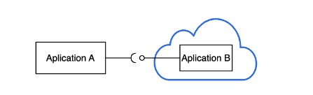

***Diagrama solución:***

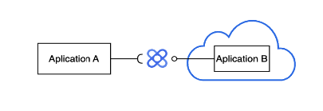

***Flujo principal:***

1. La aplicación A o dueño de la información debe configurar servicio externo en Apimanager Sura
2. Aplicación A consume servicio expuesto en Apimanager

***Flujos alternos:***

- Servicio externo no disponible, se deben implementar sistemas de resiliencia: cache, excepciones, circuit breaker, servicio alterno

***Notas, restricciones, lineamientos:***

***Stack tecnológico:***

- Apimanager definido por la compañía (Apigee)

***Documentación:***

## Escenario 8

Escenario 8

Aplicación A necesita exponer un servicio para consumo externo

***Tipo:*** Sincrono

***Diagrama necesidad:***

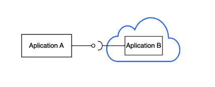

***Diagrama solución:***

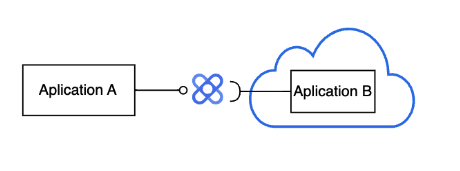

***Flujo principal:***

1. La aplicación A o dueño de la información debe configurar servicio externo en Apimanager Sura
2. Aplicación externa consume servicio expuesto en Apimanager

***Flujos alternos:***

***Notas, restricciones, lineamientos:***

- Los servicios deben cumplir unas condiciones mínimas para ser expuestos (checklist de apificación)

***Stack tecnológico:***

- Apimanager definido por la compañía (Apigee)

***Documentación:***

## Escenario 9

Escenario 9

Información que se encuentra en un FTP y deber ser consolidada en una BD

***Tipo:*** Asíncrono

***Diagrama necesidad:***

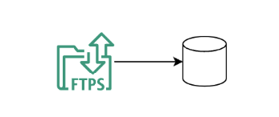

***Diagrama solución:***

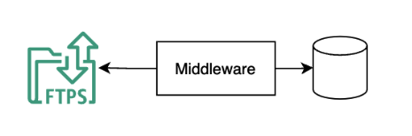

***Flujo principal:***

1. Información se encuentra en FTP
2. Dueño de la integración crea flujo en Middleware
3. Consolidación en BD

***Flujos alternos:***

***Notas, restricciones, lineamientos:***

- Se deben evitar las integraciones a nivel de capa de datos siempre y cuando se integren dominios funcionales de diferentes soluciones

***Stack tecnológico:***

- El Middleware puede ser un iPaas o un microintegrador o plataforma de LowCode

***Documentación:***

## Escenario 10

Escenario 10

Información que se encuentra en un FTP y deber ser consolidada en un Servicio Web

***Tipo:*** Asíncrono

***Diagrama necesidad:***

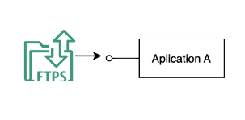

***Diagrama solución:***

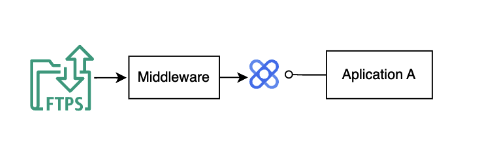

***Flujo principal:***

1. La información se encuentra en un FTP
2. El Dueño de la integración crea el flujo en el Middleware y expone servicio en apimanager
3. La aplicación A consume servicio

***Flujos alternos:***

***Notas, restricciones, lineamientos:***

- Se sugiere llevar la información del FTP a la BD y exponer esta a traves de un servicio Web

***Stack tecnológico:***

- El Middleware puede ser un iPaas o un microintegrador o plataforma de LowCode

***Documentación:***

## Escenario 11

Escenario 11

Información que se encuentra en diferentes BD, se requiere aplicarle algún tipo de transformación y consolidar en otro repositorio de datos

***Tipo:*** Asíncrono

***Diagrama necesidad:***

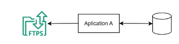

***Diagrama solución:***

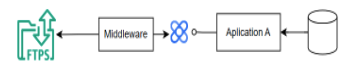

***Flujo principal:***

1. La aplicación A expone un servicio con la información de BD
2. La aplicación A, crea un flujo en el Middleware, para llevar la información al FTP

***Flujos alternos:***

Una vez almacenada la información de forma correcta en el ftp, se debe usar un sistema de marcacion de registro para el manejo de deltas, reintentos y confirmación.

***Stack tecnológico:***

- Micro Integradores
- Informatica
- Low Code

## Escenario 12

Escenario 12

Información que se encuentra en diferentes BD, se requiere aplicarle algún tipo de transformación y consolidar en otro repositorio de datos

> **⚠️ Advertencia**
>
> En construcción

## Escenario 13

Escenario 13

Replicación permanente de información de una BD a otra.

> **⚠️ Advertencia**
>
> En Construcción

## Escenario 14

Escenario 14

Aplicación A necesita acutalizar información que se encuentra en BD de aplicación B

> **⛔ Importante**
>
> Este escenario no esta permitido por lineamientos.

## Escenario 15

Escenario 15

Aplicación A necesita acutalizar información transversal de la compañia (TRM, monedas, ciudades, etc)

***Diagrama necesidad:***

LISTAS MAESTRAS (accessibility widgets)

***Diagrama solución:***

LISTAS MAESTRAS

## Escenario 16

Escenario 16

Aplicación B cuenta con la capacidad de entregar una API, que será consumido por uno o varios consumidores y requiere aplicarle transformaciones al mensaje para consumo de Aplicación A

***Tipo:*** Asíncrono

***Diagrama necesidad:***

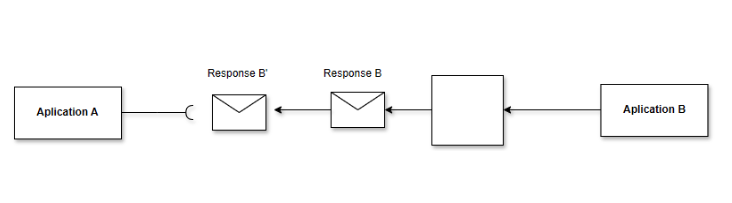

***Diagrama solución:***

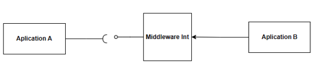

***Flujo principal:***

1. Aplicación B entrega servicio API
2. Aplicación B se encarga de realizar transformación en Middleware interno
3. Aplicación A consume resultado transformación

***Flujos alternos:***

***Notas, restricciones, lineamientos:***

- La aplicación B seguirá siendo responsable del servicio expuesto inicialmente incluyendo cualquier modificación ya que es el dueño de la información.

***Stack tecnológico:***

- Middleware de integración definido(Informática, Microintegradores, Azure iPaas)

## Escenario 17

Escenario 17 (En construcción)

Aplicación A necesita exponer de manera segura un servicio para consumo externo (Tercero) de manera asíncrona

***Tipo:*** Asíncrono

***Diagrama necesidad:***

***Diagrama solución:***

***Flujo principal:***

Prerequisitos:

1. La aplicación A o dueño de la información debe configurar un servicio externo en Apimanager Sura que se conecte con una cola de RabbitMQ.
2. Aplicación externa consume servicio expuesto en Apimanager en vez de publicar en cola.

Flujo de publicación por parte del Tercero (Solicitud)

1. La aplicación B (El tercero) se autentica mediante OAuth y obtiene un token con el scope de publicación.
2. La aplicación B envía una solicitud POST a un endpoint de la API expuesta por la aplicación A para publicar el mensaje.
3. La API expuesta por la aplicación A valida el mensaje y lo envía al broker en la cola correspondiente.
4. La API expuesta por la aplicación A responde con un ID de confirmación o estado del mensaje a la Aplicación B (tercero).

Flujo de consumo por parte del tercero (Respuesta)

1. La aplicación B (El tercero) se autentica de nuevo o reutiliza el token si es válido.
2. Polling. La aplicación B Envía una solicitud GET, a un endpoint provisto por la aplicación A a través de la API, para consumir mensajes.
3. La API recupera mensajes del broker y los envía a la aplicación B (tercero).

***Flujos alternos:***

***Notas, restricciones, lineamientos:***

1. Capa de API Bidireccional  
   La capa de API debe permitir tanto operaciones de consumo como de publicación de mensajes. Esto incluye:

   - Endpoints específicos para publicar mensajes: El tercero puede enviar datos a un endpoint específico que recibe y envía esos mensajes al broker de mensajería.
   - Endpoints de consumo: La API mantiene también los endpoints de consumo para que el tercero pueda leer mensajes cuando sea necesario.
2. Autenticación y Autorización Granular

   - OAuth 2.0: Permite autenticación y autorización por cada operación (publicación o consumo).
   - Scopes específicos en OAuth: Asignar permisos detallados para controlar si el tercero puede publicar, consumir, o ambos. Esto asegura que solo los clientes con autorización específica puedan enviar mensajes.
3. Validación y Enriquecimiento de Mensajes Entrantes

   - Antes de que un mensaje llegue al broker, la API puede validar y enriquecer el mensaje si es necesario. Esto permite mantener la integridad de los datos y prevenir mensajes malformados o potencialmente maliciosos.
   - Esquemas de Datos: La API debe validar que los mensajes cumplan con un esquema de datos específico para asegurar consistencia y seguridad.
4. Colas Dedicadas para Diferentes Operaciones

   - Crear colas separadas para la publicación y el consumo por parte del tercero puede facilitar el control y la seguridad.
   - Colas Particulares por Cliente: En caso de que diferentes terceros interactúen con el sistema, asignarles colas particulares o particionadas evita interferencias entre clientes.
5. Flujos de Confirmación y Respuestas

   - Para garantizar la fiabilidad y el rastreo de mensajes, implementar un mecanismo de confirmación (acknowledgment) para mensajes enviados.
   - Cuando el tercero publica un mensaje, la API puede responder con un ID de mensaje o confirmación de recepción. Como el proceso es asincrónico, también se debe proporcionar un endpoint de consulta de estado para que el tercero verifique si el mensaje fue procesado correctamente.
6. Medidas de Seguridad en la Publicación de Mensajes

   - Protección contra DDoS y Rate Limiting: Limitar la cantidad de mensajes por unidad de tiempo que cada cliente puede enviar, protegiendo así al sistema de un tráfico excesivo.
   - Cifrado: Los mensajes deben estar cifrados tanto en tránsito como en el broker para asegurar la confidencialidad de los datos.

***Stack tecnológico:***

- Apimanager definido por la compañía (Apigee)
- Message Broker RabbitMQ

***Documentación:***

Referencias:

<https://www.enterpriseintegrationpatterns.com/patterns/conversation/FireAndForget.html>

<https://mulesy.com/3-bi-directional-sync-pattern/>

<https://learn.microsoft.com/en-us/industry/well-architected/cross-industry/data-integration-patterns>

## Escenario 18

Escenario 18

La aplicación A emite eventos sin tener conciencia de los destinatarios.

**Tipo**

Asíncrono

Introducción de que hay dos caminos

**Flujo para integración con aplicaciones existentes**

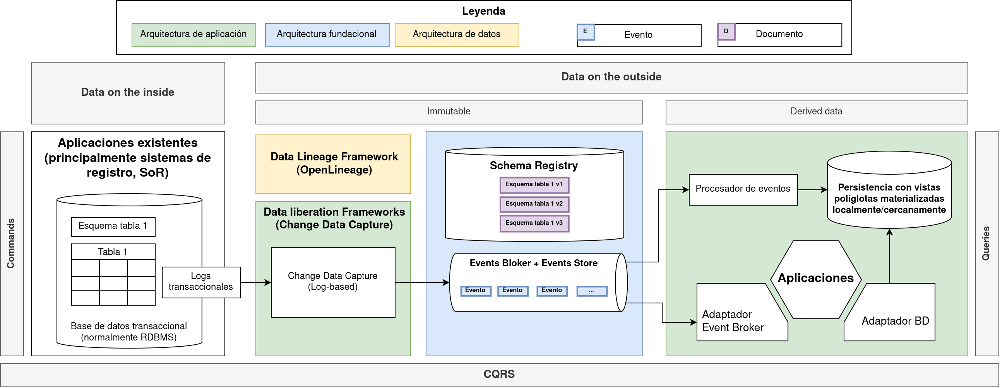

- Aplicación A es un sistema de registro, y su fuente de verdad es una base de datos transaccional.
- Gracias al marco de liberación de datos, usando el patrón Change Data Capture, son llevados a topics en el Event Broker + Event Store los eventos de cambio que ocurren sobre las tablas en la base de datos transaccional.
- Procesadores de eventos que hacen parte del dominio de la aplicación A se suscriben a los topics usados para los evetos CDC anteriores para producir eventos de dominio en otros topics (de dominio).
- Cualquier otra aplicación se suscribe a los topics con los eventos (de dominio) de su interés en el Event Broker + Event Store, para reaccionar ante los eventos o construir vistas materializadas para soportar sus casos de uso específicos.

**Flujo para aplicaciones creadas fundamentalmente en EDA**

- Aplicación A emite los eventos en topics en un Event Broker + Event Store, y teniendo los eventos como fuente única de verdad (SSoT, *Single Source of Truth*), esta fuertemente soportada sobre patrones como CQRS y *Event Sourcing*.
- Procesadores de eventos que hacen parte del dominio de la aplicación A se suscriben a los topics anteriores para producir eventos de dominio en otros topics (de dominio).
- Cualquier otra aplicación se suscribe a los topics con los eventos (de dominio) de su interés en el Event Broker + Event Store, para reaccionar ante los eventos o construir vistas materializadas para soportar sus casos de uso específicos.

**Documentación**

[Marco de trabajo para arquitecturas dirigidas por eventos (EDA Framework)](https://segurosti.atlassian.net/wiki/spaces/AR/pages/4588863512)
