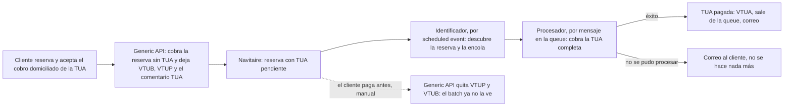
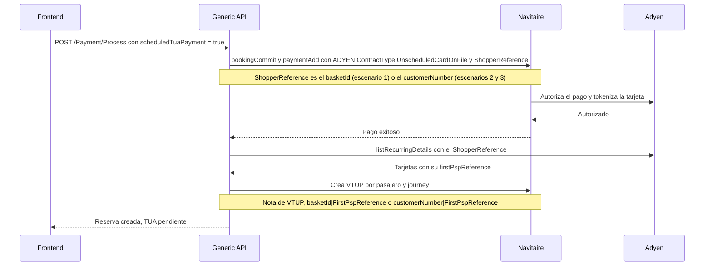
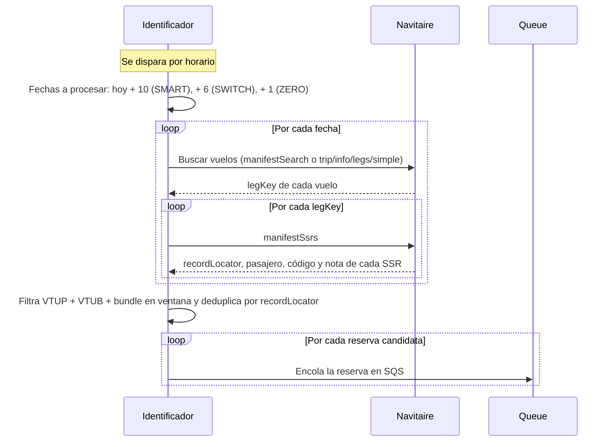
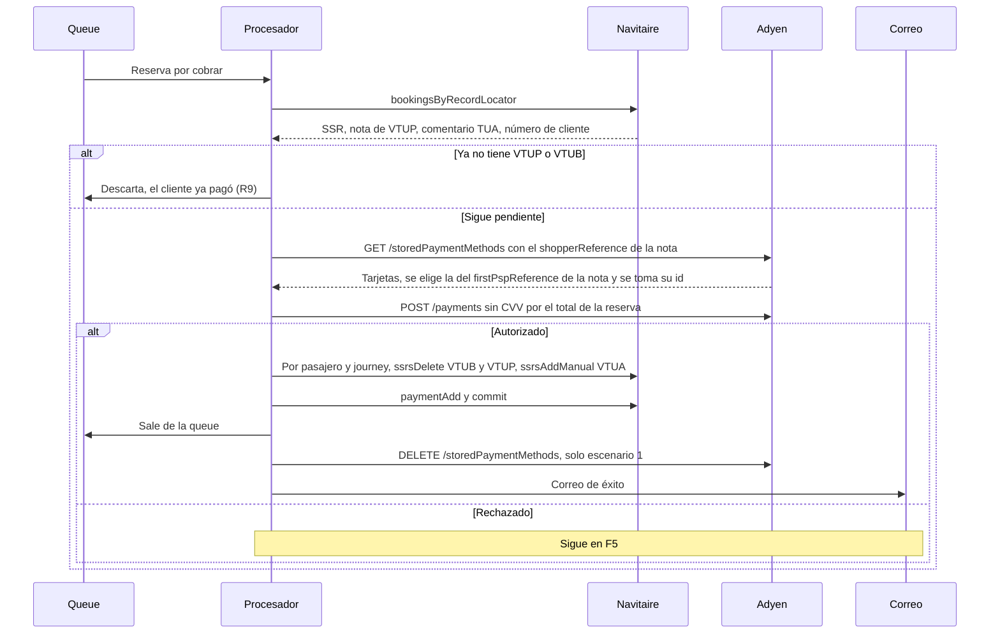
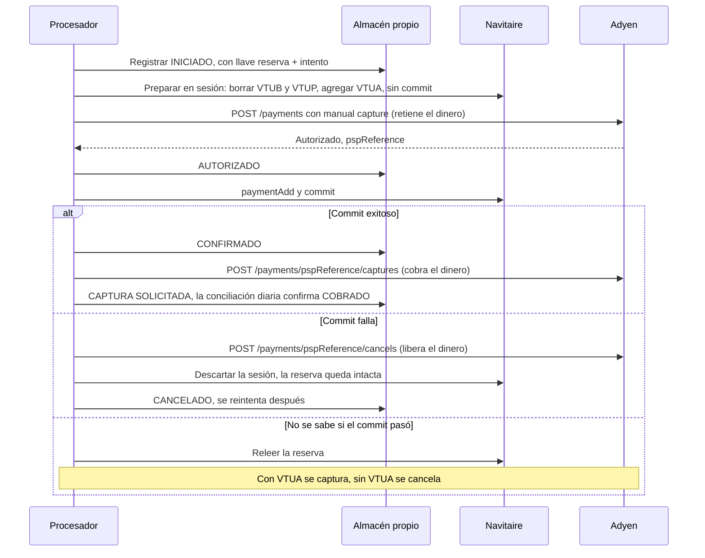
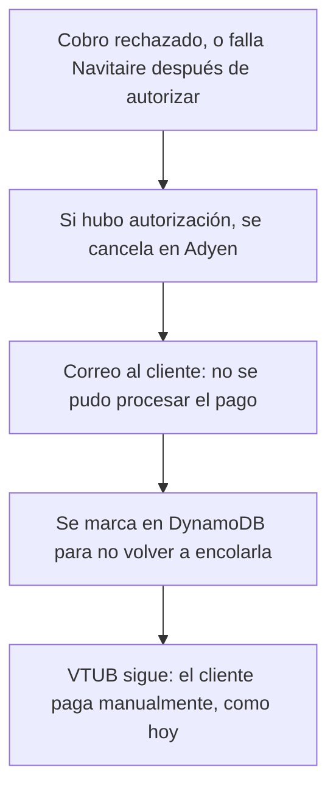
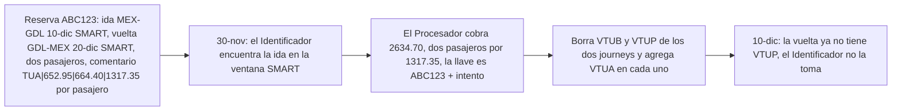
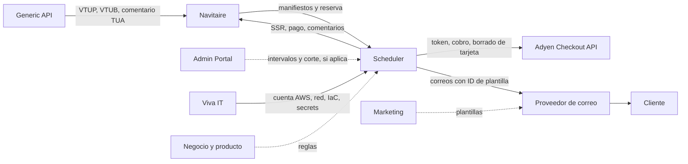

# Batch - Scheduled Payment (Viva Aerobus) — análisis para estimación

Documento interno. Fuentes, todas insumo del cliente, en `resources/`:

- `Batch - Scheduled Payment.md` y su PDF (DRAFT, 2026-11-13): alcance a estimar. Héctor confirmó en la
  sesión que es la versión definitiva; el estado DRAFT se mantiene hasta que arranque el desarrollo.
- `Generic API - Scheduled Payment.md` y su PDF (READY FOR DEV, 2026-11-13): fuera de alcance, base de la
  que depende el batch.
- `explcacion-por-el-negocio.md`: transcript de la sesión con Héctor Eduardo Rodríguez (2026-11-18).
- `screenshots/`: capturas de esa sesión. Muestran el diagrama `VTUP-full-newScope-101126.drawio` (escenarios
  de Generic API, los pasos 1 a 3 de Adyen y el batch), el SkySpeed de Navitaire y la colección Postman de
  Generic API.
- Código de Generic API en `master`, commit `9a47936cd` (2026-11-18), leído sin modificar (sección 6.1).

Lo marcado **PROPUESTA** está así en el requerimiento: es regla sugerida, no confirmada por negocio. Lo
marcado **SESIÓN** se dijo en la reunión del 2026-11-18 y falta confirmarlo por escrito. Lo que cambió con
la sesión está resumido en la sección 6.2. Los términos se definen en la sección 9.

## 1. Objetivo de negocio

**La TUA** (Tarifa de Uso de Aeropuerto) es un impuesto **por pasajero** de los aeropuertos mexicanos, que
la aerolínea cobra dentro de la reserva. Viva ya permite pagarla después, de forma manual (`VTUB`, que
bloquea el check-in). Lo nuevo es un **cobro domiciliado**: el cliente acepta al reservar que la TUA se
cobre sola, sin CVV, con la tarjeta que usó. Es un KPI estratégico del trimestre.

Reglas confirmadas en la sesión:

- **El monto no cambia:** es el que se calculó al reservar, guardado en el comentario `TUA|out|in|total`.
  Si el comentario no está, la reserva no se procesa y se marca como fallida (decisión del 2026-11-19, R8).
- **Cobro completo:** un solo cargo por reserva, por todos sus journeys y pasajeros. No se cobra la ida y
  la vuelta por separado. El requerimiento dice lo contrario (C2, R3).
- **Fecha de cobro según el bundle** (paquete tarifario que el cliente elige al comprar):

  | Bundle | Cobro antes de la salida | SSR marcador (PROPUESTA) |
  | --- | --- | --- |
  | SMART | 10 días | `VSMT` |
  | SWITCH | 6 días | `VWTH` |
  | ZERO | 1 día | `VZRO` |

  LIGHT y BASIC no tienen pago programado. La regla la fijó producto y puede cambiar; por ejemplo, que el
  cliente elija la fecha.
- **Un solo intento (decisión del 2026-11-18):** si el cobro no se puede procesar, solo se notifica al cliente
  y no se hace nada más. Sin retries, sin comentarios en la reserva y sin alerta a Operaciones; `VTUB` sigue
  y el cliente paga manualmente como hoy. Reemplaza los tres intentos del requerimiento.
  El motivo del rechazo no se le comunica.
- **Si el cliente paga antes manualmente,** Generic API quita `VTUP` y `VTUB` y agrega `VTUA`, y el batch ya
  no encuentra la reserva.

**Alcance a estimar:** un servicio nuevo (scheduler) con dos etapas:

- **Identificador de cobros pendientes** (el «Batch 1» del requerimiento): un scheduled event lo activa; encuentra
  en Navitaire las reservas con `VTUP` a las que les toca cobro y las encola en SQS.
- **Procesador de cobros** (el «Batch 2»): toma cada reserva de la queue, la relee en Navitaire, cobra en Adyen,
  registra el pago en Navitaire y notifica por SendGrid. Lo que no logra procesar por errores técnicos va a la DLQ.

**Universo que cubrimos (SESIÓN):** solo las reservas con el SSR nuevo `VTUP`. Generic API lo agrega
cuando el cliente elige el pago programado, y sirve justamente para filtrar esas reservas. `VTUB` se
verifica como señal de que la TUA sigue pendiente, pero no define el universo. Quedan fuera:

| Fuera del universo | Por qué |
| --- | --- |
| Reservas con solo `VTUB` (pago posterior manual que ya existe) | El cliente no aceptó el cobro domiciliado ni hay tarjeta tokenizada para cobrar sin CVV |
| Reservas con `VTUA` | La TUA ya está pagada (al reservar, manualmente o por el batch) |
| Journeys con `VTUI` (TUA internacional) sin `VTUP` | No son pago programado |
| Reservas que pierden `VTUP` antes del cobro (pago manual previo) | Generic API quita `VTUP` y `VTUB`; el batch las descarta |

**Visión (SESIÓN):** la TUA es el piloto. Después se quieren programar otros ancillaries, así que el
componente tiene que ser reutilizable y la regla de fecha, configurable.

**Encuadre comercial (SESIÓN):** tiempo y costo fijo, con el mismo tipo de entregable que la propuesta
anterior. El alcance es desarrollo y pruebas en el ambiente TEST. Meta del cliente: tener el backend (pago
de Generic API más el batch) integrado en TEST entre principios y mediados de enero de 2027. Producción,
hacia finales de marzo de 2027. No hay estimado de volumen: Viva está haciendo experimentos A/B con el
momento de pago de la TUA.

## 2. Actores

| Actor | Tipo | Rol |
| --- | --- | --- |
| Identificador de cobros pendientes y Procesador de cobros | Servicios nuevos, **lo que se estima** | El primero encuentra y encola; el segundo cobra, registra el pago y notifica. Dirección conversada: contenedor en Fargate, event-driven con SQS (sección 4.1) |
| Generic API | Sistema de Viva, en desarrollo por el equipo de Tech and Solve | Crea la reserva y deja `VTUB`, `VTUP` (nota con la referencia de la tarjeta) y el comentario de TUA |
| Navitaire | Externo | Manifiestos, SSR, reservas, pagos y comentarios. Autoriza el primer pago en Adyen y tokeniza la tarjeta |
| Adyen | Externo, único procesador | Bóveda de tarjetas, cobro sin CVV y borrado de tarjeta. El batch se conecta directo, con la **Checkout API** (SESIÓN) |
| Proveedor de correo | Externo (SendGrid según el diagrama) | Correos al cliente. Generic API y Transactions ya lo integran |
| Marketing de Viva | Equipo | Define las plantillas de correo y entrega su ID |
| Admin Portal | Sistema de Viva | Interruptor de la funcionalidad (alcance de Generic API). Propuesto para el batch: intervalos y corte |
| Viva IT / equipo de plataforma | Equipo | Cuenta AWS existente, red, plantillas de IaC, secrets |
| Equipo de Navitaire (ISI) | Equipo | Conoce los servicios de Navitaire; apoya a Viva en sus integraciones |
| Cliente | Persona | Recibe los correos; paga manual si el cobro falla |

## 3. Acciones

| # | Batch | Actor → destino | Acción |
| --- | --- | --- | --- |
| 1 | 1 | Scheduler | Calcula las fechas de vuelo según bundle: fecha exacta (diagrama) o rango hoy … hoy + N (PROPUESTA) |
| 2 | 1 | Scheduler → Navitaire | Busca los vuelos (`manifestSearch` o `trip/info/legs/simple`) y obtiene los `legKey` |
| 3 | 1 | Scheduler → Navitaire | Lee el manifiesto de SSR de cada leg (`manifestSsrs`) |
| 4 | 1 | Scheduler | Filtra candidatas: solo pasajeros con `VTUP`, verificando que sigan con `VTUB` (+ bundle en ventana, PROPUESTA). Las reservas con solo `VTUB` no entran. Deduplica por `recordLocator`: un cobro por reserva |
| 5 | 1 | Scheduler → SQS | Encola la reserva en SQS, un mensaje por reserva (envío en batches de hasta 10) |
| 6 | 2 | Queue → Scheduler | Toma la reserva |
| 7 | 2 | Scheduler → Navitaire | Relee la reserva y **verifica que siga con `VTUP` y `VTUB`**; si no, la descarta (R9). Obtiene la nota de `VTUP`, el monto y el número de cliente |
| 8 | 2 | Scheduler → Adyen | `GET /storedPaymentMethods` con el `shopperReference` de la nota; ubica la tarjeta por `firstPspReference` y toma su `id` (token) |
| 9 | 2 | Scheduler → Adyen | `POST /payments` sin CVV (`storedPaymentMethodId`, `ContAuth`, `UnscheduledCardOnFile`) por el total de la reserva, con `idempotency-key`. Hasta 3 intentos |
| 10 | 2 | Scheduler → Navitaire, Adyen, correo | **Éxito:** por pasajero y journey, borra `VTUB` y `VTUP` y agrega `VTUA` (cargo `VBABEQ`); `paymentAdd`, commit, saca de la queue, borra la tarjeta (solo escenario 1), correo |
| 11 | 2 | Procesador → SendGrid | **Cobro no procesado:** si hubo autorización, se cancela; correo al cliente de que no se pudo procesar el pago. No se hace nada más (decisión del 2026-11-18) |

Regla transversal: **nunca un segundo cobro.** Si el cobro pasa y falla un paso posterior en Navitaire, se
reintenta solo lo pendiente (sección 7.1).

### 3.1 Diagramas por flujo

F1 sigue el diagrama de Generic API. F2 y F3 siguen el requerimiento del batch, ajustado con la sesión. F4
es **propuesta nuestra** (sección 7.1).

**F0. Vista general**

**F1. Creación de la reserva (Generic API, fuera de este alcance)**

Lo que deja en la reserva y que el batch necesita después.

**F2. Identificador de cobros pendientes: descubrimiento y encolado**

**F3. Procesador de cobros: cobro**

**F4. Procesador de cobros: cobro como compensating transaction (propuesta nuestra, sección 7.1)**

Reemplaza el bloque "Autorizado" de F3 para que nunca quede un cliente cobrado con la reserva pendiente
(R6).

**F5. Cobro no procesado (un solo intento)**

**F6. Ida y vuelta: cobro completo**

Un solo cobro por la reserva entera. Fechas y montos son ilustrativos.

## 4. Dependencias

### 4.1 Dirección técnica conversada (SESIÓN)

| Tema | Lo conversado | Qué falta |
| --- | --- | --- |
| Patrón | Event-driven, con SQS. Lo pidieron Pablo y Alex de Viva | **Decidido (2026-11-18): SQS con DLQ.** La queue de Navitaire no se usa |
| Cómputo | Servicio contenerizado en Fargate; una queue dispara la invocación (por ejemplo, una Lambda que llama al endpoint del servicio). Héctor coincidió: escala mejor y facilita extenderlo a otros ancillaries | Validar con el equipo de plataforma de Viva |
| Cuenta | Una cuenta AWS existente de Viva (Héctor: "95% seguro"), quizá la de Transactions | Cuál cuenta, VPC, subredes y plantillas existentes (DOR-20) |
| Despliegue | Terraform (herramienta de IaC de Viva); calidad de código con el Sonar de Viva | Repositorio, estado remoto y módulos obligatorios, si existen (DOR-20) |
| Disparo | El Identificador sigue siendo por horario: nada avisa cuando se crea una reserva. El Procesador se dispara por mensaje | Frecuencia del Identificador y cómo se agendan los retries (DOR-09) |

### Definition of Ready

Criterios que deben cumplirse para implementar cada hito (sección 5). Un hito arranca cuando todos los
criterios que lo habilitan están en **Listo**. La columna "Pregunta" remite a la sección 8. El estado es al
2026-11-18, después de la sesión; los plazos los declara cada dueño.

**Definiciones de negocio y diseño**

| ID | Criterio | Dueño | Habilita | Pregunta | Estado |
| --- | --- | --- | --- | --- | --- |
| DOR-01 | Regla para distinguir el escenario 1 de los escenarios 2 y 3 (C1, R2): por el tipo de valor de la parte izquierda de la nota. Falta confirmar si el escenario 1 lleva `basketId` o `TUA-{basketId}` | Héctor / Generic API | H3 | 1 | **Parcial:** regla definida sin cambiar Generic API; falta confirmar el formato exacto |
| DOR-02 | `shopperReference` del escenario 1 con cliente logueado (C3) | Héctor / Generic API | H3 | 6 | **Parcial:** la sesión apunta a `basketId`; confirmar por escrito |
| DOR-03 | Cobro completo por reserva y idempotency key reserva + intento (C2, R3) | Héctor | H3 | 5 | **Parcial:** confirmado en sesión; el requerimiento dice cobro por journey |
| DOR-33 | Fecha de cobro cuando los journeys tienen bundles distintos | Producto | H2 | 5 | **Listo (2026-11-19):** el cobro se hace una única vez por reserva, en la primera fecha que se cumpla entre sus journeys |
| DOR-04 | Ventana de fechas: fecha exacta o rango | Negocio | H2 | 3 | Pendiente |
| DOR-05 | Intervalo entre intentos y caso ZERO | Producto | — | — | No aplica: un solo intento (2026-11-18) |
| DOR-06 | Configuración de intervalos y corte | Héctor | — | — | No aplica: un solo intento (2026-11-18) |
| DOR-07 | Tras un cobro no procesado: solo correo al cliente; falta decidir si se borra la tarjeta de un solo uso (escenario 1) | Negocio | H4 | 8 | **Parcial:** decidido que no hay retries ni otras acciones |
| DOR-08 | Correos: ID de plantilla y sus parámetros, remitente, idioma | Marketing de Viva | H5 | 9 | **Parcial:** Viva hace las plantillas; se arranca con una dummy |
| DOR-09 | Frecuencia del Identificador y forma de agendar los retries | Héctor | H1 | 10 | Pendiente |
| DOR-10 | Transporte entre etapas: SQS con DLQ, y DynamoDB como almacén de estado | Tech and Solve | H2, H3 | 2 | **Listo:** SQS decidido el 2026-11-18, coherente con PUI y con lo pedido por Viva |

**Navitaire**

| ID | Criterio | Dueño | Habilita | Pregunta | Estado |
| --- | --- | --- | --- | --- | --- |
| DOR-11 | SSR `VTUP` creado, sin cargo a la reserva | Navitaire | H2 | — | En curso (Generic API). Ya aparece en el diagrama y en el SkySpeed de pruebas |
| DOR-12 | Queue de pago TUA creada, con su código | Navitaire | — | — | No aplica: se usa SQS |
| DOR-13 | Operación de lectura de la queue de Navitaire | Navitaire / Viva | — | — | No aplica: se usa SQS |
| DOR-14 | Endpoint de búsqueda de vuelos; barrido del día sin origen ni destino | Navitaire | H2 | 3 | Pendiente |
| DOR-15 | Manifiesto de SSR: paginación y límites, nota completa, SSR de bundle incluido, `includeNonOriginSsrs` | Navitaire | H2 | 3 | Pendiente |
| DOR-16 | Campos de `paymentAdd` para un pago autorizado fuera del gateway de Navitaire | Navitaire | H3 | 4 | Pendiente |
| DOR-30 | Cómo queda el cargo de `VTUA` (fee `VBABEQ` "TUA Nacional", por pasajero y journey) El monto del comentario es por pasajero (confirmado el 2026-11-18) | Navitaire / Héctor | H3 | 4 | Pendiente |
| DOR-17 | Cuenta de servicio con rol de agente (los endpoints de manifiesto son solo para agentes) | Navitaire / Viva IT | H1 | 11 | Pendiente |
| DOR-18 | Límites de llamadas y de sesiones concurrentes | Navitaire | H1 | 11 | Pendiente |
| DOR-27 | Los cambios en sesión no persisten hasta el commit, y existe forma de descartar la sesión (sección 7.1) | Navitaire | H3 | 14 | Pendiente |

**Adyen, infraestructura y otros sistemas**

| ID | Criterio | Dueño | Habilita | Pregunta | Estado |
| --- | --- | --- | --- | --- | --- |
| DOR-28 | El batch usa la Checkout API directamente. Los tokens creados en el primer pago (Navitaire, con la API clásica) sirven como `storedPaymentMethodId` | Viva / Adyen | H3 | 12 | **Acordado en sesión**; confirmar por escrito y validar los tokens en TEST |
| DOR-19 | Credencial de pruebas de la Checkout API, con el rol para tokens (`API tokenise payment details`) y para pagos | Viva / Adyen | H1 | 12 | Pendiente |
| DOR-26 | Manual capture por petición, `captures` y `cancels` | Viva / Adyen | H3 | 14 | Pendiente. Sin webhooks ni reporte de Adyen: la conciliación es interna (DynamoDB contra Navitaire) y la confirmación del lado de Adyen la hace Viva |
| DOR-31 | Vigencia del token del escenario 1 en la bóveda de Adyen, mayor que el horizonte de venta (hasta unos 8 meses) | Héctor / Adyen | H3 | 16 | **Parcial:** Héctor cree que sobra; lo confirma |
| DOR-20 | Cuenta AWS, VPC, subredes, estado remoto y módulos de Terraform, acceso a Sonar, secrets y equipo dueño | Viva IT | H1 | 11 | **Parcial:** cuenta existente, por definir cuál |
| DOR-21 | Volumen diario de vuelos y de reservas candidatas | Viva | H1 | 11 | Sin dato: Viva no tiene estimado (experimentos A/B) |
| DOR-22 | Acceso al proveedor de correo para el scheduler | Viva | H5 | 9 | Pendiente. Generic API y Transactions ya lo integran |
| DOR-29 | El comentario `TUA\|out\|in\|total` queda en Navitaire (R8). Si falta, la reserva no se procesa y se marca como fallida: no hay fallback | Viva / Generic API | H3 | 15 | **Parcial:** regla de falta de monto decidida el 2026-11-19 |

**Generic API**

| ID | Criterio | Dueño | Habilita | Pregunta | Estado |
| --- | --- | --- | --- | --- | --- |
| DOR-23 | Reservas con `VTUP` en el ambiente de pruebas, en los tres escenarios | Generic API | H7 | 13 | En curso: lo desarrolla el equipo de Tech and Solve; sin código en `master` al 2026-11-18 |
| DOR-34 | Acceso a la colección Postman de Generic API (VB-Test) para generar reservas de prueba | Héctor | H7 | 13 | Pendiente. Existe y se mostró en la sesión |
| DOR-24 | Quitar `VTUP` al pagar manual (confirmado en sesión), al cambiar journeys o pasajeros, y no ofrecer el pago programado si la fecha de cobro ya llegó | Generic API | H6 | 13 | **Parcial:** el pago manual está confirmado; lo demás está pendiente |
| DOR-25 | Journey con origen fuera de México: sin `VTUB` ni `VTUP` | Generic API | H2 | 13 | Pendiente |

## 5. Hitos de implementación

| # | Hito | Entrega | Depende de |
| --- | --- | --- | --- |
| 0 | Cierre de definiciones | Respuestas por escrito a lo conversado en la sesión; criterios del DoR en Listo para los hitos 1 a 3 | — |
| 1 | Base del servicio | Contenedor en Fargate, SQS, IaC en la cuenta existente, secrets, clientes de Navitaire y Adyen Checkout, observabilidad y alertas de "no corrió" | DOR-09, 17 a 21 |
| 2 | Identificador — descubrimiento | Fechas por bundle, manifiestos, filtro, deduplicación por reserva y encolado | DOR-04, 10, 11, 14, 15, 25, 33 |
| 3 | Procesador — cobro exitoso | Revalidación de la reserva, token, cobro con compensating transaction (autorizar, confirmar en Navitaire, capturar), cierre de la reserva, borrado de tarjeta | DOR-01 a 03, 10, 16, 26 a 31 |
| 4 | Cobro no procesado | Un solo intento: cancelación si hubo autorización, correo al cliente y marca para no volver a encolar | DOR-07 |
| 5 | Notificaciones | Correo por intento, éxito y pago manual, con ID de plantilla (dummy al inicio) | DOR-07, 08, 22 |
| 6 | Casos borde | Pago manual concurrente, bundles distintos por journey, corrida perdida y re-ejecución por fecha, ZERO | Hitos 2 a 4, DOR-24 |
| 7 | Pruebas y entrega en TEST | Matriz de 9 casos del requerimiento y pruebas end-to-end con Generic API en TEST. Producción no está en el alcance (SESIÓN) | DOR-23, 34 |

Los hitos 2 y 3 pueden avanzar en paralelo: el transporte es SQS (DOR-10). El cliente de correo
(hito 5) no depende del resto.

### 5.1 Plan de la propuesta (decisión del 2026-11-18)

Sin iterables y sin estimación por actividades. El equipo y la licencia van solo en una lámina interna: al
cliente no se le muestra información de estimación ni de equipo. **5 semanas de implementación** (se subió de 4 a
5 al incluir el monitoreo en Datadog), con un **líder técnico al 100 %** todas las semanas, con licencia de
Claude (plan Ultra, USD 200 al mes; las 5 semanas pasan de un mes, así que son 2 meses, USD 400, incluidos en el
valor; se elige porque no tiene el límite de 5 horas y da 10 veces el uso de Pro cada semana), y un **tester al
50 %**, con licencia de Claude plan Max (USD 100 al mes, 5 veces el uso de Pro; 2 meses, USD 200). Total de
licencias: USD 600, según la [página de precios de Claude](https://claude.com/pricing) al 2026-11-18. Al cliente no se le muestran fechas: el plazo cuenta desde el arranque que defina Viva. Supuesto interno:
arranque el 30 de noviembre de 2026, con festivos el 8 y el 25 de diciembre y el 1 de enero.

| Semana | Foco | Hitos que cubre | Prerrequisitos antes de arrancarla |
| --- | --- | --- | --- |
| 1 | Arranque, contratos congelados, diseño, Terraform base, clientes de Navitaire | 0, 1 | Contratos de integración, cuenta AWS, Terraform y CI/CD, Sonar, Navitaire y Adyen de prueba, permisos del tester en TEST |
| 2 | Identificador de cobros pendientes, cliente de Adyen, pipeline a TEST | 2 | Búsqueda de vuelos y límites de Navitaire, lineamientos de SQS y DynamoDB |
| 3 | Procesador de cobros: cobro con compensating transaction, registro en Navitaire, correo con el resultado, DLQ | 3, 4, 5 | `paymentAdd` y cargo de `VTUA`, SendGrid, reporte de Adyen |
| 4 | Monitoreo en Datadog: métricas, logs, dashboard, 10 monitores y conciliación interna | Operación | Organización de Datadog de Viva, integración de AWS, API keys, canal de avisos y umbrales |
| 5 | End-to-end con Generic API, corrección de defectos, aceptación y entrega | 6, 7 | Reservas con `VTUP` en TEST en los tres escenarios, colección Postman |

**Entregables (va en la propuesta):** el código fuente de los dos servicios, la IaC y los pipelines, y las
evidencias de prueba confirmadas por el negocio. Sin documentación ni transferencia como entregables aparte.

**Permisos, accesos y ambiente estable (prerrequisito en la propuesta):** de forma general, permisos y
accesos suficientes para desarrollar, configurar, integrar, probar y cargar datos de prueba en desarrollo y TEST
(AWS incluidos IAM y el despliegue del pipeline, Navitaire, Adyen, SendGrid, Datadog, Terraform y Sonar), y
ambientes de desarrollo y TEST homologados (misma configuración, versiones e integraciones, salvo parámetros
y secrets) y estables; los ajustes por diferencias entre ambientes se cobran aparte. Engloba lo que la revisión del 2026-11-18 encontró sin pedir: crear roles de IAM, rol de
despliegue, IP de salida registrada, `VTUP` configurado en TEST, tokens de Navitaire en la misma cuenta de Adyen,
método de pago externo en Navitaire, remitente verificado y destinatario del correo, application key de Datadog
y acceso de consulta del tester a SkySpeed y Datadog. Se usa como lista de chequeo en la semana 1.

**TEST sin interrupciones (prerrequisito en la propuesta):** liberar y probar en TEST sin ventanas de
aprobación ni ambientes bloqueados, y permisos para nuestro tester en TEST (ejecutar pruebas, consultar logs,
queues y DLQ, y crear reservas de prueba). Las interrupciones se cobran aparte.

**Monitoreo en Datadog (parte del alcance desde el 2026-11-18):** dashboard con indicadores del día (cobros,
tasa de éxito, monto con captura solicitada, cobros sin cerrar, descartadas, DLQ), funnel (encoladas,
procesadas, registradas, cobradas, con descartes por motivo y no procesadas), cobros por hora y resultado, última
corrida del Identificador, queue de SQS, latencia y errores de Navitaire, Adyen y SendGrid, conciliación interna,
notificaciones (publicadas, enviadas, retries, DLQ) y tarjetas de un solo uso borradas. 10 monitores: no
corrió, nota/tarjeta/monto inválidos, queue atascada, DLQ de cobros, cobros sin cerrar, diferencias internas,
errores de Navitaire o Adyen, rechazos fuera de lo normal, correos sin enviar (DLQ de notificaciones) y falla al
borrar tarjeta. Solo lo que controlamos: ni la liquidación en Adyen ni la entrega final de los correos. Las
notificaciones van desacopladas: el Procesador publica el aviso en una queue SQS y una Lambda lo envía por
SendGrid, con retries y DLQ. Catálogo de eventos y traceability en `diseno-tecnico.md`. Criterios: métricas
agregadas (no por registro), etiquetas de baja cardinality (`bundle`, `escenario`, `resultado`, `servicio`;
nunca `recordLocator`), logs indexados solo para errores, rechazos y una muestra, y dashboard y monitores en
Terraform. Datadog cobra la ingesta de logs por GB y la indexación por millón de eventos
([precios](https://www.datadoghq.com/pricing/?product=log-management)), y cuenta como métrica distinta cada
combinación de nombre y etiquetas ([custom metrics](https://docs.datadoghq.com/metrics/custom_metrics/)).

**Stack confirmado:** desarrollo en NestJS (TypeScript), IaC en Terraform, análisis de calidad en el Sonar
de Viva y monitoreo en Datadog (lo usa Viva). Ya no son dudas. El monitoreo en Datadog es parte del alcance.

**Monitoreo (va en la propuesta):** el dashboard de Datadog y sus 10 monitores ahora son parte del alcance
(decisión del 2026-11-18), no un alcance adicional. Incluyen las alertas del requerimiento.

**Control de cambios (va en la propuesta):** los contratos de integración de todos los servicios que se
consumen (Navitaire, Adyen Checkout, SendGrid y lo que deja Generic API en la reserva) se entregan al inicio y
quedan congelados. Un cambio posterior en un contrato se gestiona como control de cambios y se cobra aparte.
Si un componente externo cambia, falla o no está disponible y eso afecta la implementación, el tiempo
adicional se cobra aparte.

**Lectura nuestra sobre la capacidad:** la estimación por actividades que se hizo antes de esta decisión
sumaba unas 610 h. El equipo decidido suma unas 264 h en 5 semanas (líder técnico unas 176 h, ya descontados los
festivos, y tester al 50 % unas 88 h). El plan depende de la productividad que dé la licencia de Claude y de que los
contratos y los prerrequisitos estén listos a tiempo, sin cambios.

## 6. Contradicciones verificadas

| # | Tema | Qué dicen las fuentes | Veredicto |
| --- | --- | --- | --- |
| C1 | Nota de `VTUP` y escenario | **Diagrama de Generic API y SkySpeed** (confirmado en sesión): escenario 1 `basketId\|FirstPspReference`; escenarios 2 y 3 `customerNumber\|FirstPspReference`. **Batch** (regla de negocio): "si tiene `\|` es escenario 1". | **Real, resuelta sin cambiar Generic API.** Las tres notas llevan `\|`, así que la regla del batch no sirve. Pero la parte izquierda ya dice el escenario: un `basketId` (GUID, escenario 1) o un `customerNumber` (numérico, escenarios 2 y 3). Ver R2. |
| C2 | Ida y vuelta | **Batch** (regla de viajes redondos): cada journey se cobra por separado. **Sesión:** un solo cobro por la reserva completa, journeys y pasajeros. | **Resuelta en sesión** a favor del cobro completo. El requerimiento debe actualizarse (R3). |
| C3 | `shopperReference` del escenario 1 | El primer pago envía `customerNumber or basketid`, y el escenario 1 aplica también a clientes logueados. | **Atenuada:** en la sesión el escenario 1 se ligó al `basketId` porque el cliente no aceptó guardar la tarjeta. Falta confirmarlo por escrito. |
| C4 | Tercer fallo | La tabla 1.2 y las reglas: correo, borrar `VTUP` y tarjeta, sacar de queue, alertar. El diagrama y la sesión: correo y sacar de queue. | **No es contradicción.** Lo demás sigue como PROPUESTA. |
| C5 | Ventana de fechas | El diagrama usa fecha exacta (hoy + N); la regla propone rango hoy … hoy + N. | **No es contradicción.** Propuesta abierta. |
| C6 | API de Adyen | **Batch:** `listRecurringDetails` v49, `authorise` v64 y `disable` (API clásica, marcada inactiva por Adyen para integraciones nuevas). **Sesión:** el batch puede y debe ir directo a la Checkout API. | **Resuelta en sesión** a favor de la Checkout API (DOR-28). Los campos `contract` del diagrama no aplican: en la Checkout API se usa `recurringProcessingModel`. |

### 6.1 Lo que confirma el código de Generic API

Commit `9a47936cd` (2026-11-18). Rutas relativas a `VivaAerobus.Generic.Api/src/app/VivaAerobus.Generic.Api/`.

| Tema | Qué hace hoy el código | Evidencia | Qué implica |
| --- | --- | --- | --- |
| Pago programado | No existe aún: ni `scheduledTuaPayment`, ni `VTUP`, ni `UnscheduledCardOnFile` | Búsqueda en `master` y en las ramas remotas | En desarrollo (DOR-23) |
| Quién cobra | Navitaire. Generic API le pasa `ADYEN::ContractType`, `ADYEN::ShopperReference` y `ADYEN::ContractPAN` | `Concepts/Payment/_Shared/Providers/StoredPayment/StoredPaymentAddPaymentRequestFactory.cs :: FillPaymentFields`; `.../_Shared/_AddPaymentRequestFactory/SkyPayCardAddPaymentRequestFactory.cs` | Confirma el diagrama de Generic API |
| Llamadas directas a Adyen | Solo la API clásica Recurring v49: `listRecurringDetails` y `disable`. Autenticación Basic, cuenta `VB_WEB` | `Concepts/AccountStoredPayments/GetStoredPayments/Adyen/ListRecurringDetails.cs`; `.../DeleteStoredPayment/Adyen/DisableRecurringDetail.cs`; `appsettings.VB-Prod.json` | El batch, con la Checkout API, no reutiliza este cliente: necesita otra credencial (DOR-19) |
| `authorise` directo | Existió (v64, 2021) y se eliminó en 2023 | Commits `a61d8f8cb` y `62861e700` | Ya no aplica: el batch va por la Checkout API |
| Filtro de contrato | `listRecurringDetails` siempre filtra por `ONECLICK` | `ListRecurringDetails.cs :: Create` | Generic API debe quitar el filtro, como pide su requerimiento |
| Escenario 1 | Hoy no se tokeniza una tarjeta que no se guarda | `SkyPayCardAddPaymentRequestFactory.cs` (campos `ADYEN::` solo si `ShouldStoreCardInAdyen`) | Generic API debe agregar `ShopperReference = basketId` |
| Escenario 2 | Guarda la tarjeta solo si es cliente y marcó guardar, con `ShopperReference = número de cliente` | `Concepts/Payment/Process/ProcessPaymentState.cs :: ShouldStoreCardInAdyen` | Coincide con lo dicho en la sesión |
| Comentarios reubicados | Comentarios con ciertos prefijos se encolan en `TXMIGR` y se mueven a VivaBookingService. Los prefijos se editan en el Admin Portal | `Concepts/Payment/Process/ProcessPaymentHandler.cs :: EnqueueCommentsRelocation`; `Concepts/_Shared/RelocatedComments/RelocatedCommentsProvider.cs`; `Assets/Seed/AdminPortal/SettingsDocuments/SystemSettings.json` | Riesgo R8 |

### 6.2 Lo que cambió con la sesión del 2026-11-18

| Tema | Antes | Después de la sesión | Impacto |
| --- | --- | --- | --- |
| Ida y vuelta | Un cobro por journey | **Un cobro por reserva**, total | F6, R3, DOR-03 y DOR-33. Simplifica la idempotencia |
| API de Adyen | Clásica v64 (inactiva para integraciones nuevas) | **Checkout API** directa | DOR-28, DOR-19, C6. Se cierra la duda de los servicios inactivos |
| Nota de `VTUP` | Dos versiones en los documentos | `basketId\|FPR` o `customerNumber\|FPR`; el tipo de la parte izquierda dice el escenario | C1 y R2 resueltos sin cambiar Generic API |
| Transporte | Queue de Navitaire | **SQS con DLQ**, decidido (pedido de Viva y mismo patrón que PUI) | DOR-10 Listo, R5 resuelto |
| Infraestructura | Desconocida | Fargate, SQS y cuenta AWS existente con IaC | Hito 1, DOR-20 |
| Monto | Comentario `TUA` | Comentario, fijo al reservar. Sin comentario, no se procesa y se marca como fallido (2026-11-19) | R8, DOR-29 |
| Pago manual previo | No contemplado | Generic API quita `VTUP` y `VTUB` | Nuevo R9: revalidar antes de cobrar |
| Webhooks de Adyen | Necesarios para confirmar captura y cancelación | No se usan; la conciliación diaria confirma (decisión del 2026-11-18) | Sección 7.1, DOR-26. Sin HTTPS ingress público |
| Alertas y monitoreo | Dashboard y alarmas propuestos por nosotros | Dashboard de Datadog y 10 monitores como parte del alcance, incluidas las alertas del requerimiento; plan de 5 semanas (2026-11-18) | Sección 5.1 |
| Universo del batch | `VTUP` + `VTUB` según el requerimiento | Solo reservas con `VTUP`; las de solo `VTUB` quedan fuera | Sección 1. Acota el alcance y la estimación |
| Monto de la TUA | Sin definir si era por reserva o por pasajero | **Por pasajero**: el cobro es ese monto por el número de pasajeros (2026-11-18) | DOR-30, F6 |
| `VTUA` | Cargo de la reserva | Lleva el fee `VBABEQ` "TUA Nacional", por pasajero y journey | DOR-30 |
| Correos | Sin dueño | Marketing define la plantilla y entrega el ID; al inicio, dummy | DOR-08 |
| Retries | PROPUESTA: tres intentos | **Un solo intento**: si falla, solo se notifica al cliente (2026-11-18) | DOR-05 a 07; R1 y R4 ya no aplican |
| Alcance y fechas | No definidos | Tiempo y costo fijo; entrega en TEST a inicios o mediados de enero de 2027 | Sección 1, hito 7 |
| Visión | Solo TUA | Piloto para programar otros ancillaries | Diseño reutilizable, regla de fecha configurable |

## 7. Riesgos identificados

Cada riesgo con un ejemplo de cómo pasa. Horas, fechas y códigos son ilustrativos.

### R1. El intervalo configurado no hace correr el batch más seguido (ya no aplica: un solo intento)

- **Contexto: dos cosas distintas deciden cuándo hay un reintento.**

  | | Qué decide | Dónde se define |
  | --- | --- | --- |
  | Horario del batch | **Cuándo corre** el proceso | Programación del scheduler (DOR-09) |
  | Intervalo entre intentos | **Cuándo una reserva ya puede** reintentarse | Admin Portal o configuración propia (DOR-06) |

  El intervalo solo se evalúa cuando hay una corrida: sin corrida no hay reintento, aunque el intervalo
  ya se haya cumplido.

- **Por qué puede pasar:** el requerimiento propone el intervalo configurable, pero no define la
  frecuencia del batch. Negocio puede configurar un intervalo más corto que la frecuencia real. En la
  sesión, Héctor coincidió en que hay que limitarlo.

- **Cómo pasa, paso a paso:** el batch corre una vez al día, a las 06:00. Negocio configura para ZERO un
  intervalo de 4 horas y un corte de 6 horas antes de la salida. El vuelo sale mañana a las 08:00.
  1. Hoy a las 06:00 corre el batch y el intento 1 falla.
  2. A las 10:00 la reserva ya podría reintentarse, pero no hay corrida.
  3. Mañana a las 06:00 corre de nuevo, dos horas antes del vuelo. Ya pasó el corte, así que pasa directo
     a "pague manualmente".

- **Consecuencia:** negocio cree que hay tres intentos y hubo uno.

- **Mitigación:** que la configuración no acepte un intervalo menor que la frecuencia del batch, o que cada
  reintento se agende con su propia hora (por ejemplo, un mensaje diferido). Ojo: el retraso nativo de SQS
  llega hasta 15 minutos
  ([DelaySeconds](https://docs.aws.amazon.com/AWSSimpleQueueService/latest/APIReference/API_SendMessage.html)),
  así que intervalos de horas necesitan un agendador o un almacén con la hora del próximo intento.
  (DOR-06, DOR-09, pregunta 10)

### R2. Se borra la tarjeta que el cliente guardó

- **Contexto: qué decide el escenario.** De él dependen dos decisiones del batch: con qué
  `shopperReference` busca la tarjeta en Adyen, y si la borra al terminar.

  | | Escenario 1 | Escenario 2 | Escenario 3 |
  | --- | --- | --- | --- |
  | Cómo paga | Tarjeta nueva, **no** la guarda | Tarjeta nueva, **sí** la guarda | Tarjeta que **ya tenía guardada** |
  | Dónde queda la tarjeta en Adyen | Bajo el `basketId`, fuera de su cuenta | Bajo su número de cliente | Ya estaba bajo su número de cliente |
  | Nota de `VTUP` (confirmada en sesión) | `basketId\|FirstPspReference` | `customerNumber\|FirstPspReference` | `customerNumber\|FirstPspReference` |
  | Al terminar el cobro | El batch **borra** la tarjeta | La conserva | La conserva |

  En el escenario 1 la tarjeta se tokeniza aunque el cliente no quiso guardarla: sin token no se puede
  cobrar días después sin CVV. Por eso queda bajo el `basketId` y el batch la borra al final.

- **Por qué el batch se equivoca:** la regla del requerimiento es "si la nota tiene `|`, es escenario 1".
  Con el formato confirmado en la sesión, **todas** las notas tienen `|`. Ya no es una posibilidad: la regla
  falla siempre en los escenarios 2 y 3.

- **Cómo pasa, paso a paso:** un cliente con sesión iniciada paga con su tarjeta guardada (escenario 3).
  Generic API deja la nota `3290129706|TR2K4BZVSVQTWBV5`: su número de cliente y el `FirstPspReference` de
  su tarjeta (valores del diagrama de la sesión). Entonces el batch:
  1. Ve el `|` y la clasifica como escenario 1.
  2. Busca la tarjeta con `3290129706` como `shopperReference`. **Funciona**, porque es el número de cliente.
  3. Cobra la TUA correctamente.
  4. Como cree que es escenario 1, **borra la tarjeta** del cliente.

- **Consecuencia:** el cobro sale bien y nadie lo nota. En su próxima compra, el cliente descubre que su
  tarjeta guardada desapareció.

- **Mitigación, sin cambiar Generic API:** el Procesador no usa el `|` sino el **tipo de valor** de la parte
  izquierda de la nota. Esa parte es el `shopperReference`, y su valor depende de si la tarjeta quedó guardada
  en la cuenta del cliente, no de si inició sesión (Héctor: "cuando no tengamos customer number le vamos a
  mandar el basket… porque el usuario decidió no guardar su tarjeta"):

  | Parte izquierda de la nota | Cómo se reconoce | Escenario | Al terminar |
  | --- | --- | --- | --- |
  | `basketId` | GUID: Generic API lo declara como `Guid BasketId` (`Concepts/Basket/GetBasket/BasketModels.cs`) | 1 | Se borra la tarjeta |
  | `TUA-{basketId}` | Prefijo `TUA-`: así aparece en la tabla del paso 3 de Adyen que mostró Héctor ("CustomerNumber o TUA-{basketId}") | 1 | Se borra la tarjeta |
  | `customerNumber` | Numérico, como `3290129706` en el ejemplo de la sesión | 2 o 3 | Se conserva |

  Las capturas no coinciden en si el escenario 1 lleva `basketId` solo (diagrama del escenario 1) o
  `TUA-{basketId}` (tabla del paso 3). La regla funciona con cualquiera de los dos; solo hay que confirmarlo.
  Si la parte izquierda no es ninguno de los tres formatos, no se cobra y se alerta (caso de error del
  requerimiento).

  (DOR-01, pregunta 1)

### R3. El requerimiento cobra por journey, pero negocio cobra la reserva completa

- **Contexto:** el requerimiento del batch dice que ida y vuelta se cobran por separado, cada una en su
  fecha y con su monto (`out` / `in`). En la sesión, Héctor dijo lo contrario: un solo cobro por todo lo
  comprado, journeys y pasajeros (F6).

- **Por qué puede pasar:** el documento no cambia hasta que arranque el desarrollo, y la estimación se hace
  sobre él.

- **Cómo pasa, paso a paso:** reserva `ABC123`, ida el 10 de diciembre y vuelta el 20, ambas SMART.
  1. Se construye según el requerimiento: el 30 de noviembre se cobra solo la ida, 652.95.
  2. La idempotency key del requerimiento es `reserva + VTUP + intento`. La nota de `VTUP` es igual en
     los dos journeys, así que el 10 de diciembre el cobro de la vuelta lleva la misma llave.
  3. Adyen todavía guarda la llave (vale entre 7 y 14 días,
     [`idempotency-key`](https://docs.adyen.com/development-resources/api-idempotency)) y devuelve la
     respuesta de la ida **sin cobrar**. La vuelta queda marcada como pagada.

- **Consecuencia:** un comportamiento que negocio no quiere (dos cargos y dos correos), retrabajo al
  alinearlo y, con la llave del requerimiento, una TUA de vuelta que no se cobra.

- **Mitigación:** estimar con el cobro completo. Un cobro por reserva por el total; borrar `VTUB` y `VTUP`
  de todos los journeys y pasajeros; llave `reserva + intento`; el cobro se hace una única vez por reserva,
  en la primera fecha que se cumpla entre sus journeys (confirmado el 2026-11-19). Pedir que el requerimiento
  se actualice. (DOR-03, DOR-33, pregunta 5)

### R4. Con ZERO no caben tres intentos antes del vuelo (ya no aplica: un solo intento)

- **Contexto: cuánto tiempo hay para cobrar.**

  | Bundle | Empieza a cobrar | Tiempo para tres intentos |
  | --- | --- | --- |
  | SMART | 10 días antes | Holgado |
  | SWITCH | 6 días antes | Holgado |
  | ZERO | 1 día antes | Menos de 24 horas: no caben con un intento diario |

- **Por qué puede pasar:** el requerimiento deja pendiente el intervalo, y él mismo advierte que con ZERO
  un reintento diario pone el tercer intento después de la salida. En la sesión, Héctor quedó en confirmar
  con producto si ZERO tiene tres intentos el mismo día o solo uno.

- **Cómo pasa, paso a paso:** un vuelo ZERO sale mañana a las 07:00 y el batch corre a diario a las 08:00.
  1. Hoy a las 08:00, intento 1: falla. El cliente recibe "falló, habrá un nuevo intento".
  2. El intento 2 tocaría mañana a las 08:00, una hora después de la salida.
  3. A las 05:00 el cliente intenta hacer check-in y está bloqueado por `VTUB`.

- **Consecuencia:** al cliente se le prometió un reintento que llega tarde.

- **Mitigación:** intervalos en horas y un corte antes de la salida para ZERO, con varias corridas al día
  (R1). Si producto decide un solo intento, el correo del intento 1 debe decir "pague manualmente".
  (DOR-05, pregunta 7)

### R5. No hay forma de leer la queue de Navitaire (resuelto: se usa SQS)

- **Contexto: la queue une los dos batch.** El requerimiento usa una queue de Navitaire, que no avisa: hay
  que ir a leerla. En la sesión, Viva pidió un patrón event-driven con SQS.

- **Por qué puede pasar:** la operación para **leer** la queue de Navitaire figura como "pending with
  Navitaire", y la queue no está creada.

- **Cómo pasa, paso a paso:**
  1. Se estima el Procesador leyendo la queue de Navitaire por API.
  2. Navitaire responde que su contenido solo se ve desde la consola de agentes.
  3. El Procesador no tiene de dónde sacar las reservas, y hay que rehacer el hito 3.

- **Consecuencia:** trabajo no estimado, descubierto después de comprometer la estimación.

- **Mitigación:** usar SQS como transporte y un almacén propio de estado (intentos, próxima fecha,
  resultado), como ya se conversó. La queue de Navitaire queda solo si Operaciones necesita ver las
  reservas en sus herramientas. (DOR-10, pregunta 2)

### R6. El cliente queda cobrado pero la reserva sigue con la TUA pendiente

- **Contexto: el cobro toca dos sistemas que no comparten transacción.** Adyen registra el dinero y
  Navitaire la reserva (`VTUB` o `VTUA`). No se pueden confirmar "a la vez".

- **Por qué puede pasar:** el requerimiento cobra primero en Adyen, con captura automática, y después
  actualiza Navitaire.

- **Cómo pasa, paso a paso:**
  1. Adyen autoriza y cobra 1317.35.
  2. El batch prepara en Navitaire el borrado de `VTUB` y `VTUP` y el alta de `VTUA`.
  3. El `paymentAdd` o el commit fallan, por ejemplo porque expiró la sesión.
  4. La reserva sigue con `VTUB`, aunque el dinero ya salió de la tarjeta.

- **Consecuencia:** si el batch reintenta todo, **cobra dos veces**. Si no, el check-in sigue bloqueado y
  el cliente puede **pagar otra vez** en el aeropuerto.

- **Mitigación:** compensating transaction: autorizar sin capturar, confirmar en Navitaire y solo entonces
  capturar; si Navitaire falla, cancelar la autorización. Sección 7.1 y F4. (DOR-16, DOR-26, DOR-27,
  pregunta 14)

### R7. Navitaire limita las llamadas y la corrida no termina

- **Contexto: el batch va a buscar todo a Navitaire.**

  | Paso | Llamadas a Navitaire |
  | --- | --- |
  | Identificador: buscar vuelos | Una por fecha (SMART, SWITCH, ZERO) |
  | Identificador: manifiesto de SSR | **Una por cada leg** de esas fechas |
  | Procesador: cobrar | Varias por reserva: releer, preparar SSR, pago, commit |

- **Por qué puede pasar:** no se conocen los límites de Navitaire, y Viva confirmó que no tiene estimado
  de volumen.

- **Cómo pasa, paso a paso:**
  1. Un día con cientos de legs en las tres fechas: cientos de llamadas solo para los manifiestos.
  2. Para terminar a tiempo, el batch lanza llamadas en paralelo.
  3. Navitaire rechaza por exceso de llamadas o de sesiones.
  4. La corrida termina con vuelos sin revisar o cobros sin hacer.

- **Consecuencia:** reservas que ese día no se cobran. Con ZERO no hay "mañana".

- **Mitigación:** concurrencia configurable, retries con espera ante rechazos y re-ejecución por fecha.
  Estimar sobre un volumen supuesto y declararlo en la propuesta. (DOR-18, DOR-21, pregunta 11)

### R8. No hay monto para cobrar

- **Contexto: de dónde sale el monto.** El batch no calcula la TUA: la lee del comentario
  `TUA|out|in|total` que Generic API deja al reservar. El diagrama de la sesión proponía un "TUA fallback"
  a Navitaire; se descartó el 2026-11-19: sin comentario, la reserva no se procesa y se marca como fallida.

- **Por qué puede pasar:** Generic API ya mueve a VivaBookingService los comentarios con ciertos prefijos,
  editables en el Admin Portal (sección 6.1). Si alguien agrega `TUA`, el comentario deja de estar en
  Navitaire. También puede faltar por un error al crear la reserva.

- **Cómo pasa, paso a paso:**
  1. Generic API crea la reserva con el comentario `TUA|652.95|664.40|1317.35`.
  2. Alguien agrega `TUA` a los prefijos reubicados; el comentario se mueve a VivaBookingService.
  3. El Procesador abre la reserva: tiene la tarjeta, pero no el monto.

- **Consecuencia:** esas reservas no se cobran; el cliente paga manualmente, como hoy.

- **Mitigación:** sin monto, la reserva no se procesa, se marca como fallida y dispara la alerta "Nota,
  tarjeta o monto inválidos", para que Viva lo vea. Que `TUA` no se agregue a los prefijos reubicados.
  (DOR-29, pregunta 15)

### R9. Doble cobro si el cliente paga manualmente después de encolado

- **Contexto:** el cliente puede pagar la TUA por su cuenta en cualquier momento. Generic API quita `VTUP`
  y `VTUB` y agrega `VTUA` (SESIÓN). Si eso pasa antes del Identificador, la reserva no se encuentra. El hueco
  está entre el encolado y el cobro.

- **Por qué puede pasar:** el Procesador recibe una reserva que ya cumplía las condiciones cuando se encoló.
  Héctor lo describió así: "ya cumplió todas las condiciones porque ya lo encolé". Si cobra con esos datos
  sin releer, no ve el pago manual.

- **Cómo pasa, paso a paso:**
  1. A las 06:00 el Identificador encola la reserva `ABC123`.
  2. A las 09:00 el cliente entra al sitio y paga la TUA manualmente.
  3. A las 10:00 toca el intento 2 de `ABC123` (el 1 falló) y el batch cobra con la tarjeta de la nota.

- **Consecuencia:** el cliente paga dos veces la TUA y hay que reembolsar.

- **Mitigación:** releer la reserva justo antes de cobrar y cobrar solo si sigue con `VTUP` y `VTUB`
  (acción 7, F3). La ventana entre leer y cobrar es de segundos, y la compensating transaction (7.1)
  cancela si el commit choca con otro cambio. Ver también DOR-24.

### 7.1 Cómo controlar el cobro como transacción (R6)

Una transacción atómica entre Adyen y Navitaire no es posible. Sí lo es una **compensating transaction**:
cada paso tiene su paso de deshacer, y el estado de cada cobro se guarda en un almacén propio. La pieza
clave es separar **autorizar** (retener el dinero) de **capturar** (cobrarlo). Adyen lo soporta con
manual capture por petición, `additionalData.manualCapture`
([captura en Adyen](https://docs.adyen.com/online-payments/capture)). Con la Checkout API todo el flujo
usa endpoints vigentes.

| # | Paso | Si falla |
| --- | --- | --- |
| 1 | Registrar el cobro (estado `INICIADO`, llave reserva + intento) | Nada; se retoma después |
| 2 | Releer la reserva (R9) y preparar en sesión de Navitaire los cambios de SSR **sin commit** | Se descarta la sesión |
| 3 | `POST /payments` con manual capture → `AUTORIZADO`, se guarda el `pspReference` ([pago con token](https://docs.adyen.com/online-payments/tokenization/make-token-payments)) | Intento fallido normal: comentario, correo, sigue en queue |
| 4 | `paymentAdd` y **commit** en Navitaire → `CONFIRMADO` | `POST /payments/{pspReference}/cancels` ([cancelar](https://docs.adyen.com/online-payments/cancel)): el cliente no paga |
| 5 | `POST /payments/{pspReference}/captures` → `CAPTURA SOLICITADA`; la conciliación diaria la pasa a `COBRADO` | Se reintenta la captura; nunca la autorización |
| 6 | Sacar de la queue, borrar la tarjeta del escenario 1 ([`DELETE /storedPaymentMethods`](https://docs.adyen.com/api-explorer/Checkout/latest/delete/storedPaymentMethods/(storedPaymentMethodId))), correo | Se reintenta solo lo pendiente |

**Casos que hay que diseñar aparte:**
- **Commit con timeout:** se relee la reserva. Con `VTUA` se captura; sin `VTUA` se cancela.
- **Vigencia de la autorización:** Adyen la expira a los 28 días y cada marca tiene su plazo; por ejemplo,
  Visa da 5 días a las transacciones iniciadas por el comercio
  ([vigencia por marca](https://docs.adyen.com/online-payments/adjust-authorisation)). Como se captura en
  minutos, solo define cuánto tiempo hay para reintentar el paso 5.
- **Resultados asíncronos, sin webhooks (decisión del 2026-11-18):** la autorización responde en la
  misma llamada (`resultCode`). La captura y la cancelación responden `"received"` y se toman como solicitadas.
  No usamos webhooks ni reportes de Adyen: la conciliación es interna (estado del cobro contra Navitaire) y la
  confirmación de la liquidación del lado de Adyen la hace Viva en su conciliación financiera. Detalle en
  `diseno-tecnico.md`.

## 8. Preguntas abiertas tras la sesión

Ordenadas por impacto en la estimación. Lo que la sesión respondió ya no está aquí (sección 6.2).

1. **Formato del escenario 1 (C1, R2):** ¿la parte izquierda de la nota lleva el `basketId` solo o como
   `TUA-{basketId}`? Con eso el Procesador distingue el escenario sin cambiar Generic API.
2. **Transporte:** decidido SQS con DLQ (2026-11-18). La queue de Navitaire no se usa; si Operaciones quisiera ver las reservas pendientes en sus herramientas, sería un alcance aparte.
3. **Búsqueda de vuelos:** ¿fecha exacta con `manifestSearch` o rango con `trip/info/legs/simple`?
4. **Registro en Navitaire:** campos de `paymentAdd` para un pago autorizado fuera de su gateway, y cómo se
   asigna el fee `VBABEQ` por pasajero y journey. El monto del comentario ya se sabe que es por pasajero.
5. **Cobro completo:** confirmarlo por escrito. Ya resuelto: el cobro se hace una única vez por reserva, aunque
   ida y vuelta tengan bundles distintos.
6. **Escenario 1 con cliente logueado:** ¿el `shopperReference` es siempre el `basketId`?
7. **Retries:** intervalos, corte antes de la salida y ZERO (¿tres intentos el mismo día o uno?). ¿La
   configuración entra en este alcance?
8. **Tercer fallo:** ¿se borran `VTUP` y la tarjeta, y se alerta a Operaciones? ¿Qué pasa después con la
   reserva: cancelación, reembolso o nada desde el batch?
9. **Correos:** ID de plantilla y parámetros. ¿El proveedor es SendGrid, como en el diagrama?
10. **Frecuencia:** ¿cada cuánto corre el Identificador, y cómo se agendan los retries?
11. **Infraestructura:** ¿qué cuenta AWS, qué equipo la administra, VPC y subredes? ¿Hay módulos de Terraform
    obligatorios y dónde vive el estado remoto? Ya conocido: Viva usa Terraform y Sonar, y el desarrollo es en
    NestJS. ¿Algún supuesto de volumen para dimensionar?
12. **Adyen:** confirmar por escrito la Checkout API, la credencial de pruebas y que los tokens del primer
    pago funcionan como `storedPaymentMethodId`.
13. **Generic API:** ¿cuándo habrá reservas con `VTUP` en TEST? ¿Nos comparten la colección Postman?
    ¿Quita `VTUP` al cambiar journeys o pasajeros?
14. **Compensating transaction:** ¿se acepta autorizar y capturar por separado? ¿De qué reporte de Adyen sale
    la conciliación diaria? ¿Navitaire confirma que nada persiste antes del commit?
15. **Monto de la TUA:** ¿se garantiza que `TUA` no se reubica? Si falta el comentario, ya está decidido: no
    se procesa y se marca como fallido.
16. **Bóveda de Adyen:** vigencia del token del escenario 1.
17. **Búsqueda por SSR:** Héctor mencionó un endpoint de Navitaire para obtener las reservas por SSR. ¿Es el
    manifiesto de SSR por leg o existe una búsqueda directa de reservas con `VTUP`? La segunda simplificaría
    el Identificador.

## 9. Conceptos

**Negocio**

| Concepto | Qué es |
| --- | --- |
| TUA | Tarifa de Uso de Aeropuerto: impuesto **por pasajero** de los aeropuertos mexicanos, cobrado en la reserva. Su monto queda fijo al reservar |
| Pago programado | También "cobro domiciliado" o automático: el cliente acepta al reservar que la TUA se cobre sola, sin CVV, antes del vuelo |
| Cobro completo | Un solo cargo por reserva, por todos sus journeys y pasajeros |
| Bundle | Paquete tarifario que el cliente elige al comprar. SMART, SWITCH y ZERO tienen pago programado (10, 6 y 1 días antes); LIGHT y BASIC no. Regla de producto, que puede cambiar |
| Journey | Un sentido del viaje (ida o vuelta) |
| Leg | Un vuelo físico dentro de un journey |
| Escenario 1 | Tarjeta nueva que el cliente **no** guarda, con o sin sesión iniciada. Adyen la tokeniza igual, bajo el `basketId`. El Procesador la borra al terminar. Nota: `basketId\|FirstPspReference` (o `TUA-{basketId}`, por confirmar); se reconoce porque el `basketId` es un GUID |
| Escenario 2 | Tarjeta nueva que el cliente **sí** guarda (logueado), bajo su número de cliente. Nota: `customerNumber\|FirstPspReference` |
| Escenario 3 | Tarjeta que el cliente **ya tenía guardada**. Nota: `customerNumber\|FirstPspReference` |
| Ancillary | Servicio adicional a la reserva. La TUA es el piloto para programar el pago de otros |

**Navitaire (sistema de reservas)**

| Concepto | Qué es |
| --- | --- |
| Navitaire | Sistema de reservas (dotREZ / NSK). SkySpeed es su consola de agentes |
| SSR | *Special Service Request*: código por pasajero y journey, con una nota opcional (SSR Note, máx. 128 caracteres). No tiene precio propio |
| Fee code | Cargo contable que Navitaire liga a un SSR. Es lo que representa el pago |
| `VTUB` | SSR: TUA pendiente de pago. Bloquea el check-in |
| `VTUA` | SSR: TUA pagada. Lleva el fee `VBABEQ` "TUA Nacional" por pasajero y journey |
| `VTUI` | SSR de TUA internacional; el impuesto cambia |
| `VTUP` | SSR nuevo, sin cargo: marca la reserva para el cobro programado ("P" de programado). Su nota guarda la referencia de la tarjeta |
| `VSMT`, `VWTH`, `VZRO`, `VLIG`, `VEXT` | SSR marcadores de bundle: SMART, SWITCH, ZERO, LIGHT, BASIC |
| Comentario `TUA\|out\|in\|total` | Comentario de la reserva con el monto de la TUA **por pasajero** calculado al reservar; el cobro es ese monto por el número de pasajeros |
| `recordLocator` | Código de la reserva (PNR) |
| Manifiesto de SSR | SSR de todos los pasajeros de un leg; permite filtrar candidatas sin abrir cada reserva |
| Queue de Navitaire | Bandeja de reservas para agentes. No es mensajería: no dispara nada, se consulta |
| Commit | Confirmación de los cambios hechos a la reserva en la sesión de Navitaire |

**Adyen (procesador de pagos)**

| Concepto | Qué es |
| --- | --- |
| Adyen | Procesador de pagos: se conecta con las redes de tarjetas y guarda las tarjetas tokenizadas (bóveda) |
| Checkout API | API vigente de Adyen; versión más reciente v72. El batch la usa directamente |
| API clásica | `Recurring` v49 y `Payment` v64. La usa hoy Generic API; Adyen marca `authorise` y `capture` v64 como inactivos para integraciones nuevas |
| `shopperReference` | Dueño de las tarjetas en Adyen: `basketId` (escenario 1) o número de cliente (escenarios 2 y 3) |
| `basketId` | Identificador de la canasta de compra en Generic API; uno por reserva |
| `customerNumber` | Número de cliente de Viva, único por cuenta |
| `FirstPspReference` | Referencia del primer pago con el que se tokenizó la tarjeta. Identifica cuál tarjeta usar cuando el cliente tiene varias |
| `GET /storedPaymentMethods` | Lista las tarjetas de un `shopperReference`, con su `id` y su `firstPspReference`. Equivale a `listRecurringDetails` |
| `storedPaymentMethodId` | Token de la tarjeta (`id`); en la API clásica, `recurringDetailReference` |
| `POST /payments` | Cobro. Con token: `storedPaymentMethodId`, `shopperReference`, `ContAuth` y `UnscheduledCardOnFile` |
| `DELETE /storedPaymentMethods/{id}` | Borra una tarjeta guardada (solo escenario 1). Equivale a `disable` |
| `UnscheduledCardOnFile` | Modelo de cobro con tarjeta guardada, sin fecha fija, iniciado por el comercio |
| `ContAuth` | Cobro iniciado por el comercio, con el cliente ausente y sin CVV |
| Idempotency key | Encabezado `idempotency-key`: reintentar la misma petición no genera un segundo cobro |

**Plataforma de Viva**

| Concepto | Qué es |
| --- | --- |
| Generic API | Backend de Viva que crea la reserva (`POST /Payment/Process`) y dejará `VTUP` |
| `scheduledTuaPayment` | Flag nuevo del request de pago: el cliente eligió el pago programado |
| Comentarios reubicados | Comentarios que Generic API mueve de Navitaire a VivaBookingService según prefijos configurables (queue `TXMIGR`) |
| Admin Portal | Portal de configuración de Viva: interruptor de la funcionalidad y, quizá, parámetros de retries |
| SQS | Queue de mensajería de AWS: sí dispara el procesamiento. Transporte propuesto entre Identificador y Procesador |
| Fargate | Servicio de AWS para correr contenedores sin administrar servidores |
| Identificador de cobros pendientes | Servicio a estimar («Batch 1»): activado por EventBridge Scheduler, encuentra las reservas con `VTUP` que toca cobrar y las encola en SQS |
| Procesador de cobros | Servicio a estimar («Batch 2»): consume SQS, cobra en Adyen, registra el pago en Navitaire y notifica por SendGrid; sus errores técnicos van a la DLQ |
| DLQ | Queue de mensajes que el Procesador no pudo procesar por errores técnicos repetidos; se revisan y reprocesan. No es el reintento de negocio: un rechazo de tarjeta se reintenta según el estado en DynamoDB |
