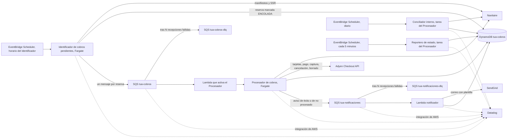
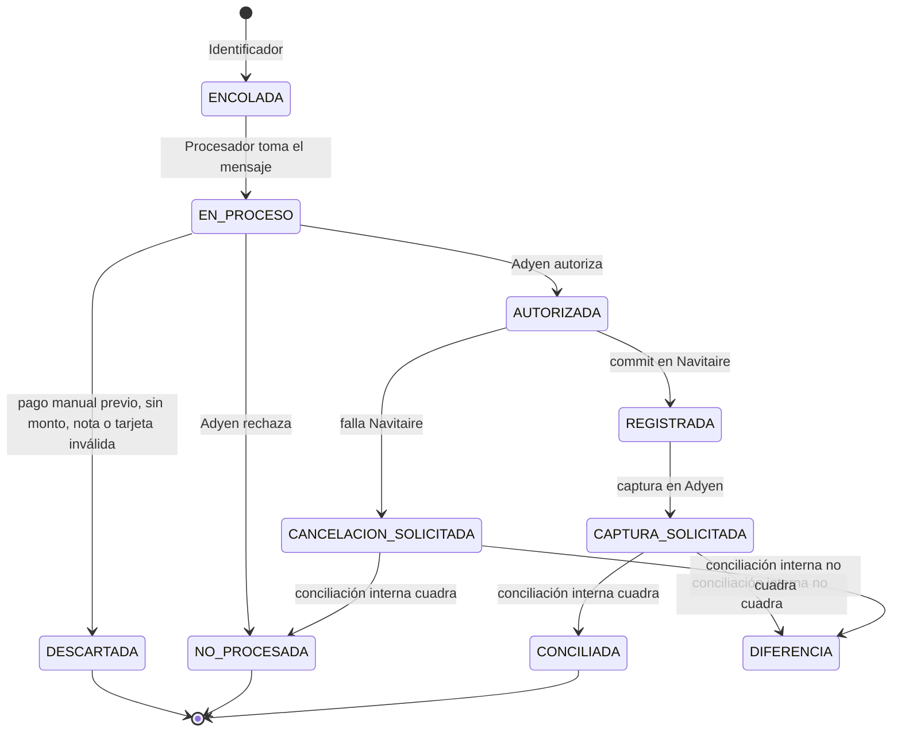

# Pago programado de la TUA — diseño técnico

Documento técnico del equipo. Describe cómo se construye la solución de la propuesta
(`v1/propuesta-viva-scheduled-payment-v1-*.html`) y cómo se garantiza el monitoreo en Datadog que en ella se
compromete: tablero, embudo y 10 monitores. Se apoya en `analisis.md`, que guarda las fuentes, los riesgos
(R1 a R10) y los criterios de Definition of Ready (DOR).

**Decisiones de partida** (sesión con Héctor y ajustes posteriores, 2026-11-18):

| Tema | Decisión |
| --- | --- |
| Universo | Solo reservas con el SSR `VTUP` (pago programado) |
| Cobro | Uno por reserva, por todos sus journeys y pasajeros. El monto del comentario de TUA es por pasajero |
| Fallo | Un solo intento: si el cobro no se puede procesar, se cancela lo autorizado, se avisa al cliente y no se hace nada más |
| Adyen | Checkout API directa, sin webhooks. Captura y cancelación quedan como "solicitadas"; la confirmación del lado de Adyen la hace Viva en su conciliación financiera |
| Conciliación | Interna: el estado de cada cobro contra Navitaire, que controlamos por completo |
| Notificaciones | Desacopladas: el Procesador publica el aviso en una cola SQS y una Lambda lo envía por SendGrid, con reintentos y DLQ propia |
| Transporte | SQS con DLQ; la cola de Navitaire no se usa |
| Stack | NestJS (TypeScript) en ECS Fargate, Lambda en TypeScript, Terraform, Sonar de Viva, Datadog |
| Ambiente | Desarrollo y TEST; Producción la despliega Viva con la misma IaC |
| Plazo | 5 semanas; la semana 4 es para el monitoreo |

## 1. Arquitectura



| Componente | Qué hace | Cómo se despliega |
| --- | --- | --- |
| EventBridge Scheduler | Dispara el Identificador (horario de Viva), el Conciliador (diario) y el Reportero de estado (cada 5 minutos) | Terraform |
| Identificador de cobros pendientes | Encuentra las reservas con `VTUP` cuyo vuelo cae en la ventana del bundle y las encola | Servicio NestJS en ECS Fargate, endpoint interno `POST /identificador/corridas` (acepta `fecha` para re-ejecutar) |
| SQS `tua-cobros` y `tua-cobros-dlq` | Transporte entre el Identificador y el Procesador. Tras N recepciones fallidas el mensaje pasa a la DLQ | Terraform |
| Lambda que activa el Procesador | Toma los mensajes de `tua-cobros` y llama al endpoint del Procesador; si falla, el mensaje vuelve a la cola | Terraform. Alternativa más simple: que el Procesador consuma SQS directamente |
| Procesador de cobros | Relee la reserva, cobra en Adyen con transacción compensada, registra en Navitaire y publica el aviso al cliente | Servicio NestJS en ECS Fargate, endpoint interno `POST /procesador/cobros` |
| SQS `tua-notificaciones` y `tua-notificaciones-dlq` | Desacopla el envío de correos del cobro. Tras N recepciones fallidas el aviso pasa a su DLQ | Terraform |
| Lambda notificador | Consume `tua-notificaciones`, envía el correo por SendGrid con la plantilla de Viva y maneja los reintentos | Lambda en TypeScript, con la extensión y la librería de Datadog |
| Conciliador interno | Verifica que cada captura solicitada esté registrada en Navitaire y cada cancelación no | Tarea del Procesador, endpoint interno `POST /procesador/conciliaciones` |
| Reportero de estado | Lee DynamoDB y publica los gauges que alimentan el monitor de cobros sin cerrar | Tarea del Procesador, endpoint interno `POST /procesador/reportes-estado` |
| DynamoDB | Estado de cada cobro, de cada aviso y de cada corrida | Terraform |
| Secrets Manager, KMS | Credenciales de Navitaire, Adyen, SendGrid y Datadog | Terraform |
| Agente de Datadog | Contenedor auxiliar en cada tarea de Fargate: métricas, trazas y logs | Definición de tarea en Terraform (sección 7.2) |

Los endpoints son internos: no hay ingreso público. La salida hacia Navitaire, Adyen, SendGrid y Datadog va por
NAT. Si alguno exige IP fija, Viva la registra.

**Por qué desacoplar las notificaciones:** si SendGrid falla o responde lento, el cobro no se detiene ni se
reintenta. El aviso queda en su cola y se reintenta por su cuenta, sin riesgo de volver a cobrar. Además el
envío escala y se monitorea aparte.

### 1.1 Contratos que se consumen

Se entregan congelados el día 1 (lámina "Contratos congelados" de la propuesta). Cualquier cambio posterior es
control de cambios.

| Sistema | Operación | Usada por |
| --- | --- | --- |
| Navitaire | Búsqueda de vuelos por fecha (`manifestSearch` o `trip/info/legs/simple`) | Identificador |
| Navitaire | Manifiesto de SSR por leg (`manifestSsrs`) | Identificador |
| Navitaire | Consulta de la reserva por `recordLocator` | Procesador, Conciliador |
| Navitaire | Baja de SSR (`ssrsDelete`), alta de SSR (`ssrsAddManual`), `paymentAdd`, commit | Procesador |
| Adyen Checkout | `GET /storedPaymentMethods` | Procesador |
| Adyen Checkout | `POST /payments` con captura manual | Procesador |
| Adyen Checkout | `POST /payments/{pspReference}/captures` y `/cancels` | Procesador |
| Adyen Checkout | `DELETE /storedPaymentMethods/{id}` | Procesador (escenario 1) |
| SendGrid | Envío con ID de plantilla y sus parámetros | Lambda notificador |
| Generic API | Formato de la nota de `VTUP`, comentario `TUA|out|in|total` por pasajero, SSR que deja en la reserva | Identificador, Procesador |

## 2. Modelo de datos

### 2.1 Tabla `tua-cobros`

Un registro por reserva. Es la fuente de verdad del estado del cobro, de la idempotencia y de los gauges.

| Atributo | Contenido |
| --- | --- |
| `pk` | `RESERVA#{recordLocator}` |
| `estado` | Ver 2.3 |
| `corridaId`, `fechaObjetivo`, `bundle` | Corrida del Identificador que la encoló, fecha de vuelo que la disparó y bundle de ese journey |
| `escenario` | `un_solo_uso` (escenario 1) o `guardada` (escenarios 2 y 3), según la nota de `VTUP` |
| `pasajeros`, `montoPorPasajero`, `montoTotal`, `moneda` | `montoTotal = montoPorPasajero × pasajeros con VTUP` (confirmar en DOR-30) |
| `pspReference` | Referencia de Adyen del pago autorizado |
| `motivo` | Motivo de descarte o de no procesado |
| `encoladaEn`, `autorizadaEn`, `registradaEn`, `capturaSolicitadaEn`, `conciliadaEn` | Marcas de tiempo por transición |
| `aviso` | `publicado`, `enviado` o `sin_enviar`, con su marca de tiempo |
| `tarjetaBorrada` | Resultado del borrado del token (escenario 1) |
| `correlationId` | Une logs, trazas y eventos de la reserva |

No se guardan datos de tarjeta ni datos personales: solo referencias de Adyen y de Navitaire.

**Índice secundario `estado-actualizado`** (`estado`, `actualizadoEn`): lo usan el Reportero de estado y el
Conciliador para contar y recorrer cobros por estado sin barrer la tabla.

### 2.2 Tabla `tua-corridas`

Un registro por corrida del Identificador, del Conciliador y del Reportero: `corridaId`, `tipo`, `fecha`,
`iniciadaEn`, `finalizadaEn`, `resultado`, contadores. Sirve para la re-ejecución por fecha y para auditar.

### 2.3 Estados del cobro



Cada transición es un `UpdateItem` condicionado al estado anterior. Si la condición falla, otro proceso ya
avanzó el cobro y el actual se detiene. Esto protege contra la entrega "al menos una vez" de SQS y contra dos
instancias del Procesador con el mismo mensaje.

`CONCILIADA` significa que el cobro y la reserva cuadran en nuestro lado: captura solicitada en Adyen y `VTUA`
con el pago registrado en Navitaire. Que el dinero se haya liquidado lo confirma Viva en su conciliación
financiera con Adyen.

## 3. Mensajes de SQS

**`tua-cobros`** (Identificador → Procesador):

```json
{
  "version": 1,
  "corridaId": "id-2026-12-01T06:00",
  "correlationId": "c8f2…",
  "recordLocator": "ABC123",
  "fechaObjetivo": "2026-12-10",
  "bundle": "smart",
  "encoladaEn": "2026-11-30T06:03:12Z"
}
```

Sin tarjeta, sin monto y sin datos personales: el Procesador relee todo en Navitaire. Así un mensaje viejo no
puede cobrar con datos desactualizados (R9).

**`tua-notificaciones`** (Procesador → Lambda notificador):

```json
{
  "version": 1,
  "correlationId": "c8f2…",
  "recordLocator": "ABC123",
  "tipo": "exito",
  "plantillaId": "d-…",
  "parametros": { "monto": "2634.70", "moneda": "MXN" }
}
```

El destinatario no viaja en el mensaje: la Lambda lo obtiene de la reserva en Navitaire o de lo que acuerde
Viva para las plantillas (pendiente de definir con el ID de plantilla). Así la cola no guarda datos personales.

## 4. Identificador de cobros pendientes

1. EventBridge llama a `POST /identificador/corridas`. Se registra la corrida y se emite
   `tua.identificador.corrida.iniciada`.
2. Calcula las fechas de vuelo: hoy + 10 (SMART), + 6 (SWITCH) y + 1 (ZERO). La regla es configurable.
3. Por cada fecha busca los vuelos en Navitaire y, por cada leg, lee el manifiesto de SSR.
4. Toma los pasajeros con `VTUP`, verifica que sigan con `VTUB` y agrupa por `recordLocator`. Una reserva con
   varios journeys o pasajeros es una sola candidata.
5. Por cada candidata hace `PutItem` en `tua-cobros` con condición "no existe". Si ya existe, la omite: ya fue
   encolada o procesada antes (incluido un cobro no procesado, que no se vuelve a intentar).
   Así el cobro se hace **una única vez por reserva**, en la primera fecha que se cumpla entre sus journeys,
   aunque ida y vuelta tengan bundles distintos.
6. Encola el mensaje en SQS, en lotes de hasta 10.
7. En el bloque `finally` registra el fin de la corrida y emite `tua.identificador.corrida.finalizada` con su
   resultado. Si el proceso muere, no hay evento de fin y el monitor de "no corrió" lo detecta (sección 7.6).

**Re-ejecución:** el mismo endpoint con `fecha` explícita. La condición del paso 5 evita duplicados.
**Concurrencia:** número de llamadas simultáneas a Navitaire configurable, con espera exponencial ante rechazos
por límite (R7).
**Si `PutItem` funciona y el envío a SQS falla:** se reintenta el envío. Si sigue fallando, el registro queda en
`ENCOLADA` sin mensaje; el Reportero lo cuenta en "cobros sin cerrar" pasado el umbral.

## 5. Procesador de cobros

| Paso | Acción | Transición | Si falla |
| --- | --- | --- | --- |
| 1 | Toma el mensaje y marca el cobro | `ENCOLADA → EN_PROCESO` | Condición fallida: ya lo procesa otro, se descarta el mensaje |
| 2 | Relee la reserva en Navitaire | — | Error técnico: excepción, el mensaje vuelve a SQS y, tras N veces, va a la DLQ |
| 3 | Sin `VTUP`: el cliente ya pagó | `→ DESCARTADA` (`pago_manual_previo`) | — |
| 4 | Lee el monto por pasajero del comentario de TUA | Si no está, no se procesa y se marca como fallido: `→ DESCARTADA` (`sin_monto`), sin cobro ni aviso al cliente | — |
| 5 | Lee la nota de `VTUP`: `basketId` o `TUA-{basketId}` (GUID) es escenario 1; `customerNumber` es escenario 2 o 3 | `→ DESCARTADA` (`nota_invalida`) si no es ninguno | — |
| 6 | `GET /storedPaymentMethods` con el `shopperReference`; elige la tarjeta del `FirstPspReference` | `→ DESCARTADA` (`tarjeta_no_encontrada`) si no está | Error técnico: reintento de SQS |
| 7 | `POST /payments` sin CVV, captura manual, `idempotency-key = {recordLocator}-autorizar` | `→ AUTORIZADA` o `→ NO_PROCESADA` (`rechazo`) | Timeout: se reintenta con la misma llave; Adyen devuelve el mismo resultado |
| 8 | En la sesión de Navitaire: baja de `VTUB` y `VTUP`, alta de `VTUA` por pasajero y journey, `paymentAdd`, commit | `→ REGISTRADA` | `POST /cancels` (`{recordLocator}-cancelar`), `→ CANCELACION_SOLICITADA` |
| 9 | Commit sin respuesta | — | Relee la reserva: con `VTUA` sigue al paso 10; sin `VTUA`, cancela como en el paso 8 |
| 10 | `POST /captures` (`{recordLocator}-capturar`) | `→ CAPTURA_SOLICITADA` | Se reintenta la captura; nunca la autorización |
| 11 | Escenario 1: `DELETE /storedPaymentMethods/{id}` | `tarjetaBorrada` | Se registra la falla; no detiene el cobro |
| 12 | Publica el aviso en `tua-notificaciones`: `exito` (paso 10) o `no_procesado` (pasos 7 y 8) | `aviso = publicado` | Error al publicar: se reintenta; el cobro no se revierte |

Un cobro no procesado no se reintenta y no se hace nada más sobre la reserva: `VTUB` sigue y el cliente paga
manualmente, como hoy. Los descartes (pasos 3 a 6) no generan aviso, salvo que Viva lo pida al definir las
plantillas.

### 5.1 Lambda notificador

1. Lambda recibe un lote de `tua-notificaciones`.
2. Por cada aviso revisa en `tua-cobros` que `aviso` no esté ya en `enviado`. Si lo está, el mensaje es un
   duplicado de SQS y se descarta sin reenviar.
3. Llama a SendGrid con el ID de plantilla y los parámetros.
4. **Aceptado:** marca `aviso = enviado` (actualización condicionada) y emite `tua.correo.envio{resultado:enviado}`.
5. **Error temporal** (timeout, 429 o 5xx): emite `resultado:reintento` y devuelve el mensaje como fallido. La
   Lambda usa respuestas parciales de lote (`ReportBatchItemFailures`), así solo ese aviso vuelve a la cola y se
   reintenta cuando vence su tiempo de visibilidad.
6. **Error permanente** (por ejemplo, plantilla inexistente): emite `resultado:rechazado`, marca
   `aviso = sin_enviar` y devuelve el mensaje como fallido. Tras N recepciones pasa a `tua-notificaciones-dlq`
   para revisión.

El comportamiento de reintento, visibilidad y respuestas parciales es el que documenta AWS para Lambda con SQS
([manejo de errores con SQS](https://docs.aws.amazon.com/lambda/latest/dg/services-sqs-errorhandling.html)).
N, la visibilidad y la concurrencia de la Lambda se fijan en la semana 3.

## 6. Conciliador interno y Reportero de estado

**Conciliador interno (diario):** recorre por el índice los cobros en `CAPTURA_SOLICITADA` y
`CANCELACION_SOLICITADA` del día anterior y relee cada reserva en Navitaire:

| Estado en `tua-cobros` | Navitaire | Resultado |
| --- | --- | --- |
| `CAPTURA_SOLICITADA` | Con `VTUA` y pago registrado | `CONCILIADA` |
| `CANCELACION_SOLICITADA` | Sin `VTUA` | `NO_PROCESADA` |
| Cualquier otra combinación | | `DIFERENCIA`, con su motivo |

No consulta Adyen: la confirmación de la liquidación del lado de Adyen es de Viva. Todo lo que el Conciliador
compara lo controlamos.

**Reportero de estado (cada 5 minutos):** cuenta por el índice y publica gauges. El monitor de cobros sin
cerrar lee estos gauges y no depende de que un servicio haya emitido un evento en el momento del fallo. Si el
Reportero deja de correr, el monitor pasa a "sin datos" y avisa (sección 7.6).

## 7. Observabilidad en Datadog

### 7.1 Principios

1. **Métricas agregadas, no registros.** Contadores y gauges con pocas etiquetas. Una reserva puntual se busca en
   los logs por `recordLocator` o `correlationId`.
2. **Un evento por transición, emitido después de persistirla.** El evento sale solo si el `UpdateItem`
   condicionado tuvo éxito. Un mensaje repetido de SQS no cuenta dos veces.
3. **Silencio también alerta.** Lo que debe ocurrir periódicamente (corrida del Identificador, Reportero,
   Conciliador) tiene un monitor que avisa si no llega.
4. **Lo crítico no depende del código que falla.** Las DLQ y las colas salen de la integración de AWS; los
   cobros sin cerrar, del Reportero leyendo DynamoDB.
5. **Solo lo que controlamos.** No hay widgets ni monitores sobre la liquidación en Adyen ni sobre la entrega
   final de los correos.
6. **Privacidad.** Ni datos de tarjeta ni datos personales en métricas, logs o trazas.

### 7.2 Cómo llegan los datos a Datadog

| Dato | Mecanismo | Referencia |
| --- | --- | --- |
| Métricas propias de Fargate | DogStatsD por UDP 8125 hacia el agente de Datadog, que corre como contenedor auxiliar en la misma tarea (`ECS_FARGATE=true`) | [Datadog en ECS Fargate](https://docs.datadoghq.com/integrations/ecs_fargate/) |
| Trazas de Fargate | APM del mismo agente (`DD_APM_ENABLED=true`); la aplicación usa `localhost` | Misma referencia |
| Logs de Fargate | FireLens con `aws-for-fluent-bit` hacia Datadog | Misma referencia |
| Métricas, trazas y logs de la Lambda | Librería de Datadog para el runtime más la extensión de Datadog para Lambda | [Datadog para AWS Lambda](https://docs.datadoghq.com/serverless/aws_lambda/) |
| Métricas de SQS | Integración de AWS: `aws.sqs.approximate_number_of_messages_visible` y `aws.sqs.approximate_age_of_oldest_message` | [Integración de SQS](https://docs.datadoghq.com/integrations/amazon_sqs/) |
| Latencias | Métricas de distribución, con percentiles globales (p95) | [Distribuciones](https://docs.datadoghq.com/metrics/distributions/) |

En NestJS y en la Lambda, un único `MetricsService` envuelve el cliente de métricas y fija los nombres y las
etiquetas permitidas: nadie emite métricas fuera de él. Un interceptor del cliente HTTP compartido emite las
métricas de integración de toda llamada a Navitaire, Adyen y SendGrid.

### 7.3 Etiquetas permitidas

| Etiqueta | Valores | Dónde |
| --- | --- | --- |
| `env` | `dev`, `test` | Todas |
| `service` | `tua-identificador`, `tua-procesador`, `tua-notificador` | Todas |
| `bundle` | `smart`, `switch`, `zero` | Encolado y cobro |
| `escenario` | `un_solo_uso`, `guardada` | Cobro |
| `evento` | `autorizado`, `rechazado`, `registrado`, `captura_solicitada`, `cancelacion_solicitada` | `tua.cobro.evento` |
| `motivo` | `pago_manual_previo`, `sin_monto`, `nota_invalida`, `tarjeta_no_encontrada` | Descartes |
| `tipo` | `exito`, `no_procesado` | Avisos y correos |
| `integracion`, `operacion` | `navitaire`, `adyen`, `sendgrid`; nombre corto de la operación | Integraciones |
| `resultado` | `ok`, `error`, `limite`, `enviado`, `reintento`, `rechazado` | Corridas, integraciones, correo, borrado |

Prohibidas en métricas: `recordLocator`, `basketId`, `customerNumber`, `pspReference`, correo del cliente.
Ejemplo de cardinalidad: `tua.cobro.evento` tiene 5 eventos × 3 bundles × 2 escenarios × 2 ambientes = 60 series.

### 7.4 Catálogo de eventos

**Identificador de cobros pendientes**

| Métrica | Tipo | Cuándo se emite | Etiquetas |
| --- | --- | --- | --- |
| `tua.identificador.corrida.iniciada` | count | Al empezar la corrida | — |
| `tua.identificador.corrida.finalizada` | count | En el `finally` de la corrida | `resultado` |
| `tua.identificador.corrida.duracion` | distribution (s) | En el `finally` | `resultado` |
| `tua.identificador.legs_revisados` | count | Por cada manifiesto leído | `bundle` |
| `tua.identificador.candidatas` | count | Por cada reserva con `VTUP` y `VTUB` | `bundle` |
| `tua.identificador.encoladas` | count | Al enviar el mensaje a SQS | `bundle` |
| `tua.identificador.omitidas` | count | Si la reserva ya existía en `tua-cobros` | `bundle` |

**Procesador de cobros**

| Métrica | Tipo | Cuándo se emite | Etiquetas |
| --- | --- | --- | --- |
| `tua.procesador.recibidas` | count | Tras `ENCOLADA → EN_PROCESO` | `bundle` |
| `tua.procesador.descartadas` | count | Tras `→ DESCARTADA` | `motivo`, `bundle` |
| `tua.cobro.evento` | count | Tras cada transición de cobro | `evento`, `bundle`, `escenario` |
| `tua.cobro.no_procesado` | count | Tras `→ NO_PROCESADA` o `→ CANCELACION_SOLICITADA` en el Procesador | `bundle`, `escenario` |
| `tua.cobro.monto_capturado` | count (valor en MXN) | Tras `→ CAPTURA_SOLICITADA`, con el monto | `bundle` |
| `tua.tarjeta.borrado` | count | Tras el `DELETE` del token (escenario 1) | `resultado` |
| `tua.notificacion.publicada` | count | Tras publicar el aviso en `tua-notificaciones` | `tipo` |

**Lambda notificador**

| Métrica | Tipo | Cuándo se emite | Etiquetas |
| --- | --- | --- | --- |
| `tua.correo.envio` | count | Tras cada intento de envío a SendGrid | `resultado` (`enviado`, `reintento`, `rechazado`), `tipo` |

**Todos los servicios (interceptor HTTP)**

| Métrica | Tipo | Cuándo se emite | Etiquetas |
| --- | --- | --- | --- |
| `tua.integracion.llamada` | count | Toda llamada a Navitaire, Adyen o SendGrid | `integracion`, `operacion`, `resultado` (`ok`, `error`, `limite`) |
| `tua.integracion.latencia` | distribution (ms) | Toda llamada | `integracion`, `operacion` |

**Conciliador interno y Reportero de estado**

| Métrica | Tipo | Cuándo se emite | Etiquetas |
| --- | --- | --- | --- |
| `tua.conciliacion.corrida` | count | Al terminar la conciliación diaria | `resultado` |
| `tua.conciliacion.conciliadas` | count | Por cada cobro que pasa a `CONCILIADA` o se confirma cancelado | `tipo` (`captura`, `cancelacion`) |
| `tua.conciliacion.diferencias` | gauge | Al terminar: cobros en `DIFERENCIA` | — |
| `tua.estado.sin_cerrar` | gauge | Cada 5 minutos: `EN_PROCESO`, `AUTORIZADA` o `REGISTRADA` con más del umbral, y `ENCOLADA` sin procesar | — |

**Logs.** Cada transición y cada error se registra también como log JSON con el mismo nombre de evento,
`correlationId`, `recordLocator`, `estado` y `motivo`. En logs sí va el `recordLocator`, para buscar una reserva;
nunca datos de tarjeta ni personales. Se indexan errores, rechazos, descartes y una muestra de los exitosos.

### 7.5 Trazabilidad: tablero → fuente

| Widget del tablero | Consulta (resumen) | Fuente |
| --- | --- | --- |
| Cobros del día | `sum` de `tua.cobro.evento{evento:captura_solicitada}` en el día | Procesador |
| Tasa de éxito | `captura_solicitada / tua.procesador.recibidas` | Procesador |
| Monto cobrado (captura solicitada) | `sum` de `tua.cobro.monto_capturado` | Procesador |
| Cobros sin cerrar | `tua.estado.sin_cerrar` | Reportero |
| Descartadas | `sum` de `tua.procesador.descartadas` | Procesador |
| Mensajes en la DLQ | `aws.sqs.approximate_number_of_messages_visible{queuename:tua-cobros-dlq}` | AWS |
| Embudo: encoladas | `tua.identificador.encoladas` | Identificador |
| Embudo: procesadas | `tua.procesador.recibidas` | Procesador |
| Embudo: registradas | `tua.cobro.evento{evento:registrado}` | Procesador |
| Embudo: cobradas | `tua.cobro.evento{evento:captura_solicitada}` | Procesador |
| Embudo: descartadas por motivo | `tua.procesador.descartadas` por `motivo` | Procesador |
| Embudo: no procesadas | `tua.cobro.no_procesado` | Procesador |
| Cobros por hora y resultado | `tua.cobro.evento` por `evento`, por hora | Procesador |
| Identificador, última corrida | `tua.identificador.corrida.duracion`, `legs_revisados`, `encoladas` por `bundle`, errores de `tua.integracion.llamada{service:tua-identificador,integracion:navitaire}` | Identificador |
| Cola de cobros | `aws.sqs.approximate_number_of_messages_visible` y `aws.sqs.approximate_age_of_oldest_message` de `tua-cobros` | AWS |
| Integraciones | p95 de `tua.integracion.latencia` y errores de `tua.integracion.llamada`, por `integracion` | Todos los servicios |
| Conciliación interna | `tua.conciliacion.conciliadas`, `tua.conciliacion.diferencias` | Conciliador |
| Notificaciones | `tua.notificacion.publicada`, `tua.correo.envio` por `resultado`, y mensajes en `tua-notificaciones-dlq` | Procesador, Lambda, AWS |
| Tarjetas de un solo uso | `tua.tarjeta.borrado` por `resultado` | Procesador |

### 7.6 Trazabilidad: monitores → fuente

| # | Monitor | Condición (resumen) | Fuente | Cubre |
| --- | --- | --- | --- | --- |
| 1 | Identificador no corrió | `tua.identificador.corrida.finalizada{resultado:ok}` < 1 en la ventana del horario, o cualquier `resultado:error` | Identificador | Requerimiento |
| 2 | Nota, tarjeta o monto inválidos | `tua.procesador.descartadas{motivo:nota_invalida OR tarjeta_no_encontrada OR sin_monto}` > 0 | Procesador | Requerimiento, R8 |
| 3 | Cola atascada | `aws.sqs.approximate_age_of_oldest_message{queuename:tua-cobros}` > umbral | AWS | Operación |
| 4 | Mensajes en la DLQ | `aws.sqs.approximate_number_of_messages_visible{queuename:tua-cobros-dlq}` > 0 | AWS | Operación |
| 5 | Cobros sin cerrar | `tua.estado.sin_cerrar` > 0, avisa también si no llegan datos | Reportero | R6 |
| 6 | Diferencias internas | `tua.conciliacion.diferencias` > 0, o `tua.conciliacion.corrida` ausente en 25 h | Conciliador | R6 |
| 7 | Errores de Navitaire o Adyen | `tua.integracion.llamada{resultado:error OR limite}` por `integracion` > umbral | Todos los servicios | R7 |
| 8 | Rechazos fuera de lo normal | Monitor de anomalías sobre `rechazado / recibidas` | Procesador | Operación |
| 9 | Correos sin enviar | `aws.sqs.approximate_number_of_messages_visible{queuename:tua-notificaciones-dlq}` > 0 | AWS | Cliente |
| 10 | Falla al borrar tarjeta | `tua.tarjeta.borrado{resultado:error}` > 0 | Procesador | Escenario 1 |

Para las métricas de AWS se configura un retraso de evaluación: Datadog recomienda 15 minutos para métricas de
nube, que el proveedor completa con retraso. Los monitores de silencio usan la opción "Show NO DATA and notify"
([configuración de monitores](https://docs.datadoghq.com/monitors/configuration/),
[monitores de métrica y anomalías](https://docs.datadoghq.com/monitors/types/metric/)).

### 7.7 Por qué con estos eventos el monitoreo queda garantizado

1. **Cobertura completa.** Las tablas 7.5 y 7.6 dan a cada widget y a cada monitor al menos una fuente, y cada
   fuente tiene un emisor y un momento de emisión en 7.4. No hay widget sin dato ni monitor sin fuente.
2. **Todos los caminos emiten.** Cada estado final del diagrama 2.3 (`DESCARTADA`, `NO_PROCESADA`,
   `CAPTURA_SOLICITADA`, `CANCELACION_SOLICITADA`, `CONCILIADA`, `DIFERENCIA`) tiene su evento. Los caminos sin
   estado final (excepción técnica) quedan en `EN_PROCESO` o en una DLQ, y los cubren los monitores 4, 5 y 9, que
   no dependen del proceso que falló.
3. **El embudo cuadra.** Cada día se cumplen tres igualdades:
   - `encoladas = recibidas + en cola`
   - `recibidas = descartadas + no procesadas + registradas + en curso`
   - `avisos publicados = enviados + en cola de notificaciones + en su DLQ`

   Si una no cierra, falta un evento o algo quedó atascado. La prueba de monitoreo (punto 6) las verifica, y los
   monitores 5 y 9 avisan del atasco.
4. **Sin dobles conteos.** El evento sale después del `UpdateItem` condicionado. Un reintento de SQS que
   encuentra la transición hecha no emite nada, y la Lambda no reenvía un aviso ya enviado.
5. **El silencio avisa.** Los monitores 1, 5 y 6 alertan si su métrica no llega. Si muere el Identificador, el
   Reportero o el Conciliador, se sabe.
6. **Prueba de monitoreo antes de la aceptación (semana 4).** En TEST se fuerza cada caso y se comprueba que el
   widget se mueve y el monitor dispara:

   | Caso forzado en TEST | Se debe ver |
   | --- | --- |
   | Cobro exitoso en los tres escenarios | Embudo completo, monto, aviso publicado y enviado, tarjeta borrada (escenario 1) |
   | Tarjeta de prueba rechazada | `no_procesado`, aviso de no procesado enviado, datos del monitor 8 |
   | Nota inválida, tarjeta inexistente, comentario sin monto | Descartes por motivo, monitor 2 |
   | Reserva pagada manualmente antes de procesarla | Descarte `pago_manual_previo` |
   | Navitaire falla después de autorizar | `cancelacion_solicitada`, aviso de no procesado |
   | Error técnico repetido en el Procesador | Mensaje en la DLQ de cobros, monitor 4 |
   | Procesador detenido con mensajes en la cola | Monitor 3 y, pasado el umbral, monitor 5 |
   | Identificador sin correr en su horario | Monitor 1 |
   | Reportero o Conciliador detenidos | Monitores 5 o 6 en "sin datos" |
   | SendGrid de prueba con errores temporales | `resultado:reintento` y luego `enviado` |
   | Plantilla inexistente en SendGrid | `resultado:rechazado`, aviso en la DLQ de notificaciones, monitor 9 |
   | Borrado de token con error del simulador de Adyen | Monitor 10 |
   | Reserva modificada a mano para que no cuadre | Monitor 6 |
   | Llamadas rechazadas por límite en el simulador de Navitaire | Monitor 7 |

7. **Pruebas unitarias de emisión.** Con un doble del `MetricsService`, cada camino del Identificador, del
   Procesador y de la Lambda verifica qué eventos emite y cuáles no. Una prueba falla si se agrega un camino sin
   evento.

### 7.8 Límites que hay que conocer

| Límite | Consecuencia | Cómo se maneja |
| --- | --- | --- |
| SendGrid confirma que aceptó el correo, no que llegó | "Enviado" significa aceptado por SendGrid; los rebotes posteriores no se ven | Ver rebotes exige el Event Webhook de SendGrid, con ingreso público: fuera de alcance |
| La liquidación en Adyen no la vemos | "Monto cobrado" es monto con captura solicitada; la conciliación es interna | La confirmación del lado de Adyen la hace Viva en su conciliación financiera |
| Métricas de AWS con retraso | Los monitores 3, 4 y 9 no son instantáneos | Retraso de evaluación de 15 minutos, como recomienda Datadog |
| El monitor de anomalías necesita historia | En TEST, con poco volumen, el monitor 8 no es representativo | Se deja configurado; se ajusta en Producción |
| Umbrales | No hay datos de volumen | Se acuerdan con Viva en la semana 4 y se ajustan con datos reales |

## 8. Terraform

| Módulo | Contenido |
| --- | --- |
| `red` | Subredes, grupos de seguridad y salida NAT sobre la VPC de Viva |
| `datos` | Tablas `tua-cobros` y `tua-corridas`, índice `estado-actualizado`, cifrado con KMS |
| `mensajeria` | `tua-cobros` y `tua-notificaciones` con sus DLQ, políticas de reintento, la Lambda que activa el Procesador y la Lambda notificador con respuestas parciales de lote |
| `servicios` | ECR, clúster y servicios de ECS Fargate, con el agente de Datadog y FireLens en cada tarea |
| `programacion` | Tres horarios de EventBridge Scheduler |
| `secretos` | Secrets Manager e IAM de mínimo privilegio |
| `datadog` | Integración de AWS, tablero, 10 monitores, índice y filtros de logs |

El módulo `datadog` usa el proveedor oficial de Datadog para Terraform, que tiene recursos para monitores,
tableros, integración de cuentas de AWS, índices de logs y métricas generadas desde logs
([recursos del proveedor](https://github.com/DataDog/terraform-provider-datadog/tree/master/docs/resources)).
Así el tablero y los monitores se versionan y se promueven igual que la infraestructura.

## 9. Seguridad y calidad

- Sin datos de tarjeta en el servicio, en DynamoDB, en mensajes, en logs ni en métricas: solo tokens y
  referencias. Los avisos no llevan el correo del cliente.
- Enmascaramiento de logs en el cliente HTTP compartido (cuerpos de Adyen, Navitaire y SendGrid).
- Secretos en Secrets Manager, cifrado con KMS, IAM de mínimo privilegio, sin endpoints públicos.
- Análisis de calidad en el Sonar de Viva dentro del pipeline; pruebas unitarias en cada historia.

## 10. Pendientes que afectan este diseño

| Pendiente | Afecta | Referencia |
| --- | --- | --- |
| Formato del escenario 1: `basketId` o `TUA-{basketId}` | Paso 5 del Procesador | DOR-01 |
| Campos de `paymentAdd` y cargo de `VTUA` por pasajero | Paso 8 del Procesador | DOR-16, DOR-30 |
| Pasajeros que suman al monto (todos o solo con `VTUP`) | `montoTotal` | DOR-30 |
| ID de plantilla, parámetros y de dónde sale el destinatario | Lambda notificador | DOR-08 |
| Organización de Datadog, integración de AWS, API keys, canal y umbrales | Sección 7 | Prerrequisito de la semana 4 |
| ¿Se borra la tarjeta de un solo uso si el cobro no se procesa? | Paso 11 | DOR-07 |
| Lambda que activa el Procesador o consumo directo de SQS | Módulo `mensajeria` | Decisión técnica de la semana 1 |
