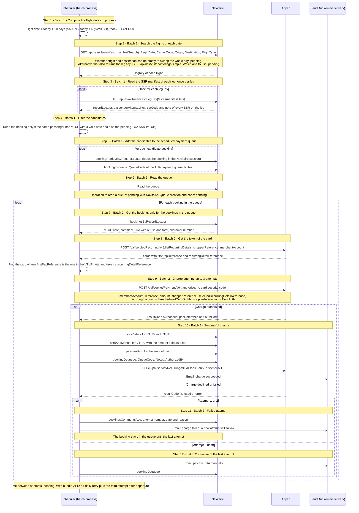
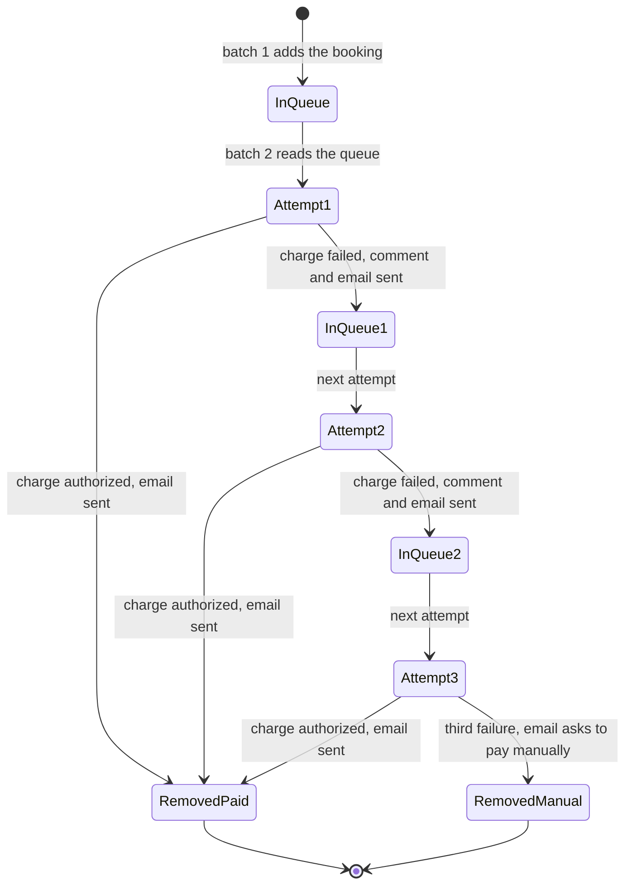

# Batch \- Scheduled Payment

# 0. Document Status

| Field | Value |
| --- | --- |
| Status | DRAFT |
| Tech Lead | Héctor Rodríguez |
| Target Epic | [ECOM25-801](https://vivaaerobus.atlassian.net/browse/ECOM25-801) |
| Ready for Dev? | NOT YET |
| Last updated | 2026-11-13 |

# 1. Business Context REQUIRED

## 1.1 Problem statement

Create a reservation **without paying the TUA**, where the scheduled payment date is set from the flight departure date and the bundle (SMART 10 days before, SWITCH 6 days before, ZERO 1 day before), and charge the TUA later through a scheduled process, using the card the customer provided when creating the reservation. Three scenarios: (1) the customer pays with a new card and does not save it, (2) the customer pays with a new card and saves it, (3) the customer pays with an already stored card. A single payment processor (Adyen) is used.

This document contains only the scope for the batch process. The reservation is created by Generic API (see the Generic API document), which leaves in the reservation:

- the SSR `VTUP`, with the SSR note `basketid|FirstPspReference` (scenario 1) or `FirstPspReference` (scenarios 2 and 3);
- the pay-later SSR `VTUB`;
- the booking comment `TUA|out|in|total`, with the TUA amount.

## 1.2 Batch flow overview

| # | Batch | Step | Operation (swagger, GraphQL) | Result |
| --- | --- | --- | --- | --- |
| 1 | 1 | Compute the flight dates to process according to the bundle (+10, +6 or +1 days; see the rule on the window in Business Rules) | Internal to the scheduler | List of dates |
| 2 | 1 | Search the flights of each date | `GET /api/nsk/v2/manifest` (`manifestSearch`) | `legKey` of each flight |
| 3 | 1 | Read the SSR manifest of each leg, once per leg | `GET /api/nsk/v1/manifest/{legKey}/ssrs` (`manifestSsrs`) | `recordLocator`, `ssrCode` and `note` of each SSR |
| 4 | 1 | Filter the candidates: SSR `VTUP` with a valid note, the pending TUA SSR (`VTUB`) and the bundle SSR of the journey | Internal to the scheduler | Candidate bookings for the scheduled payment |
| 5 | 1 | Add the candidates to the scheduled payment queue | Navitaire queue (`bookingRetrieveByRecordLocator`, then `bookingEnqueue`) | Queue filled; end of batch 1 |
| 6 | 2 | Read the queue | Read operation | Bookings to charge |
| 7 | 2 | Get the booking, only for the bookings in the queue | `bookingsByRecordLocator` | `VTUP` note, TUA amount in TUA comment |
| 8 | 2 | Get the token of the card from the `FirstPspReference` of the note | Adyen `POST /pal/servlet/Recurring/v49/listRecurringDetails` | `recurringDetailReference` (token) |
| 9 | 2 | Charge attempt, up to N = 3 attempts | Adyen `POST /pal/servlet/Payment/v64/authorise`, no card security code | Charge authorized or declined |
| 10 | 2 | Successful charge: remove `VTUB` and `VTUP`, add `VTUA` with the amount paid as a fee, register the payment, remove from the queue, delete the card created for this payment (scenario 1) and send the success email | `ssrsDelete`, `ssrsAddManual`, `paymentAdd`, `bookingDequeue`, Adyen `disable`, SendGrid | Booking finalized |
| 11 | 2 | Failed attempt (1 or 2): record the attempt and notify the customer by email | `bookingsCommentsAdd` and SendGrid | The booking stays in the queue until attempt N |
| 12 | 2 | Failure of the last attempt: email to pay manually, remove `VTUP`, delete the card (scenario 1), remove from the queue and alert Operations | SendGrid, `ssrsDelete`, Adyen `disable`, `bookingDequeue` | Booking out of the queue |

# 2. Sequence Diagram REQUIRED

## 2.1 Sequence Diagram Batch Process




## 2.2 Life of a booking in the TUA payment queue




# 3. API Changes REQUIRED

## 3.1 Scheduled TUA charge scheduler

| Field | Value |
| --- | --- |
| URL | N/A — scheduled process |
| Method | N/A |
| Flows affected | Booking (post-creation) |
| Change type | New process |

### Execution Steps

The steps are the ones of the table in 1.2. Real operations are named as in the Navitaire swagger.

| Batch | Steps | Calls |
| --- | --- | --- |
| 1 | 1 to 5: flight dates, flights, SSR manifest, filter, queue | B.1 to B.3 |
| 2 | 6 to 12: read the queue, booking, token, charge and result | B.4 to B.10 |

### Business Rules

- **Candidate booking (step 4):** the same passenger has the SSR `VTUP` with a note and also the pending TUA SSR (`VTUB`).
- **SSR note of **`VTUP`: if it contains `|`, it is scenario 1 and the format is `basketid|FirstPspReference` or `customerid|FirstPspReference`. Otherwise it is scenario 2 or 3 and the note is the `FirstPspReference`.
- **Shopper reference (step 8):** scenario 1, the `basketid` of the note (the same value used in the first payment). Scenarios 2 and 3, the customer number of the booking. The exact value of scenario 1 (`basketid`) must be the one Generic API used in the first payment: to confirm.
- **TUA amount (step 9):** the total of the booking comment `TUA|out|in|total`. 
- **Attempts:** three charge attempts. Time between attempts: pending.

**Selection, attempts and edge cases**

| Topic | Rule | Status |
| --- | --- | --- |
| Window and dates | Batch 1 processes the flights with departure date from today up to today + N (N = 10 SMART, 6 SWITCH, 1 ZERO), not only the exact date, so a missed run is recovered by the next one. The range needs `GET /api/nsk/v2/trip/info/legs/simple` (`BeginDate` and `EndDate`); `manifestSearch` only has `BeginDate`. Generic API does not offer the scheduled payment when the charge date is today or has passed: the customer pays the TUA at that moment. | PROPOSAL, business to confirm |
| Bundle | The bundle of each journey is read from its bundle marker SSR in the SSR manifest: `VSMT` (SMART), `VWTH` (SWITCH), `VZRO` (ZERO). A booking is a candidate only if the days to departure of the journey are within N of its bundle. LIGHT (`VLIG`) and BASIC (`VEXT`) have no scheduled payment. | PROPOSAL; to verify that the manifest returns the bundle SSR |
| Round trips | `VTUB` and `VTUP` are per journey and the comment has one amount per journey. Each journey is charged on its own date and bundle: amount `out` for the first journey, `in` for the second. After the charge, `VTUB` and `VTUP` of that journey are removed, so the other journey keeps its own pair. Deduplication key: `recordLocator` + journey. | PROPOSAL; Generic API creates `VTUP` per journey and passenger |
| Time between attempts | Parameters in the Admin Portal: interval between attempts per bundle, and a cutoff in hours before departure. The third attempt runs before the cutoff, so with ZERO the interval is in hours and the batch runs several times a day. | Values: pending business |
| Three failed attempts | `VTUP` is removed (so the booking is not picked again); `VTUB` stays (check-in stays blocked and the customer pays with the existing pay-later flow); the card of scenario 1 is deleted; the booking leaves the queue; the customer gets the email and an alert with the `recordLocator` goes to Operations. | PROPOSAL; Operations channel: pending |
| Changes to the reservation | The TUA comment is written only when the reservation is paid. Any flow that changes the journeys or the passengers must remove `VTUP`: without `VTUP` there is no automatic charge and the customer pays with `VTUB`. A cancelled booking does not appear in the manifest. | PROPOSAL; scope in Generic API: pending |
| Missed run | The next run recovers the pending bookings (range rule). An alert is raised if the batch did not run, and a run can be repeated for a given date. | PROPOSAL |
| Duplicates | In a run, the candidates are deduplicated by `recordLocator` + journey after reading all the manifests (a connection appears in several legs). Between runs, a booking already in the queue is not queued again (needs the read operation of the queue). The attempt number comes from the booking comments. | PROPOSAL; depends on the queue read operation |

### Service Integrations

#### B.1 Step 2 — Navitaire: search the flights of the date

| Field | Value |
| --- | --- |
| Endpoint / operation | `GET /api/nsk/v2/manifest` (GraphQL `manifestSearch`). Agent-only endpoint. Alternative that also returns the `legKey`: `GET /api/nsk/v2/trip/info/legs/simple` |
| Request | `BeginDate` (target flight date), `CarrierCode`, `Origin`, `Destination`, `FlightType`. Whether `Origin` and `Destination` can be empty to sweep the whole day: pending |
| Response | Journeys, segments and legs; the `legKey` of each leg is used |

#### B.2 Step 3 — Navitaire: SSR manifest of each leg

| Field | Value |
| --- | --- |
| Endpoint / operation | `GET /api/nsk/v1/manifest/{legKey}/ssrs` (GraphQL `manifestSsrs`). Agent-only endpoint |
| Request | `legKey` in the path. `includeNonOriginSsrs` (optional): value to use pending |
| Response | List with `recordLocator`, `passengerAlternateKey`, `ssrCode` and `note` of each SSR on the leg |

The manifest has what the scheduler needs to filter (booking reference, SSR code, SSR note and passenger), so no booking is read before the queue. To confirm with Navitaire: pagination or size limits, and that the SSR note is returned complete.

#### B.3 Step 5 — Navitaire: add the candidates to the queue

`bookingRetrieveByRecordLocator` (loads the booking in the Navitaire session, required before the next call) and `bookingEnqueue` (`QueueCode` of the TUA payment queue, `Notes`). Only the candidates are loaded.

#### B.4 Step 6 — Navitaire: read the queue

Read the content of a queue. Operation, request and returned data. The queue and its code must also be created in Navitaire.

#### B.5 Step 7 — Navitaire: get the booking

| Field | Value |
| --- | --- |
| Endpoint / operation | `bookingsByRecordLocator` |
| Triggered when | For each booking in the queue |
| Data used | The `note` of the SSR `VTUP`, the comment \`TUA\\out\\in\\total`(example`TUA\\652.95\\0\\652.95\`) and the customer number |

#### B.6 Step 8 — Adyen: get the token of the card

Adyen `POST /pal/servlet/Recurring/v49/listRecurringDetails`. Adyen returns all the cards stored for the merchant account and the shopper reference.

| Request field | Value |
| --- | --- |
| `merchantAccount` | `VB_WEB` |
| `shopperReference` | As defined in Business Rules |

Response (simplified, values masked as in the example):

```json
{
    "shopperReference": "3290129706",
    "details": [
        {
            "RecurringDetail": {
                "card": {
                    "number": "1111"
                },
                "variant": "visa",
                "firstPspReference": "TR2K4BZVSVQTWBV5",
                "recurringDetailReference": "*XWV5"
            }
        },
        {
            "RecurringDetail": {
                "card": {
                    "number": "1278"
                },
                "variant": "mc",
                "firstPspReference": "JP8F9P5SXQDV5CV5",
                "recurringDetailReference": "*63V5"
            }
        }
    ]
}
```

The scheduler looks for the entry whose `firstPspReference` is the one in the `VTUP` note (for example `TR2K4BZVSVQTWBV5`) and takes its `recurringDetailReference` (`*XWV5`), which is the token to charge.

#### B.7 Step 9 — Adyen: charge the card without the card security code

Adyen `POST /pal/servlet/Payment/v64/authorise` (the mapping received shows `/pal/servlet/Payment`; same service as the first payment).

| Field | Origin |
| --- | --- |
| `merchantAccount` | Constant `VB_WEB` |
| `reference` | Business reference generated for this charge (for example `TUA-CHARGE-{bookingReference}`; format pending) |
| `amount` | Currency of the booking and the TUA amount, in minor units |
| `shopperReference` | The same value used in B.6 |
| `selectedRecurringDetailReference` | `recurringDetailReference` of the entry found in B.6 |
| `recurring.contract` | `UnscheduledCardOnFile` |
| `shopperInteraction` | `ContAuth` (started by the merchant, customer not present) |

The Adyen idempotency key is booking reference + `VTUP` + attempt number (header name to confirm with Adyen).

Response: `pspReference`, `resultCode` (`Authorised` or a refusal) and `authCode`.

#### B.8 Step 10 — Navitaire: finalize the booking

Same sequence as the existing TUA payment in manage booking through Generic API:

1. `ssrsDelete` for `VTUB` and for `VTUP`.
2. `ssrsAddManual` for `VTUA` per actual passenger and journey, so that the TUA appears in the booking fees with the amount paid.
3. `paymentAdd` for the amount paid. Fields for a payment already authorized by Adyen outside the Navitaire gateway: pending. Whether the `firstPspReference` is added as a payment field: to confirm.
4. Commit of the booking, as in the existing TUA flows.

#### B.9 Step 10 and 12 — Navitaire: remove the booking from the queue

`bookingDequeue`: `QueueCode`, `Notes`, `AuthorizedBy`. Called after a successful charge and after the third failed attempt. After a successful charge in scenario 1, Adyen `POST /pal/servlet/Recurring/v49/disable` deletes the card created for this payment; cards saved by the customer (scenarios 2 and 3) are never deleted.

#### B.10 Steps 10 to 12 — Failed attempt and email

- **Failed attempt (step 11):** `bookingsCommentsAdd` with the attempt number, date and reason. The format is a PROPOSAL. The number of attempts is read back from these comments.
- **Email (steps 10 to 12):** SendGrid, one per attempt: success, failed with a new attempt, failed with manual payment. Templates, sender, language and recipient rule: pending with business. A failed email does not roll back the charge.

### Validation & Error cases

| Scenario | Expected behavior |
| --- | --- |
| Booking with `VTUP` but without the pending TUA SSR (`VTUB`) | Not added to the queue |
| `VTUP` note without a valid format, or no card with that `firstPspReference` | No charge, alert |
| Charge declined or failed (attempts 1 and 2) | Booking comment and email; the booking stays in the queue |
| Third failed attempt | Email asks to pay manually; `VTUP` removed; card deleted in scenario 1; booking removed from the queue; alert to Operations |
| Charge succeeded and a later Navitaire step fails | Retry only what is pending; a second charge is never made |

### Acceptance Criteria

- Given a booking with `VTUP` and the pending TUA SSR (`VTUB`) in the SSR manifest, then it is added to the queue; given a booking without both, then it is not added. No booking is read before the queue.
- Given a booking in the queue, when the scheduler runs, then it finds the card by the `firstPspReference` of the note and charges the TUA amount of the booking comment, without the card security code.
- Given a successful charge, then `VTUB` and `VTUP` are removed, `VTUA` is added with the amount paid as a fee, the payment is registered, the booking leaves the queue and a success email is sent.
- Given a failed charge on attempt 1 or 2, then a comment records the attempt, an email is sent, and the booking stays in the queue.
- Given a failed charge on attempt 3, then an email asks the customer to pay manually and the booking leaves the queue.
- Given a successful charge followed by a failure while finalizing the booking, when the scheduler retries, then no second charge is produced.

### Test Matrix

| # | Scenario type | Test case description | Expected Result | Notes |
| --- | --- | --- | --- | --- |
| 1 | Happy path | Charge of a SMART booking 10 days before departure, scenario 1 | `VTUB` and `VTUP` removed, `VTUA` added, payment registered, out of the queue, card deleted, success email | Integration test of the scheduler |
| 2 | Happy path | Same for scenarios 2 and 3 | Same, and the card is not deleted |  |
| 3 | Happy path | Discovery: flights, SSR manifest, filter, queue | Only bookings with `VTUP` and `VTUB` are queued | No booking is read before the queue |
| 4 | Error handling | Charge declined on attempts 1 and 2 | Comment and email each time, booking stays in the queue |  |
| 5 | Error handling | Charge declined on attempt 3 | Pay-manually email and booking removed from the queue |  |
| 6 | Edge case | Navitaire fails after a successful charge | A single charge and retry of what is pending |  |
| 7 | Edge case | Bundle ZERO with the third attempt after departure | Behavior to be defined | Depends on the interval between attempts |
| 8 | Happy path | Round trip with a different bundle in each journey | Each journey is charged on its own date with its own amount; no double charge |  |
| 9 | Edge case | The batch does not run one day | The next run charges the pending bookings | Depends on the range rule |

### Dependencies

| Dependency | Team / system | What is needed |
| --- | --- | --- |
| Infrastructure | Viva IT | AWS Account: Hosting of the scheduler, service account, alerts, secrets store |
| Generic API | Generic API team | `VTUP` per journey and passenger; no scheduled payment when the charge date is today or has passed; remove `VTUP` in the flows that change journeys or passengers |

### Documentation:

- navitaire: <https://dotrezapi.test.vb.navitaire.com/swagger/index.html#/>
- Adyen: [Recurring v49 - Get stored payment details | Adyen API Explorer](https://docs.adyen.com/api-explorer/Recurring/49/post/listRecurringDetails)
